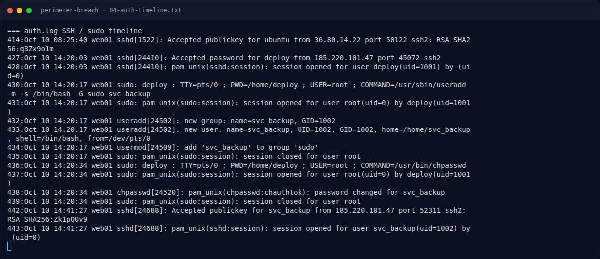

# Perimeter Breach — Analisis Artefak

[← Overview](07-perimeter-breach.md) · [Index](index.md)

> **Langkah 6/11 — Analisis Artefak.** Password deploy tidak terlihat di log, tetapi sangat mungkin berasal dari /home/deploy/.env yang dibaca webshell.
>
> **Titik penting:** 185.220.101.47
>
> **Berikutnya:** [Lima pertanyaan investigasi (rekonstruksi)](07-perimeter-breach-07-lima-pertanyaan-investigasi-rekonstruksi.md)

## 2.5 Lateral movement — SSH sebagai deploy

`auth.log`:

```text
Oct 10 14:20:03 web01 sshd[24410]: Accepted password for deploy from 185.220.101.47 port 45072 ssh2
Oct 10 14:20:03 web01 sshd[24410]: pam_unix(sshd:session): session opened for user deploy(uid=1001) by (uid=0)
```

Password `deploy` tidak terlihat di log, tetapi sangat mungkin berasal dari `/home/deploy/.env` yang dibaca webshell. Penyerang masuk via SSH password dari IP yang sama.

## 2.6 Persistence — user svc_backup

Masih di sesi `deploy`:

```text
Oct 10 14:20:17 web01 sudo: deploy : TTY=pts/0 ; PWD=/home/deploy ; USER=root ; COMMAND=/usr/sbin/useradd -m -s /bin/bash -G sudo svc_backup
Oct 10 14:20:17 web01 useradd[24502]: new group: name=svc_backup, GID=1002
Oct 10 14:20:17 web01 useradd[24502]: new user: name=svc_backup, UID=1002, GID=1002, home=/home/svc_backup, shell=/bin/bash, from=/dev/pts/0
Oct 10 14:20:17 web01 usermod[24509]: add 'svc_backup' to group 'sudo'
Oct 10 14:20:34 web01 sudo: deploy : TTY=pts/0 ; PWD=/home/deploy ; USER=root ; COMMAND=/usr/bin/chpasswd
Oct 10 14:20:34 web01 chpasswd[24520]: pam_unix(chpasswd:chauthtok): password changed for svc_backup
Oct 10 14:21:38 web01 sshd[24410]: Received disconnect from 185.220.101.47 port 45072:11: disconnected by user
Oct 10 14:41:27 web01 sshd[24688]: Accepted publickey for svc_backup from 185.220.101.47 port 52311 ssh2: RSA SHA256:Zk1pQ0v9
Oct 10 14:41:27 web01 sshd[24688]: pam_unix(sshd:session): session opened for user svc_backup(uid=1002) by (uid=0)
```

Persistence: akun `svc_backup` dengan sudo, password baru, dan **publickey** yang memungkinkan login ulang tanpa password. Fingerprint `SHA256:Zk1pQ0v9` adalah artifact kunci penyerang.

### Evidence langkah ini



*Terminal evidence — `04-auth-timeline.txt` (arsip transkrip sesi solve).*

**Berkas mentah langkah ini:**

- [`04-auth-timeline.txt`](assets/perimeter-breach/04-auth-timeline.txt)
