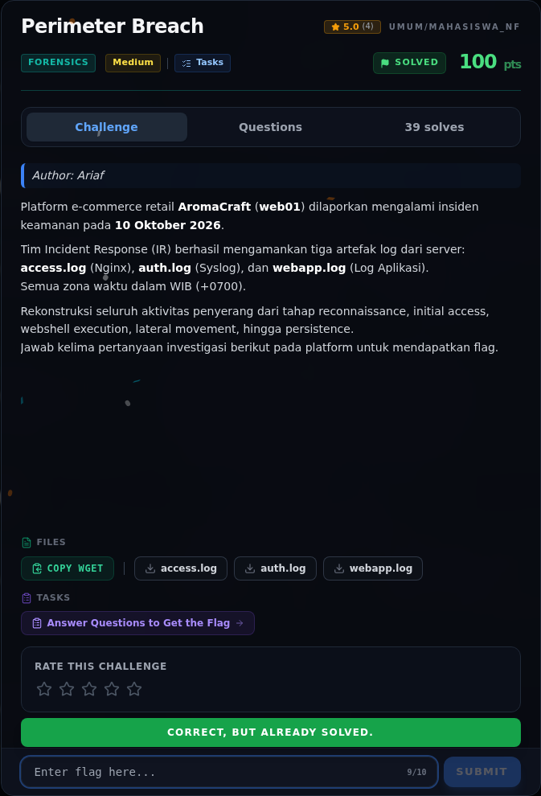

# Perimeter Breach — Flag & Verifikasi

[← Overview](07-perimeter-breach.md) · [Index](index.md)

> **Langkah 9/11 — Flag.** Flag
>
> **Titik penting:** NFX{P4th_1nt0_Pr0duct10n}
>
> **Berikutnya:** [Bukti / Evidence](07-perimeter-breach-10-bukti-evidence.md)

> **Flag:** `NFX{P4th_1nt0_Pr0duct10n}`
> **Status:** `VERIFIED`

```text
NFX{P4th_1nt0_Pr0duct10n}
```

Verifikasi/status:

```text
Sumber : flags/forensics/Perimeter_Breach.txt
Isi    : NFX{P4th_1nt0_Pr0duct10n}
Status : VERIFIED platform (submit via web; flag lokal; challenge solved di platform)
```

### Bukti submit di platform



*Submit flag di platform: `CORRECT, BUT ALREADY SOLVED.`*

> **Bukti submit:** screenshot form challenge di atas menampilkan `CORRECT, BUT ALREADY SOLVED.`
