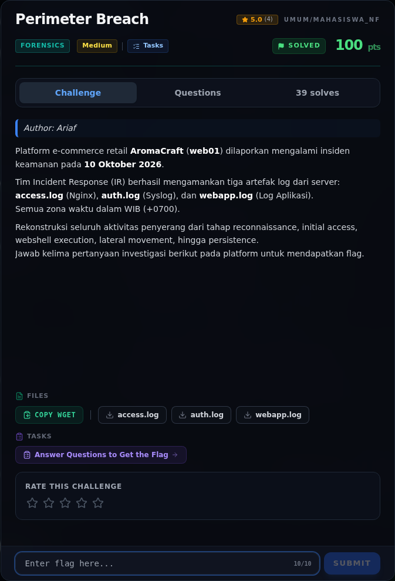

# Perimeter Breach — Referensi

[← Overview](07-perimeter-breach.md) · [Index](index.md)

> **Langkah 11/11 — Referensi.** Referensi
>
> **Titik penting:** —
>
> **Selesai.** Kembali ke [Overview](07-perimeter-breach.md).

- Nginx combined log format.
- `sqlmap` UNION-based SQL injection.
- Linux `auth.log` / `sudo` / `useradd` / `chpasswd`.
- MITRE ATT&CK: T1595 (Active Scanning), T1190 (Exploit Public-Facing Application), T1505.003 (Web Shell), T1078 (Valid Accounts), T1136 (Create Account).

### Evidence langkah ini

*Challenge brief asli di platform NFX CTF 2026.*
