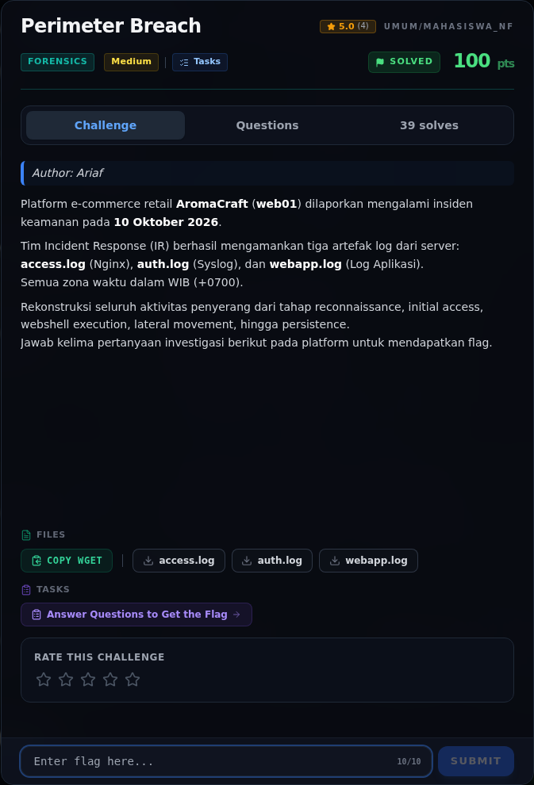
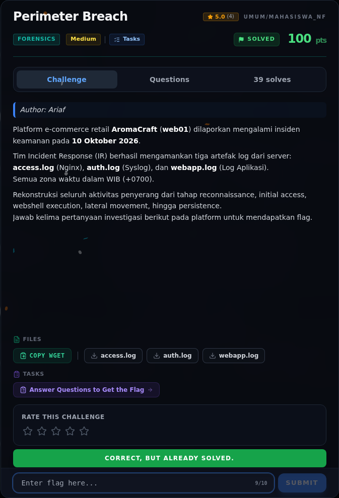

# Perimeter Breach

Track Mahasiswa NF · ForensicsMedium100 poinVERIFIED

| Field | Nilai |
|---|---|
| Event | `umum/mahasiswa_nf` |
| Kategori | `Forensics` |
| Difficulty | `Medium` |
| Poin | `100` |
| Author | `Ariaf` |
| Tools | gobuster, sqlmap, python3, tshark, git |
| Flag | `NFX{P4th_1nt0_Pr0duct10n}` |
| Status | `VERIFIED` |

[← Kembali ke Index](index.md)

## Challenge Brief (platform)

*Challenge brief asli di platform NFX CTF 2026.*

## Cerita singkat

Jadi ceritanya gini. tiga log (`access.log` Nginx, `auth.log` syslog, `webapp.log`) merekam satu kampanye serangan dari **185.220.101.47** pada 10 Oktober 2026. Terus, rekon: `gobuster/3.6` (13:02), SQL injection `sqlmap/1.7.2` pada `products.php?id=` (13:15), dump tabel `users`. Lalu, initial access: login admin berhasil pada **13:42:02** dengan password `Aroma#Craft2026`. Nah, dari situ kita bisa sampai ke flag dan bukti submit-nya.

## Alur & Titik Penting

| # | Langkah | Titik penting | Buka |
|---:|---|---|---|
| 1 | Recon Artefak | sha256sum access.log auth.log webapp.log | [Buka](07-perimeter-breach-01-recon-artefak.md) |
| 2 | Reconnaissance — gobuster | 185.220.101.47 | [Buka](07-perimeter-breach-02-reconnaissance-gobuster.md) |
| 3 | SQL injection — sqlmap | https://sqlmap.org | [Buka](07-perimeter-breach-03-sql-injection-sqlmap.md) |
| 4 | Initial access — admin login | 36.80.14.22 | [Buka](07-perimeter-breach-04-initial-access-admin-login.md) |
| 5 | Webshell execution | https://aromacraft.example/admin/upload.php" | [Buka](07-perimeter-breach-05-webshell-execution.md) |
| 6 | Analisis Artefak | 185.220.101.47 | [Buka](07-perimeter-breach-06-analisis-artefak.md) |
| 7 | Lima pertanyaan investigasi (rekonstruksi) | NFX{P4th_1nt0_Pr0duct10n} | [Buka](07-perimeter-breach-07-lima-pertanyaan-investigasi-rekonstruksi.md) |
| 8 | Pemulihan Artefak | python3 - <<'PY' | [Buka](07-perimeter-breach-08-pemulihan-artefak.md) |
| 9 | Flag | NFX{P4th_1nt0_Pr0duct10n} | [Buka](07-perimeter-breach-09-flag.md) |
| 10 | Bukti / Evidence | arsip screenshot dan transkrip | [Buka](07-perimeter-breach-10-bukti-evidence.md) |
| 11 | Referensi | — | [Buka](07-perimeter-breach-11-referensi.md) |

## TL;DR

- Tiga log (`access.log` Nginx, `auth.log` syslog, `webapp.log`) merekam satu kampanye serangan dari **185.220.101.47** pada 10 Oktober 2026.
- Rekon: `gobuster/3.6` (13:02), SQL injection `sqlmap/1.7.2` pada `products.php?id=` (13:15), dump tabel `users`.
- Initial access: login admin berhasil pada **13:42:02** dengan password `Aroma#Craft2026`.
- Webshell: upload `cache_thumb.php` (412 byte, MIME `image/jpeg`) ke `/uploads/`, dieksekusi lewat `?c=` untuk `whoami`, `id`, `cat /etc/passwd`, `cat /home/deploy/.env`.
- Lateral movement: SSH password sebagai `deploy` dari IP penyerang (14:20:03).
- Persistence: `deploy` membuat user **`svc_backup`** (UID 1002, group sudo), mengganti password, lalu login SSH publickey sebagai `svc_backup` (14:41:27).
- Flag: `NFX{P4th_1nt0_Pr0duct10n}`.

Pratinjau evidence. Buka halaman <a href="07-perimeter-breach-10-bukti-evidence.html">Evidence / Bukti</a> untuk semua screenshot dan transkrip.

## Navigasi Halaman

<a class="nx-page-card" href="07-perimeter-breach-01-recon-artefak.html"><b>Recon Artefak</b>Enumerasi target dan bukti awal</a>
<a class="nx-page-card" href="07-perimeter-breach-02-reconnaissance-gobuster.html"><b>Reconnaissance — gobuster</b>Enumerasi target dan bukti awal</a>
<a class="nx-page-card" href="07-perimeter-breach-03-sql-injection-sqlmap.html"><b>SQL injection — sqlmap</b>Baca bagian ini</a>
<a class="nx-page-card" href="07-perimeter-breach-04-initial-access-admin-login.html"><b>Initial access — admin login</b>Baca bagian ini</a>
<a class="nx-page-card" href="07-perimeter-breach-05-webshell-execution.html"><b>Webshell execution</b>Baca bagian ini</a>
<a class="nx-page-card" href="07-perimeter-breach-06-analisis-artefak.html"><b>Analisis Artefak</b>Membaca alur dan akar masalah</a>
<a class="nx-page-card" href="07-perimeter-breach-07-lima-pertanyaan-investigasi-rekonstruksi.html"><b>Lima pertanyaan investigasi (rekonstruksi)</b>Baca bagian ini</a>
<a class="nx-page-card" href="07-perimeter-breach-08-pemulihan-artefak.html"><b>Pemulihan Artefak</b>Baca bagian ini</a>
<a class="nx-page-card" href="07-perimeter-breach-09-flag.html"><b>Flag</b>Flag dan verifikasi platform</a>
<a class="nx-page-card" href="07-perimeter-breach-10-bukti-evidence.html"><b>Bukti / Evidence</b>Screenshot, transkrip, dan artefak</a>
<a class="nx-page-card" href="07-perimeter-breach-11-referensi.html"><b>Referensi</b>Sumber dan bacaan lanjutan</a>

