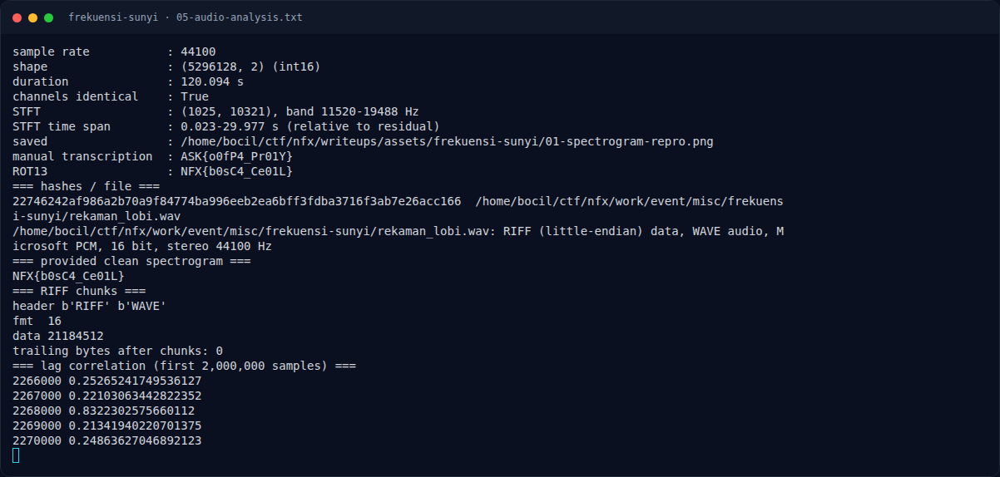
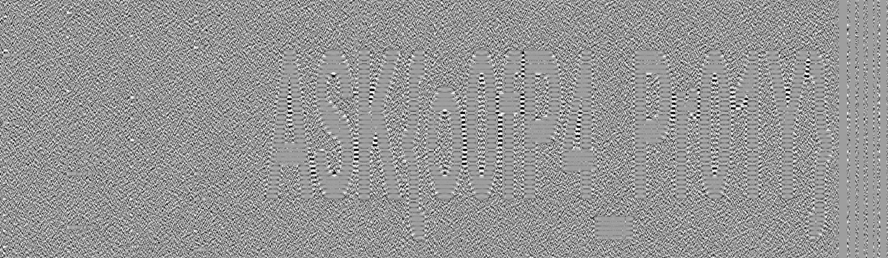

# Frekuensi Sunyi — Triage awal

[← Overview](08-frekuensi-sunyi.md) · [Index](index.md)

> **Langkah 2/9 — Triage awal.** Triage awal
>
> **Titik penting:** file work/event/misc/frekuensi-sunyi/rekaman_lobi.wav · python3 - <<'EOF'
>
> **Berikutnya:** [Analisis](08-frekuensi-sunyi-03-analisis.md)

## 1.4 Triage awal

```bash
$ file work/event/misc/frekuensi-sunyi/rekaman_lobi.wav
RIFF (little-endian) data, WAVE audio, Microsoft PCM, 16 bit, stereo 44100 Hz

$ python3 - <<'EOF'
from scipy.io import wavfile
import numpy as np
fs, a = wavfile.read('rekaman_lobi.wav')
print(fs, a.shape, a.dtype, a.shape[0]/fs)
print('channels identical:', np.array_equal(a[:,0], a[:,1]))
EOF
44100 (5296128, 2) int16 120.09360544217687
channels identical: True
```

**Temuan:** kanal kiri dan kanan identik, jadi tidak ada pesan stereo
difference. RIFF hanya berisi `fmt` + `data` standar; tidak ada trailing
data. Ini memperkuat dugaan bahwa payload ada di **isi frekuensi**, bukan
di struktur file.

### Evidence langkah ini



*Terminal evidence — `05-audio-analysis.txt` (arsip transkrip sesi solve).*



*Evidence — `01-spectrogram-repro.png`.*

**Berkas mentah langkah ini:**

- [`05-audio-analysis.txt`](assets/frekuensi-sunyi/05-audio-analysis.txt)
