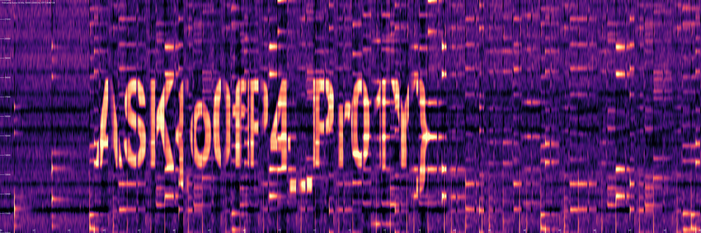

# Frekuensi Sunyi — Analisis

[← Overview](08-frekuensi-sunyi.md) · [Index](index.md)

> **Langkah 4/9 — Analisis.** Hasil gambar (lihat 04-text-crop.png) menunjukkan deretan karakter:
>
> **Titik penting:** NFX{b0sC4_Ce01L}
>
> **Berikutnya:** [Penyelesaian](08-frekuensi-sunyi-05-penyelesaian.md)

## 2.3 Membaca glyph

Hasil gambar (lihat `04-text-crop.png`) menunjukkan deretan karakter:

```text
ASK{o0fP4_Pr01Y}
```

Pada pembacaan awal, harmonik musik yang tebal bisa membuat glyph saling
menyatu (misalnya `o0fP4` terbaca sebagai `OFFP4RT`, atau `{`/`_` terbaca
sebagai `4`/spasi). Karena itu, median filter vertikal `(9,1)` — atau
`(11,1)` pada report — penting: ia membuang garis-garis harmonik horizontal
yang menutupi huruf. Spektrogram bersih yang disimpan di
`flags/misc/Frekuensi_Sunyi_spectrogram.png` mengonfirmasi pembacaan ini.

## 2.4 ROT13

`ASK` adalah `NFX` setelah ROT13. Seluruh teks didekode:

```python
import codecs
codecs.decode("ASK{o0fP4_Pr01Y}", "rot_13")
```

```text
NFX{b0sC4_Ce01L}
```

### Evidence langkah ini



*Spectrogram — `00-provided-spectrogram.png`.*

**Berkas mentah terkait:**

- [`05-audio-analysis.txt`](assets/frekuensi-sunyi/05-audio-analysis.txt)
