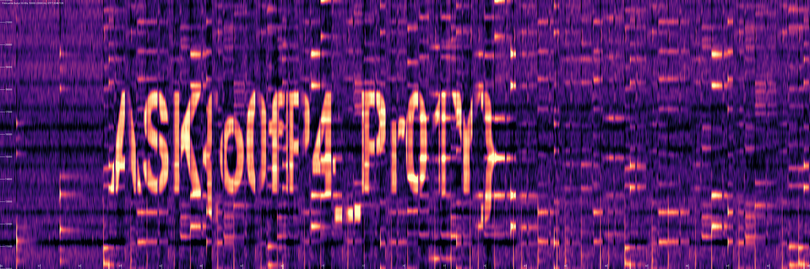
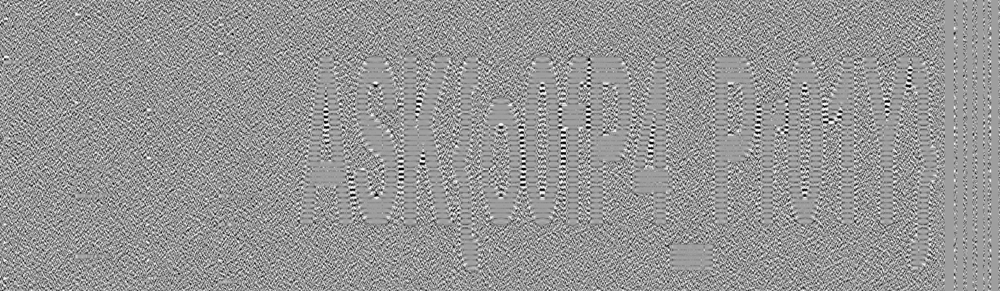
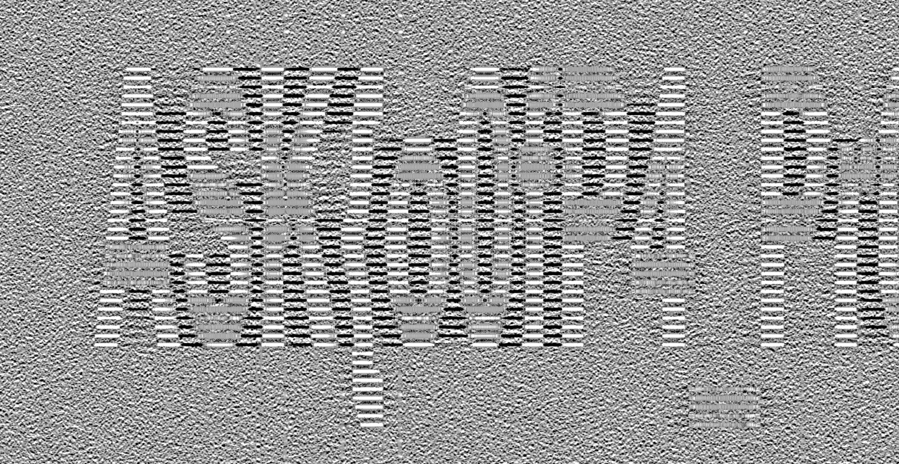
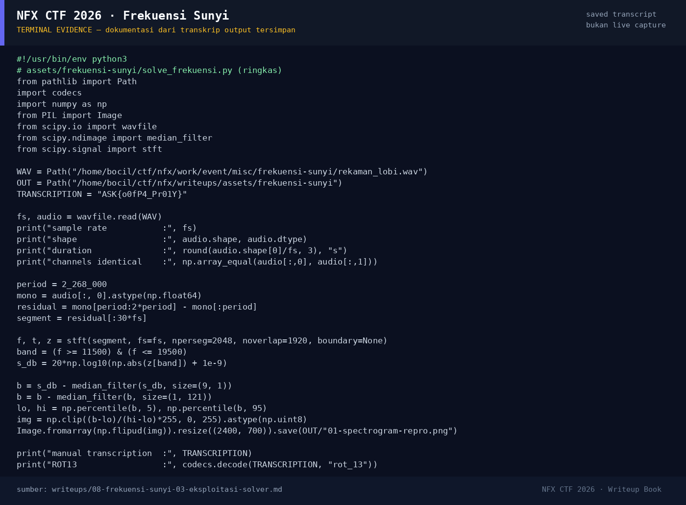

# Frekuensi Sunyi — Evidence / Bukti

4 screenshot2 transkrip / script

[← Overview](08-frekuensi-sunyi.md) · [Index](index.md)

## Arsip Evidence

> Semua file di bawah berasal dari folder `assets/frekuensi-sunyi/`. Screenshot ditempel langsung; file teks/script ditautkan.

### Screenshot

<figure><figcaption>00-provided-spectrogram.png</figcaption></figure>
<figure><figcaption>01-spectrogram-repro.png</figcaption></figure>
<figure><figcaption>04-text-crop.png</figcaption></figure>
<figure><figcaption>98-terminal-evidence.png</figcaption></figure>

### Transkrip / file pendukung

- [`05-audio-analysis.txt`](assets/frekuensi-sunyi/05-audio-analysis.txt)
- [`solve_frekuensi.py`](assets/frekuensi-sunyi/solve_frekuensi.py)

## Tabel Evidence

Semua bukti berada di `writeups/assets/frekuensi-sunyi/`.

| Bukti | File | Keterangan |
|---|---|---|
| Spektrogram bersih (referensi) | `00-provided-spectrogram.png` | Salinan `flags/misc/Frekuensi_Sunyi_spectrogram.png`; glyph terbaca jelas |
| Reproduksi spektrogram | `01-spectrogram-repro.png` | Hasil STFT + median filter lokal |
| Crop teks | `04-text-crop.png` | Perbesaran area glyph `ASK{o0fP4_Pr01Y}` |
| Analisis audio | `05-audio-analysis.txt` | Metadata WAV, hash, channel identik, parameter STFT, transkripsi, ROT13 |
| Solver | `solve_frekuensi.py` | Script yang dijalankan ulang |
| Report asli | `flags/misc/Frekuensi_Sunyi.report.txt` | Catatan + submit log +460 |