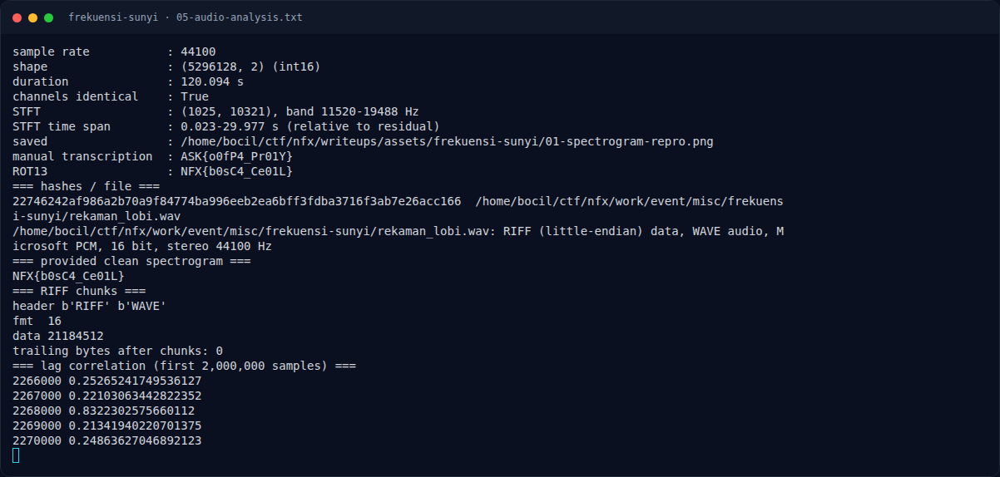

# Frekuensi Sunyi — Output asli

[← Overview](08-frekuensi-sunyi.md) · [Index](index.md)

## 3.3 Output asli

```text
$ python3 solve_frekuensi.py
sample rate           : 44100
shape                 : (5296128, 2) (int16)
duration              : 120.094 s
channels identical    : True
STFT                  : (1025, 10321), band 11520-19488 Hz
STFT time span        : 0.023-29.977 s (relative to residual)
saved                 : /home/bocil/ctf/nfx/writeups/assets/frekuensi-sunyi/01-spectrogram-repro.png
manual transcription  : ASK{o0fP4_Pr01Y}
ROT13                 : NFX{b0sC4_Ce01L}
```

### Evidence langkah ini



*Terminal evidence — `05-audio-analysis.txt` (arsip transkrip sesi solve).*

**Berkas mentah langkah ini:**

- [`05-audio-analysis.txt`](assets/frekuensi-sunyi/05-audio-analysis.txt)
