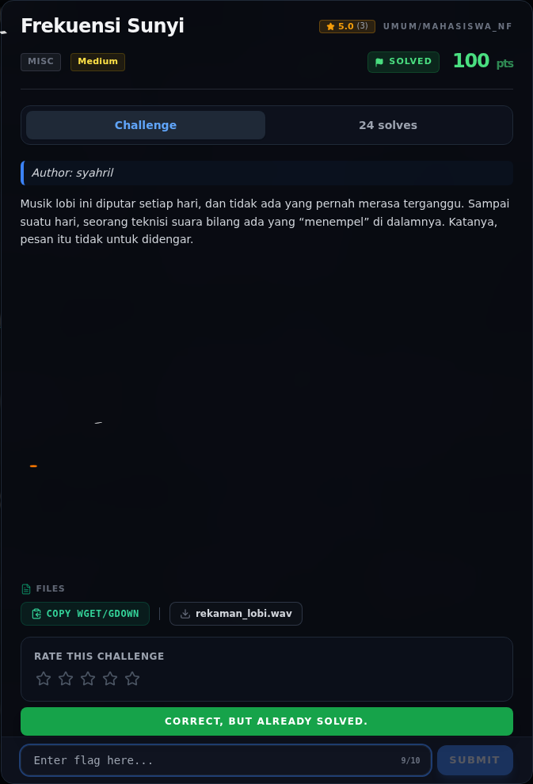

# Frekuensi Sunyi — Flag & Verifikasi

[← Overview](08-frekuensi-sunyi.md) · [Index](index.md)

> **Langkah 7/9 — Flag.** Report submit (flags/misc/FrekuensiSunyi.report.txt) mencatat:
>
> **Titik penting:** NFX{b0sC4_Ce01L}
>
> **Berikutnya:** [Bukti / Evidence](08-frekuensi-sunyi-08-bukti-evidence.md)

> **Flag:** `NFX{b0sC4_Ce01L}`
> **Status:** `VERIFIED`

```text
NFX{b0sC4_Ce01L}
```

Verifikasi:

```text
$ python3 -c 'import codecs; print(codecs.decode("ASK{o0fP4_Pr01Y}","rot_13"))'
NFX{b0sC4_Ce01L}

$ cat flags/misc/Frekuensi_Sunyi.txt
NFX{b0sC4_Ce01L}
```

Report submit (`flags/misc/Frekuensi_Sunyi.report.txt`) mencatat:

```text
VERIFIED FLAG (accepted by platform, submit log: Correct! +460 points):
  NFX{b0sC4_Ce01L}
```

### Bukti submit di platform



*Submit flag di platform: `CORRECT, BUT ALREADY SOLVED.`*

> **Verifikasi platform:** flag sudah diterima. Recheck 2026-11-09 mengembalikan `Correct, but already solved.`
