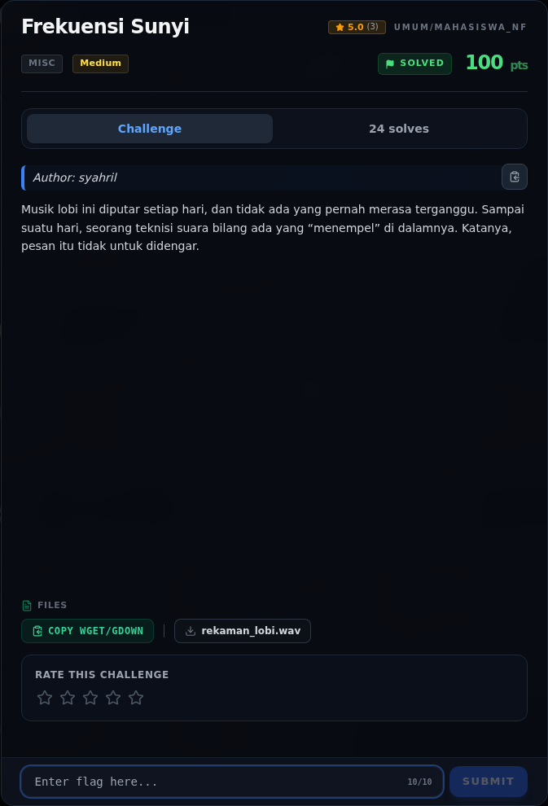
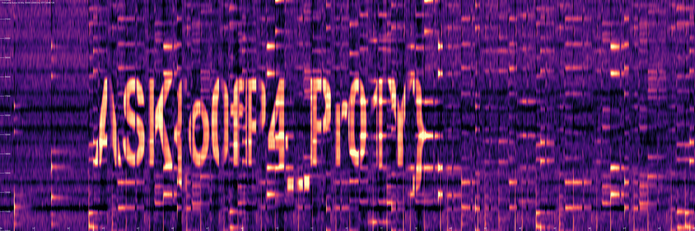
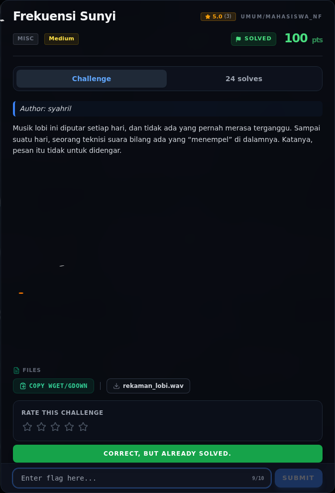
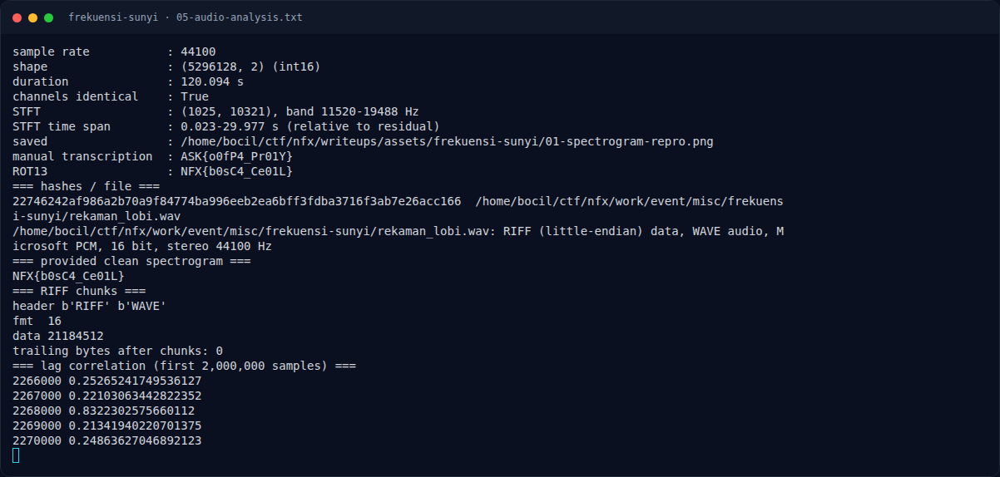
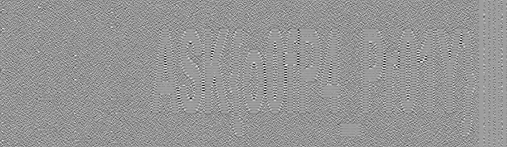
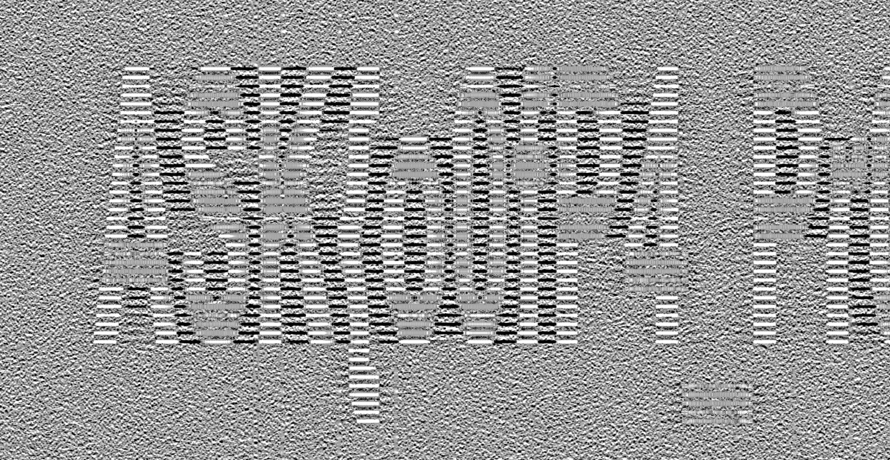

# Frekuensi Sunyi — Evidence / Bukti

6 screenshot2 transkrip / script

[← Overview](08-frekuensi-sunyi.md) · [Index](index.md)

> **Langkah 8/9 — Bukti / Evidence.** Semua bukti berada di writeups/assets/frekuensi-sunyi/.
>
> **Titik penting:** arsip screenshot dan transkrip
>
> **Berikutnya:** [Referensi](08-frekuensi-sunyi-09-referensi.md)

## Arsip Evidence

> Semua file berasal dari `assets/frekuensi-sunyi/`. Screenshot platform dan terminal adalah bukti asli dari sesi solve; transkrip mentah tetap ditautkan di bagian bawah.

### Platform

<figure><figcaption>00-challenge-platform.png</figcaption></figure>

*Challenge brief asli di platform NFX CTF 2026.*

<figure><figcaption>00-provided-spectrogram.png</figcaption></figure>

*Evidence — `00-provided-spectrogram.png`.*

<figure><figcaption>00b-submit-platform.png</figcaption></figure>

*Submit flag di platform: `CORRECT, BUT ALREADY SOLVED.`*

### Terminal (arsip sesi)

<figure><figcaption>term-05-audio-analysis.png</figcaption></figure>

*Terminal evidence — `05-audio-analysis.txt` (arsip transkrip sesi solve).*

### Screenshot langkah

<figure><figcaption>01-spectrogram-repro.png</figcaption></figure>

*Evidence — `01-spectrogram-repro.png`.*

<figure><figcaption>04-text-crop.png</figcaption></figure>

*Evidence — `04-text-crop.png`.*

### Transkrip mentah & script

- [`05-audio-analysis.txt`](assets/frekuensi-sunyi/05-audio-analysis.txt)
- [`solve_frekuensi.py`](assets/frekuensi-sunyi/solve_frekuensi.py)

## Tabel Evidence

Semua bukti berada di `writeups/assets/frekuensi-sunyi/`.

| Bukti | File | Keterangan |
|---|---|---|
| Spektrogram bersih (referensi) | `00-provided-spectrogram.png` | Salinan `flags/misc/Frekuensi_Sunyi_spectrogram.png`; glyph terbaca jelas |
| Reproduksi spektrogram | `01-spectrogram-repro.png` | Hasil STFT + median filter lokal |
| Crop teks | `04-text-crop.png` | Perbesaran area glyph `ASK{o0fP4_Pr01Y}` |
| Analisis audio | `05-audio-analysis.txt` | Metadata WAV, hash, channel identik, parameter STFT, transkripsi, ROT13 |
| Solver | `solve_frekuensi.py` | Script yang dijalankan ulang |
| Report asli | `flags/misc/Frekuensi_Sunyi.report.txt` | Catatan + submit log +460 |