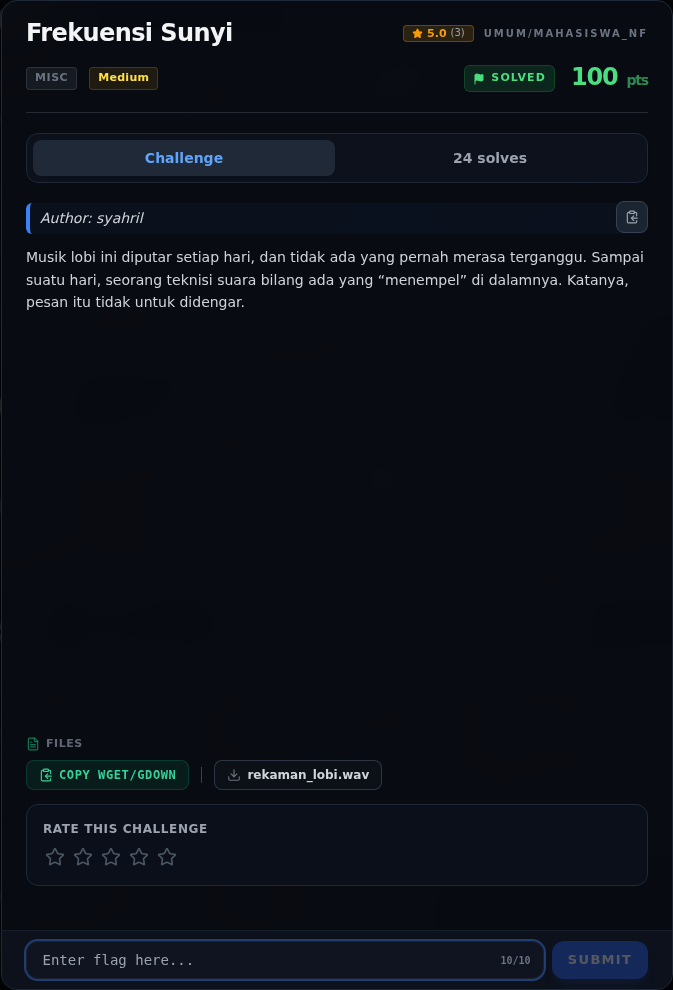
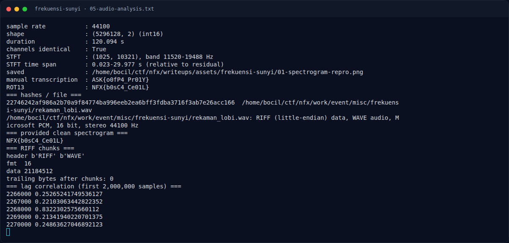

# Frekuensi Sunyi

Track Mahasiswa NF · MiscMedium180 poinVERIFIED

| Field | Nilai |
|---|---|
| Event | `umum/mahasiswa_nf` |
| Kategori | `Misc` |
| Difficulty | `Medium` |
| Poin (snapshot) | `180` |
| Author | `Kesatria Baja Ringan` |
| Tools | python3 |
| Flag | `NFX{b0sC4_Ce01L}` |
| Status | `VERIFIED` |
| Snapshot | 2026-11-13 |

[← Kembali ke Index](index.md)

## Challenge Brief (platform)

*Challenge brief asli di platform NFX CTF 2026.*

## Cerita singkat

Jadi ceritanya gini. attachment aslinya adalah `rekaman_lobi.wav`: PCM 16-bit, 44.100 Hz, stereo, durasi 120,09 detik, dan kedua kanal identik (mono duplikat). Terus, musik lobi berulang dengan periode **2.268.000 sampel** (±51,43 detik). Dua periode yang dikurangkan saling menghilangkan sebagian besar musik. Lalu, pada band **±11–20 kHz** terdapat teks yang "tidak untuk didengar": `ASK{o0fP4_Pr01Y}`. Nah, dari situ kita bisa sampai ke flag dan bukti submit-nya.

## Alur & Titik Penting

| # | Langkah | Titik penting | Buka |
|---:|---|---|---|
| 1 | Recon | sha256sum work/event/misc/frekuensi-sunyi/rekaman_lobi.wav | [Buka](08-frekuensi-sunyi-01-recon.md) |
| 2 | Triage awal | file work/event/misc/frekuensi-sunyi/rekaman_lobi.wav | [Buka](08-frekuensi-sunyi-02-triage-awal.md) |
| 3 | Analisis | Musik latar berulang. | [Buka](08-frekuensi-sunyi-03-analisis.md) |
| 4 | Analisis | NFX{b0sC4_Ce01L} | [Buka](08-frekuensi-sunyi-04-analisis-2.md) |
| 5 | Penyelesaian | — | [Buka](08-frekuensi-sunyi-05-penyelesaian.md) |
| 6 | Output asli | python3 solve_frekuensi.py | [Buka](08-frekuensi-sunyi-06-output-asli.md) |
| 7 | Flag | NFX{b0sC4_Ce01L} | [Buka](08-frekuensi-sunyi-07-flag.md) |
| 8 | Bukti / Evidence | arsip screenshot dan transkrip | [Buka](08-frekuensi-sunyi-08-bukti-evidence.md) |
| 9 | Referensi | — | [Buka](08-frekuensi-sunyi-09-referensi.md) |

## Ringkasan

> Catatan metadata: `writeups/_manifest.json` mencatat 180 poin / 17 solves /
> author `syahril`, sedangkan `challenge.json` kerja dan report submit
> mencatat 460 poin / 3 solves / author `Kesatria Baja Ringan`. Nilai dari
> report submit (`+460`) dipakai di tabel ini; perbedaannya dicatat agar
> tidak menyesatkan.
## TL;DR

- Attachment aslinya adalah `rekaman_lobi.wav`: PCM 16-bit, 44.100 Hz, stereo,
  durasi 120,09 detik, dan kedua kanal identik (mono duplikat).
- Musik lobi berulang dengan periode **2.268.000 sampel** (±51,43 detik).
  Dua periode yang dikurangkan saling menghilangkan sebagian besar musik.
- Pada band **±11–20 kHz** terdapat teks yang "tidak untuk didengar":
  `ASK{o0fP4_Pr01Y}`.
- Teks itu adalah **ROT13** dari flag. ROT13 menghasilkan
  `NFX{b0sC4_Ce01L}`.
- Report solve sebelumnya juga mencatat tidak ada layer LSB, metadata, DTMF,
  Morse, atau payload tambahan; satu-satunya pesan adalah teks pada
  spektrogram.

Pratinjau evidence. Buka halaman <a href="08-frekuensi-sunyi-08-bukti-evidence.html">Evidence / Bukti</a> untuk semua screenshot dan transkrip.

## Navigasi Halaman

<a class="nx-page-card" href="08-frekuensi-sunyi-01-recon.html"><b>Recon</b>Enumerasi target dan bukti awal</a>
<a class="nx-page-card" href="08-frekuensi-sunyi-02-triage-awal.html"><b>Triage awal</b>Baca bagian ini</a>
<a class="nx-page-card" href="08-frekuensi-sunyi-03-analisis.html"><b>Analisis</b>Membaca alur dan akar masalah</a>
<a class="nx-page-card" href="08-frekuensi-sunyi-04-analisis-2.html"><b>Analisis</b>Membaca alur dan akar masalah</a>
<a class="nx-page-card" href="08-frekuensi-sunyi-05-penyelesaian.html"><b>Penyelesaian</b>Baca bagian ini</a>
<a class="nx-page-card" href="08-frekuensi-sunyi-06-output-asli.html"><b>Output asli</b>Baca bagian ini</a>
<a class="nx-page-card" href="08-frekuensi-sunyi-07-flag.html"><b>Flag</b>Flag dan verifikasi platform</a>
<a class="nx-page-card" href="08-frekuensi-sunyi-08-bukti-evidence.html"><b>Bukti / Evidence</b>Screenshot, transkrip, dan artefak</a>
<a class="nx-page-card" href="08-frekuensi-sunyi-09-referensi.html"><b>Referensi</b>Sumber dan bacaan lanjutan</a>

