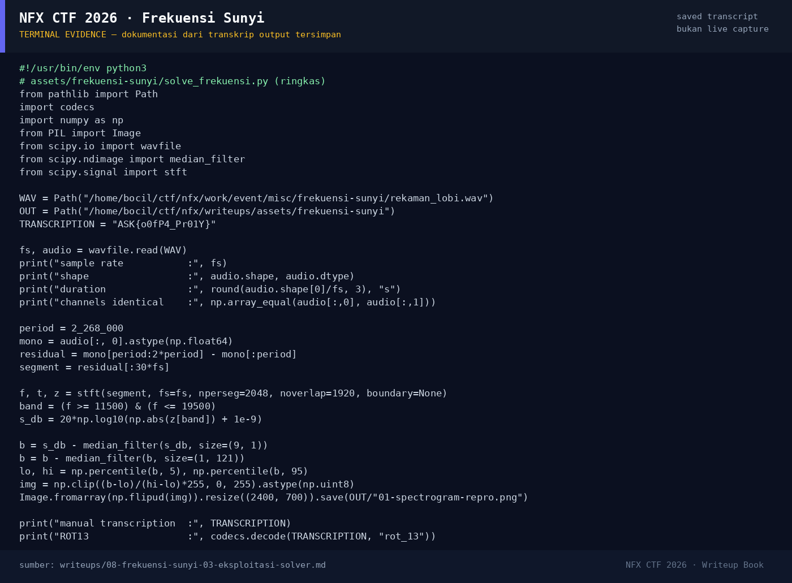

# Frekuensi Sunyi

Track Mahasiswa NF · MiscMedium180 poinVERIFIED

| Field | Nilai |
|---|---|
| Event | `umum/mahasiswa_nf` |
| Kategori | `Misc` |
| Difficulty | `Medium` |
| Poin | `180` |
| Author | `Kesatria Baja Ringan` |
| Tools | python3 |
| Flag | `NFX{b0sC4_Ce01L}` |
| Status | `VERIFIED` |

[← Kembali ke Index](index.md)

## Ringkasan

> Catatan metadata: `writeups/_manifest.json` mencatat 180 poin / 17 solves /
> author `syahril`, sedangkan `challenge.json` kerja dan report submit
> mencatat 460 poin / 3 solves / author `Kesatria Baja Ringan`. Nilai dari
> report submit (`+460`) dipakai di tabel ini; perbedaannya dicatat agar
> tidak menyesatkan.
## TL;DR

- Attachment aslinya adalah `rekaman_lobi.wav`: PCM 16-bit, 44.100 Hz, stereo,
  durasi 120,09 detik, dan kedua kanal identik (mono duplikat).
- Musik lobi berulang dengan periode **2.268.000 sampel** (±51,43 detik).
  Dua periode yang dikurangkan saling menghilangkan sebagian besar musik.
- Pada band **±11–20 kHz** terdapat teks yang "tidak untuk didengar":
  `ASK{o0fP4_Pr01Y}`.
- Teks itu adalah **ROT13** dari flag. ROT13 menghasilkan
  `NFX{b0sC4_Ce01L}`.
- Report solve sebelumnya juga mencatat tidak ada layer LSB, metadata, DTMF,
  Morse, atau payload tambahan; satu-satunya pesan adalah teks pada
  spektrogram.

Pratinjau evidence. Buka halaman <a href="08-frekuensi-sunyi-05-bukti-evidence.html">Evidence / Bukti</a> untuk semua screenshot dan transkrip.

## Navigasi Halaman

<a class="nx-page-card" href="08-frekuensi-sunyi-01-recon.html"><b>Recon</b>Enumerasi target dan bukti awal</a>
<a class="nx-page-card" href="08-frekuensi-sunyi-02-analisis.html"><b>Analisis</b>Membaca alur dan akar masalah</a>
<a class="nx-page-card" href="08-frekuensi-sunyi-03-eksploitasi-solver.html"><b>Eksploitasi / Solver</b>Langkah exploit dan solver</a>
<a class="nx-page-card" href="08-frekuensi-sunyi-04-flag.html"><b>Flag</b>Flag dan verifikasi platform</a>
<a class="nx-page-card" href="08-frekuensi-sunyi-05-bukti-evidence.html"><b>Bukti / Evidence</b>Screenshot, transkrip, dan artefak</a>
<a class="nx-page-card" href="08-frekuensi-sunyi-06-referensi.html"><b>Referensi</b>Sumber dan bacaan lanjutan</a>

