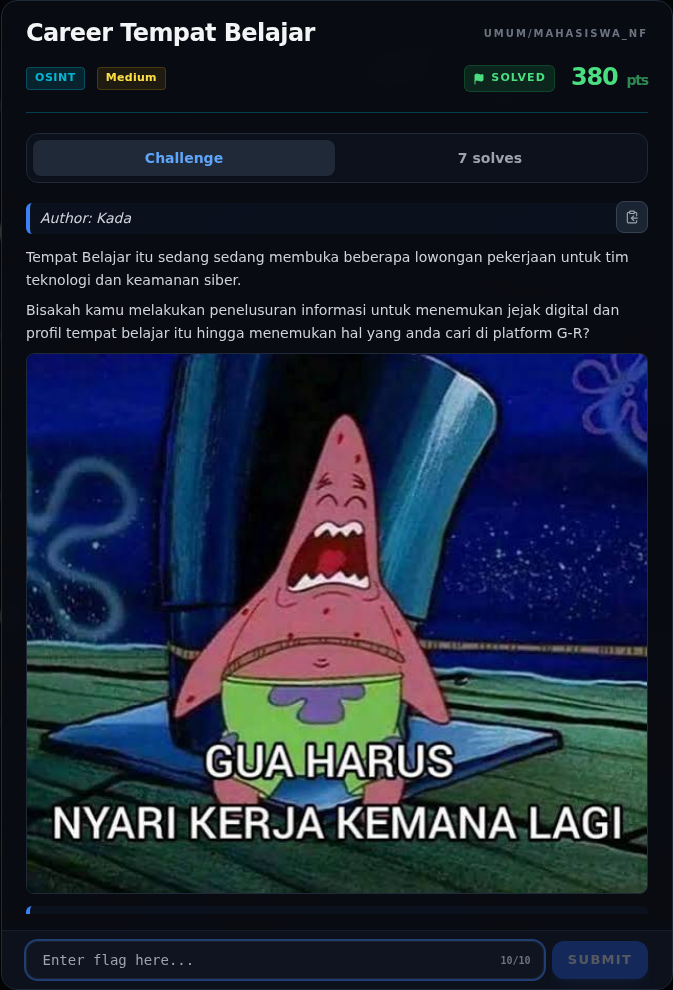

# Career Tempat Belajar — Jejak Awal

[← Overview](09-career-tempat-belajar.md) · [Index](index.md)

> **Langkah 1/8 — Jejak Awal.** dipakai untuk menyamarkan sebuah platform belajar.
>
> **Titik penting:** sha256sum osint/office.png · NFX{your_flag_here}
>
> **Berikutnya:** [Triage awal](09-career-tempat-belajar-02-triage-awal.md)

## 1.1 Deskripsi challenge

> **Author: Kada**
>
> Tempat Belajar itu sedang sedang membuka beberapa lowongan pekerjaan untuk
> tim teknologi dan keamanan siber.
>
> Bisakah kamu melakukan penelusuran informasi untuk menemukan jejak digital
> dan profil tempat belajar itu hingga menemukan hal yang anda cari di
> platform G-R?
>
> Format: `NFX{your_flag_here}`

Petunjuk penting:

- “Tempat Belajar” bukan nama perusahaan literal; ini adalah frasa yang
  dipakai untuk menyamarkan sebuah platform belajar.
- “platform G-R” hampir pasti **Gravatar** (G-R), platform profil global yang
  di-key oleh hash MD5 email.
- Poster yang diberikan memuat branding yang bisa dicari.

## 1.2 File / service yang diberikan

| File/Service | Ukuran | Keterangan |
|---|---|---|
| `osint/office.png` | 3.186.772 byte | Poster “DIGITAL HOUR LEARNING”, 1824×2346 |
| `umum/Osint/career-tempat-belajar/BRIEF.md` | 1.1 KB | Deskripsi + format flag |
| `umum/Osint/career-tempat-belajar/challenge.json` | 1.5 KB | Metadata challenge |

Hash:

```bash
$ sha256sum osint/office.png
f531e041cff71d858f2215ee97bcb2dd40429cf35e3264818c0fde676e2621f9  osint/office.png
```

## 1.3 Environment

- OS: Linux x86-64.
- Tools: `file`, `exiftool`, `sha256sum`, Python 3, `curl`, `Pillow`.
- Service: tidak ada service jaringan yang diberikan; challenge sepenuhnya
  OSINT dari artefak gambar + sumber publik.
- Endpoint publik yang dipakai: Instagram (login-walled), Gravatar API,
  mesin pencari.

### Evidence langkah ini



*Challenge brief asli di platform NFX CTF 2026.*
