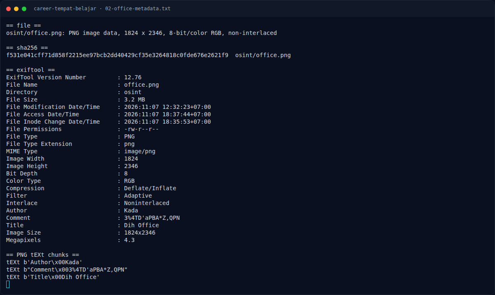

# Career Tempat Belajar — Triage awal

[← Overview](09-career-tempat-belajar.md) · [Index](index.md)

## 1.4 Triage awal

```bash
$ file osint/office.png
PNG image data, 1824 x 2346, 8-bit/color RGB, non-interlaced

$ exiftool osint/office.png
Author      : Kada
Comment     : 3%4TD'aPBA*Z,QPN
Title       : Dih Office
Image Size  : 1824x2346
```

**Temuan:** selain teks visual “DIGITAL HOUR LEARNING”, metadata PNG
mengandung:

- `Author: Kada` — sesuai author challenge.
- `Title: Dih Office` — “Dih” adalah singkatan **Dihlearn**.
- `Comment: 3%4TD'aPBA*Z,QPN` — terlihat seperti password, tetapi sudah diuji
  dan **bukan** password Instagram. Ini decoy.

PNG hanya berisi chunk standar (`IHDR`, `tEXt`, banyak `IDAT`, `IEND`); tidak
ada data trailing atau chunk aneh:

```text
IHDR 13
tEXt 11   Author\0Kada
tEXt 24   Comment\03%4TD'aPBA*Z,QPN
tEXt 16   Title\0Dih Office
IDAT ...  (banyak)
IEND 0
```

### Evidence langkah ini



*Terminal evidence — `02-office-metadata.txt` (arsip transkrip sesi solve).*


*Evidence — `01-office.png`.*

**Berkas mentah langkah ini:**

- [`02-office-metadata.txt`](assets/career-tempat-belajar/02-office-metadata.txt)
