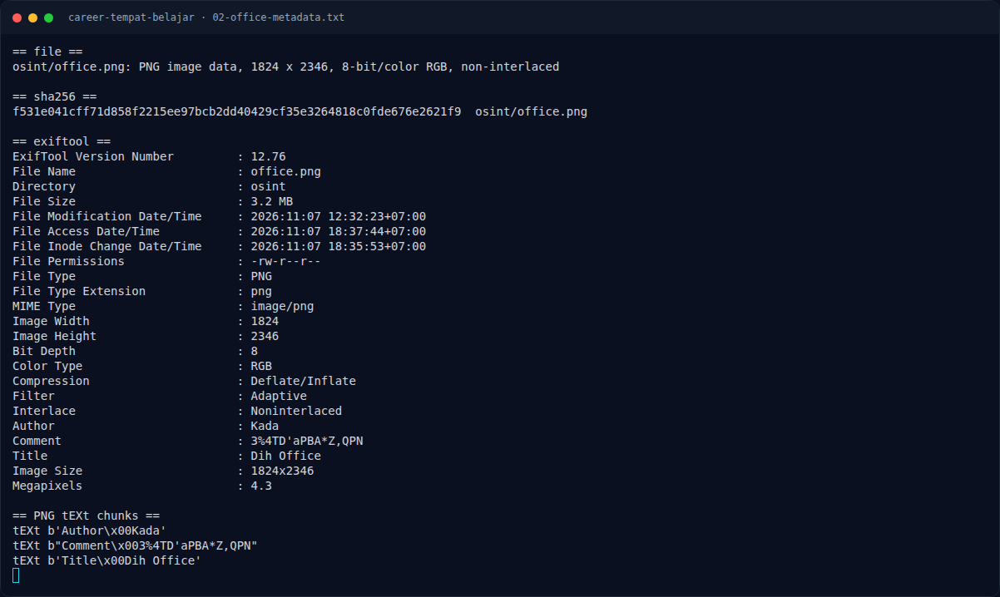

# Career Tempat Belajar — Analisis Jejak

[← Overview](09-career-tempat-belajar.md) · [Index](index.md)

## 2.1 Membaca poster

Poster menampilkan sekelompok orang belajar di tepi kolam, dengan teks besar:

```text
DIGITAL HOUR
LEARNING
The Open-Source LMS for
Gamified & Interactive Education.
```

Nama “Digital Hour Learning” adalah nama perusahaan fiktif yang dibuat untuk
challenge. Singkatannya **Dihlearn** (Dih + Learning), cocok dengan
`Title: Dih Office` pada metadata.

## 2.2 Mencari jejak perusahaan

Pencarian publik untuk `"Digital Hour Learning"` dan `dihlearn` mengarah ke
akun Instagram:

- `@dihlearn.id` — akun utama.
- `@career.dihlearn.id` — akun karier/rekrutmen.

Akun-akun ini login-walled saat diakses tanpa sesi, tetapi post lowongannya
pernah dibaca pada sesi investigasi sebelumnya. Post tersebut membuka
lowongan untuk tim teknologi dan keamanan siber, dan mencantumkan alamat
email rekrutmen:

```text
dihlearn.id@gmail.com
```

Catatan: ada juga artefak base64 dari post `@career.dihlearn.id` yang
mengarah ke challenge lain (“Tempat Belajar”), tetapi untuk challenge
**Career** ini jalur yang benar adalah email rekrutmen → Gravatar.

## 2.3 “Platform G-R” = Gravatar

Gravatar mengidentifikasi profil dengan **MD5 dari alamat email** (huruf kecil,
di-trim). Jadi email rekrutmen diubah menjadi hash:

```bash
$ python3 - <<'EOF'
import hashlib
email = "dihlearn.id@gmail.com"
print(hashlib.md5(email.strip().lower().encode()).hexdigest())
EOF
7149a84591149f4933058779e485a3c9
```

Hash lain yang diuji:

```text
dihlearn.id@gmail.com          -> 7149a84591149f4933058779e485a3c9
career.dihlearn.id@gmail.com   -> ec6f32f5e856fc584c4f897f040a37c1  (tidak ada profil)
info@dihlearn.id               -> 9d23764ce63b9f0f69049da5f9befdf1  (tidak ada profil)
```

### Evidence langkah ini



*Terminal evidence — `02-office-metadata.txt` (arsip transkrip sesi solve).*
