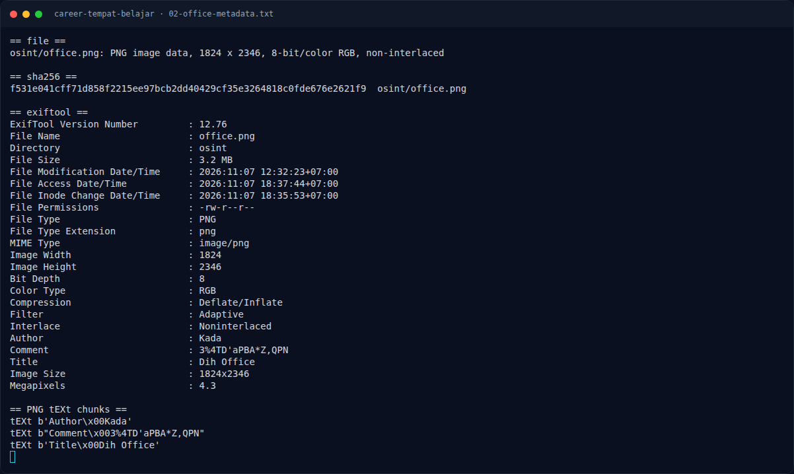
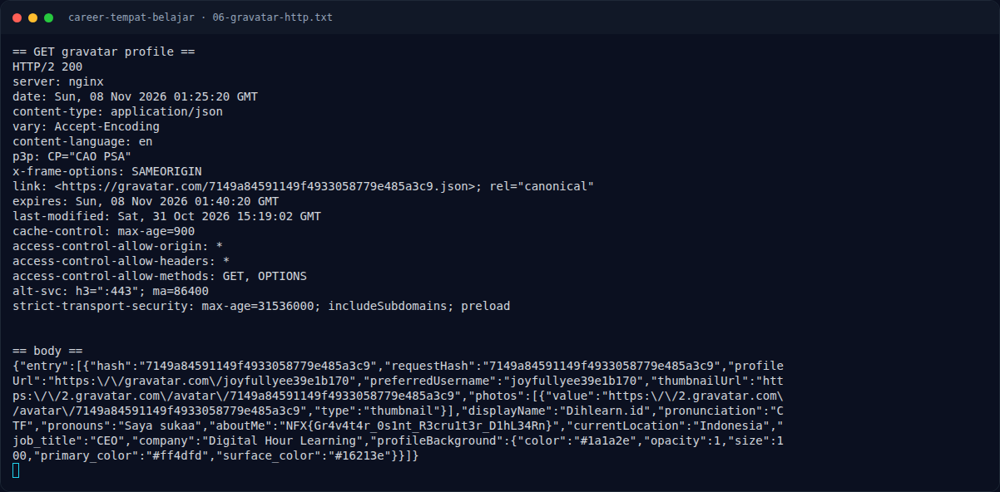

# Career Tempat Belajar — Analisis Jejak

[← Overview](09-career-tempat-belajar.md) · [Index](index.md)

## 2.4 Membaca profil Gravatar

Endpoint profil Gravatar:

```bash
$ curl -sL 'https://gravatar.com/7149a84591149f4933058779e485a3c9.json'
```

Respons live (diringkas):

```json
{
  "entry": [{
    "hash": "7149a84591149f4933058779e485a3c9",
    "profileUrl": "https://gravatar.com/joyfullyee39e1b170",
    "preferredUsername": "joyfullyee39e1b170",
    "displayName": "Dihlearn.id",
    "pronunciation": "CTF",
    "pronouns": "Saya sukaa",
    "aboutMe": "NFX{Gr4v4t4r_0s1nt_R3cru1t3r_D1hL34Rn}",
    "currentLocation": "Indonesia",
    "job_title": "CEO",
    "company": "Digital Hour Learning"
  }]
}
```

Field `aboutMe` berisi flag secara langsung. Ini bukan tebakan: profil
Gravatar-nya masih live saat writeup ini dibuat, dan `company`/`displayName`
cocok dengan perusahaan pada poster.

## 2.5 Mengapa bukan metadata comment?

`Comment: 3%4TD'aPBA*Z,QPN` terlihat seperti kredensial. Pada sesi
investigasi sebelumnya comment ini diuji sebagai password Instagram
`@dihlearn.id` dan `@career.dihlearn.id`; hasilnya “login information
incorrect”. Jadi comment tersebut adalah **decoy** yang sengaja dipasang
untuk mengecoh, bukan bagian dari flag.

### Evidence langkah ini



*Terminal evidence — `02-office-metadata.txt` (arsip transkrip sesi solve).*



*Terminal evidence — `06-gravatar-http.txt` (arsip transkrip sesi solve).*

**Berkas mentah langkah ini:**

- [`02-office-metadata.txt`](assets/career-tempat-belajar/02-office-metadata.txt)
- [`06-gravatar-http.txt`](assets/career-tempat-belajar/06-gravatar-http.txt)
