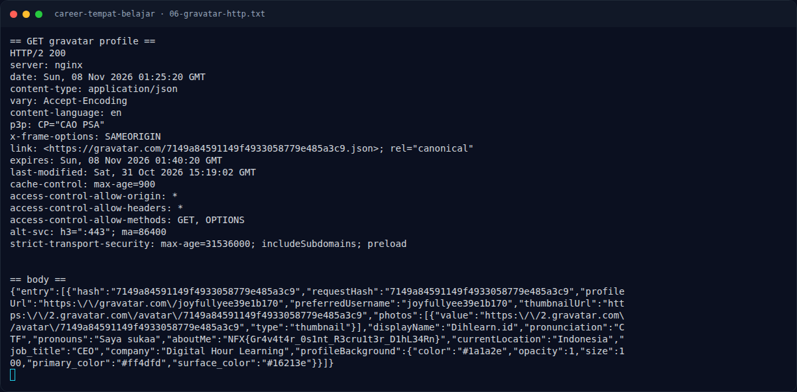
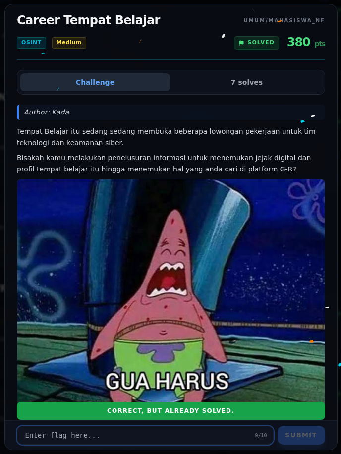

# Career Tempat Belajar — Flag & Verifikasi

[← Overview](09-career-tempat-belajar.md) · [Index](index.md)

> **Langkah 6/8 — Flag.** Flag ini tercatat accepted di platform; terminal evidence asli ada di halaman Flag.
>
> **Titik penting:** NFX{Gr4v4t4r_0s1nt_R3cru1t3r_D1hL34Rn}
>
> **Berikutnya:** [Bukti / Evidence](09-career-tempat-belajar-07-bukti-evidence.md)

> **Asal flag.** Flag diperoleh dari langkah exploit/solver yang terdokumentasi, lalu disubmit ke platform.  
> **Tingkat bukti metode.** Terdokumentasi. [Buka Evidence](09-career-tempat-belajar-07-bukti-evidence.md)

> **Flag:** `NFX{Gr4v4t4r_0s1nt_R3cru1t3r_D1hL34Rn}`
> **Status:** `VERIFIED`

```text
NFX{Gr4v4t4r_0s1nt_R3cru1t3r_D1hL34Rn}
```

Verifikasi:

```text
Gravatar profile hash : 7149a84591149f4933058779e485a3c9
displayName           : Dihlearn.id
company               : Digital Hour Learning
job_title             : CEO
aboutMe               : NFX{Gr4v4t4r_0s1nt_R3cru1t3r_D1hL34Rn}
```

Flag ini tercatat accepted di platform (lihat terminal evidence asli).
Verifikasi lokal tetap dilakukan lewat respons API Gravatar yang live, bukan
tebakan.

### Terminal evidence (real)



*Terminal evidence (real).*

> **Bukti:** terminal evidence (real).

## Validasi platform (real)



*Screenshot asli dari platform NFX CTF 2026. Platform menjawab
`CORRECT, BUT ALREADY SOLVED.` untuk flag ini.*
