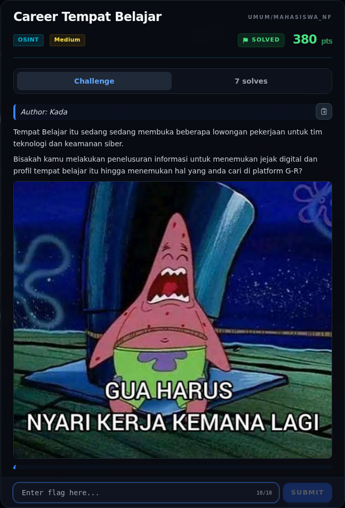
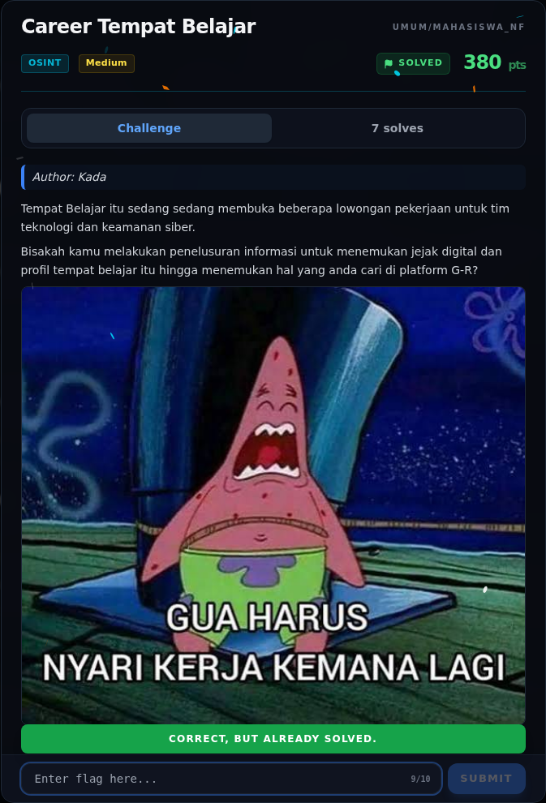
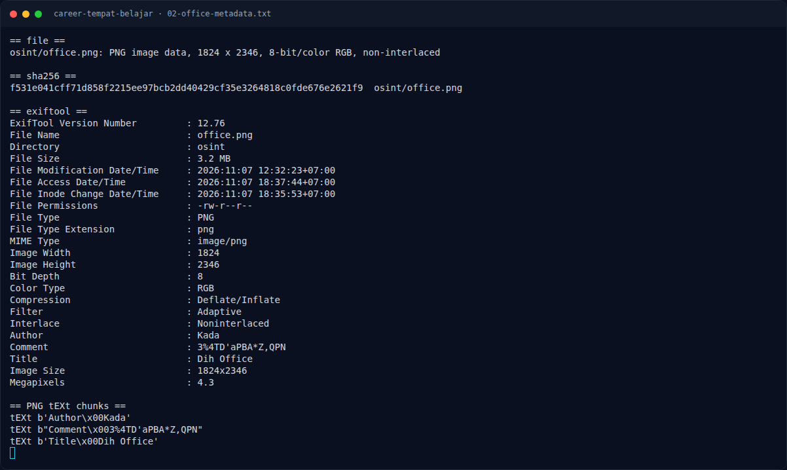
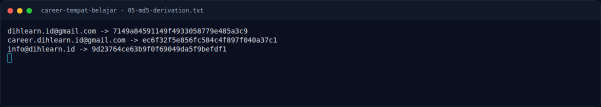
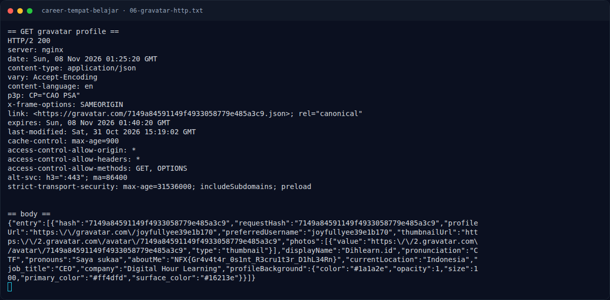

# Career Tempat Belajar — Evidence / Bukti

7 screenshot4 transkrip / script

[← Overview](09-career-tempat-belajar.md) · [Index](index.md)

> **Langkah 7/8 — Bukti / Evidence.** Semua bukti berada di writeups/assets/career-tempat-belajar/.
>
> **Titik penting:** arsip screenshot dan transkrip
>
> **Berikutnya:** [Referensi](09-career-tempat-belajar-08-referensi.md)

## Arsip Evidence

> Semua file berasal dari `assets/career-tempat-belajar/`. Screenshot platform dan terminal adalah bukti asli dari sesi solve; transkrip mentah tetap ditautkan di bagian bawah.

### Platform

<figure><figcaption>00-challenge-platform.png</figcaption></figure>

*Challenge brief asli di platform NFX CTF 2026.*

<figure><figcaption>00b-submit-platform.png</figcaption></figure>

*Submit flag di platform: `CORRECT, BUT ALREADY SOLVED.`*

### Terminal (arsip sesi)

<figure><figcaption>term-02-office-metadata.png</figcaption></figure>

*Terminal evidence — `02-office-metadata.txt` (arsip transkrip sesi solve).*

<figure><figcaption>term-05-md5-derivation.png</figcaption></figure>

*Terminal evidence — `05-md5-derivation.txt` (arsip transkrip sesi solve).*

<figure><figcaption>term-06-gravatar-http.png</figcaption></figure>

*Terminal evidence — `06-gravatar-http.txt` (arsip transkrip sesi solve).*

### Screenshot langkah

<figure><figcaption>01-office.png</figcaption></figure>

*Evidence — `01-office.png`.*

<figure><figcaption>04-gravatar-avatar.png</figcaption></figure>

*Evidence — `04-gravatar-avatar.png`.*

### Transkrip mentah & script

- [`02-office-metadata.txt`](assets/career-tempat-belajar/02-office-metadata.txt)
- [`03-gravatar-profile.json`](assets/career-tempat-belajar/03-gravatar-profile.json)
- [`05-md5-derivation.txt`](assets/career-tempat-belajar/05-md5-derivation.txt)
- [`06-gravatar-http.txt`](assets/career-tempat-belajar/06-gravatar-http.txt)

## Tabel Evidence

Semua bukti berada di `writeups/assets/career-tempat-belajar/`.

| Bukti | File | Keterangan |
|---|---|---|
| Poster asli | `01-office.png` | Gambar challenge, 1824×2346 |
| Metadata PNG | `02-office-metadata.txt` | `Author: Kada`, `Title: Dih Office`, `Comment` decoy |
| Profil Gravatar | `03-gravatar-profile.json` | Respons JSON live, berisi flag |
| Avatar Gravatar | `04-gravatar-avatar.png` | Avatar publik dari hash yang sama |
| Derivasi MD5 | `05-md5-derivation.txt` | Email → hash |
| HTTP Gravatar | `06-gravatar-http.txt` | Header + body respons |