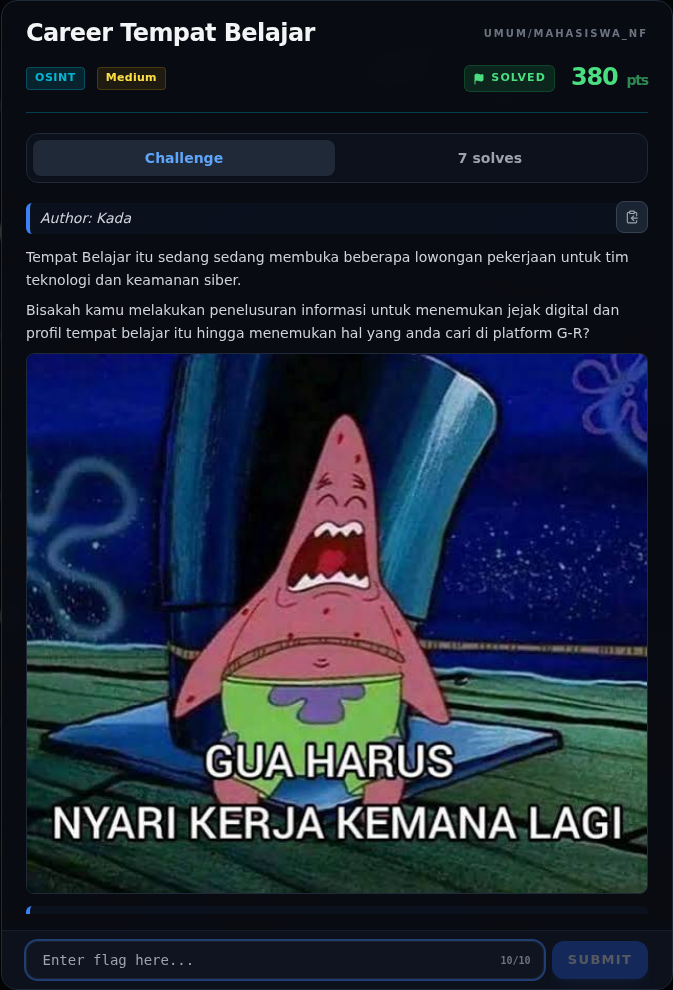
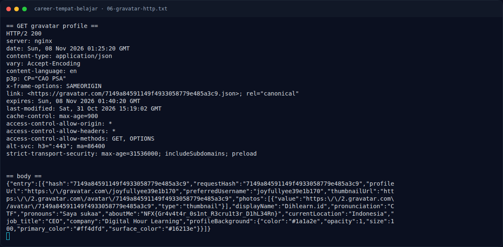

# Career Tempat Belajar

Track Mahasiswa NF · OsintMedium380 poinVERIFIED

| Field | Nilai |
|---|---|
| Event | `umum/mahasiswa_nf` |
| Kategori | `Osint` |
| Difficulty | `Medium` |
| Poin | `380` |
| Author | `Kada` |
| Tools | curl, python3, exiftool, git |
| Flag | `NFX{Gr4v4t4r_0s1nt_R3cru1t3r_D1hL34Rn}` |
| Status | `VERIFIED` |

[← Kembali ke Index](index.md)

## Challenge Brief (platform)

*Challenge brief asli di platform NFX CTF 2026.*

## Cerita singkat

Jadi ceritanya gini. challenge memberi sebuah poster AI berjudul **“DIGITAL HOUR LEARNING”**. Metadata PNG-nya membocorkan nama perusahaan: `Title: Dih Office`, `Author: Kada`, dan `Comment: 3%4TD'aPBA*Z,QPN` (decoy, bukan password). Terus, nama perusahaan adalah **Digital Hour Learning / Dihlearn**. Jejak publiknya ada di Instagram `@dihlearn.id` dan akun karier `@career.dihlearn.id`. Lalu, jejak publik akun karier mengarah ke alamat email rekrutmen **`dihlearn.id@gmail.com`**. Nah, dari situ kita bisa sampai ke flag dan bukti submit-nya.

## Alur & Titik Penting

| # | Langkah | Titik penting | Buka |
|---:|---|---|---|
| 1 | Jejak Awal | sha256sum osint/office.png | [Buka](09-career-tempat-belajar-01-jejak-awal.md) |
| 2 | Triage awal | file osint/office.png | [Buka](09-career-tempat-belajar-02-triage-awal.md) |
| 3 | Analisis Jejak | python3 - <<'EOF' | [Buka](09-career-tempat-belajar-03-analisis-jejak.md) |
| 4 | Analisis Jejak | curl -sL 'https://gravatar.com/7149a84591149f4933058779e485a3c9.json' | [Buka](09-career-tempat-belajar-04-analisis-jejak-2.md) |
| 5 | Pencarian & Verifikasi | python3 gravatar_check.py | [Buka](09-career-tempat-belajar-05-pencarian-verifikasi.md) |
| 6 | Flag | NFX{Gr4v4t4r_0s1nt_R3cru1t3r_D1hL34Rn} | [Buka](09-career-tempat-belajar-06-flag.md) |
| 7 | Bukti / Evidence | arsip screenshot dan transkrip | [Buka](09-career-tempat-belajar-07-bukti-evidence.md) |
| 8 | Referensi | https://gravatar.com/<md5>.json | [Buka](09-career-tempat-belajar-08-referensi.md) |

## Ringkasan

> Catatan metadata: `writeups/_manifest.json` mencatat 380 poin / 7 solves,
> sedangkan `umum/Osint/career-tempat-belajar/challenge.json` mencatat
> 480 poin / 2 solves (snapshot saat challenge baru dibuat). Angka platform
> terbaru yang dipakai di tabel; perbedaannya dicatat agar tidak menyesatkan.
## TL;DR

- Challenge memberi sebuah poster AI berjudul **“DIGITAL HOUR LEARNING”**.
  Metadata PNG-nya membocorkan nama perusahaan: `Title: Dih Office`,
  `Author: Kada`, dan `Comment: 3%4TD'aPBA*Z,QPN` (decoy, bukan password).
- Nama perusahaan adalah **Digital Hour Learning / Dihlearn**. Jejak publiknya
  ada di Instagram `@dihlearn.id` dan akun karier `@career.dihlearn.id`.
- Jejak publik akun karier mengarah ke alamat email rekrutmen
  **`dihlearn.id@gmail.com`**.
- “Platform G-R” pada deskripsi adalah **Gravatar**. Gravatar mencari profil
  berdasarkan **MD5 dari email**:
  `md5("dihlearn.id@gmail.com") = 7149a84591149f4933058779e485a3c9`.
- Profil Gravatar live tersebut memuat flag di field `aboutMe`:
  `NFX{Gr4v4t4r_0s1nt_R3cru1t3r_D1hL34Rn}`.

Pratinjau evidence. Buka halaman <a href="09-career-tempat-belajar-07-bukti-evidence.html">Evidence / Bukti</a> untuk semua screenshot dan transkrip.

## Navigasi Halaman

<a class="nx-page-card" href="09-career-tempat-belajar-01-jejak-awal.html"><b>Jejak Awal</b>Baca bagian ini</a>
<a class="nx-page-card" href="09-career-tempat-belajar-02-triage-awal.html"><b>Triage awal</b>Baca bagian ini</a>
<a class="nx-page-card" href="09-career-tempat-belajar-03-analisis-jejak.html"><b>Analisis Jejak</b>Membaca alur dan akar masalah</a>
<a class="nx-page-card" href="09-career-tempat-belajar-04-analisis-jejak-2.html"><b>Analisis Jejak</b>Membaca alur dan akar masalah</a>
<a class="nx-page-card" href="09-career-tempat-belajar-05-pencarian-verifikasi.html"><b>Pencarian &amp; Verifikasi</b>Baca bagian ini</a>
<a class="nx-page-card" href="09-career-tempat-belajar-06-flag.html"><b>Flag</b>Flag dan verifikasi platform</a>
<a class="nx-page-card" href="09-career-tempat-belajar-07-bukti-evidence.html"><b>Bukti / Evidence</b>Screenshot, transkrip, dan artefak</a>
<a class="nx-page-card" href="09-career-tempat-belajar-08-referensi.html"><b>Referensi</b>Sumber dan bacaan lanjutan</a>

