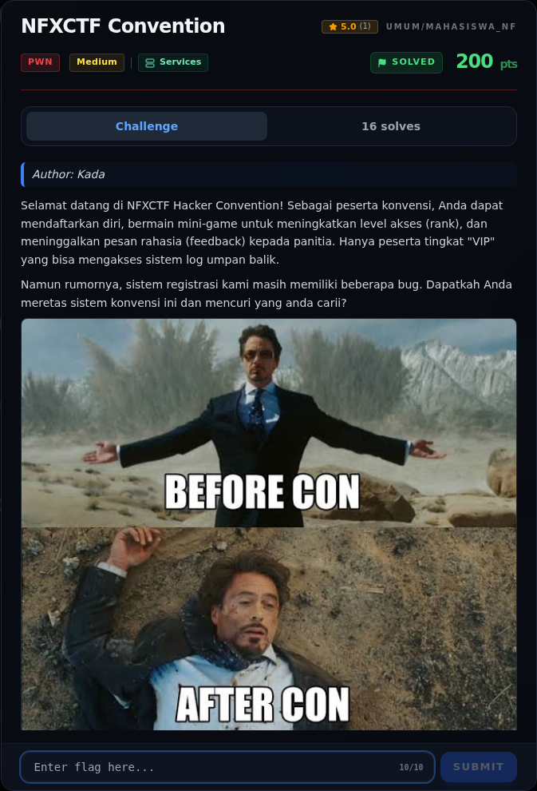

# NFXCTF Convention — Recon

[← Overview](10-nfxctf-convention.md) · [Index](index.md)

> **Langkah 1/9 — Recon.** Metadata platform (writeups/challenges.json) mencatat challenge ini sebagai Pwn Medium, 280 poin, 12 solves, author Kada.
>
> **Titik penting:** NFX{your_flag_here}
>
> **Berikutnya:** [Recon](10-nfxctf-convention-02-recon-2.md)

## 1.1 Deskripsi challenge

> **Author: Kada**
>
> Selamat datang di NFXCTF Hacker Convention! Sebagai peserta konvensi, Anda dapat mendaftarkan diri, bermain mini-game untuk meningkatkan level akses (rank), dan meninggalkan pesan rahasia (feedback) kepada panitia. Hanya peserta tingkat "VIP" yang bisa mengakses sistem log umpan balik.
>
> Namun rumornya, sistem registrasi kami masih memiliki beberapa bug. Dapatkah Anda meretas sistem konvensi ini dan mencuri yang anda carii?
>
> Format Flag: `NFX{your_flag_here}`

Metadata platform (`writeups/_challenges.json`) mencatat challenge ini sebagai Pwn Medium, 280 poin, 12 solves, author Kada.

## 1.2 File / service yang diberikan

Platform tidak melampirkan file (`attachments: []`); challenge berupa service TCP dinamis `NFX/NFXCTFConvention`. Namun **source bundle** yang sama tersedia publik di repo upstream yang sudah di-mirror ke workspace:

| File | Ukuran | SHA-256 |
|---|---|---|
| `work/event/pwn/nfxctf-convention/src/peserta/oscar_convention` | 17.000 B | `ff7ff155dd6df34d61c019aee43c7c3fc2fc0863bbdd297db053cd75874fdd88` |
| `.../src/peserta/libc.so.6` | 2.220.400 B | `e01b1ce7be2987f3b8560e26d0df2623f9dd5cec17be923ae28a785bc0d32d50` |
| `.../src/peserta/ld-linux-x86-64.so.2` | 240.936 B | (loader Ubuntu 22.04, lihat `assets/.../01-file-hash-checksec.txt`) |

Bundle zip asli: `work/upstream/qazwsx/pwn/NFXCTFConvention.zip` (berisi `peserta/oscar_convention`, `libc.so.6`, `ld-linux-x86-64.so.2`). Ada juga `oscar_local`, yaitu rebuild lokal untuk uji; writeup ini memakai `oscar_convention` asli.

### Evidence langkah ini

*Challenge brief asli di platform NFX CTF 2026.*
