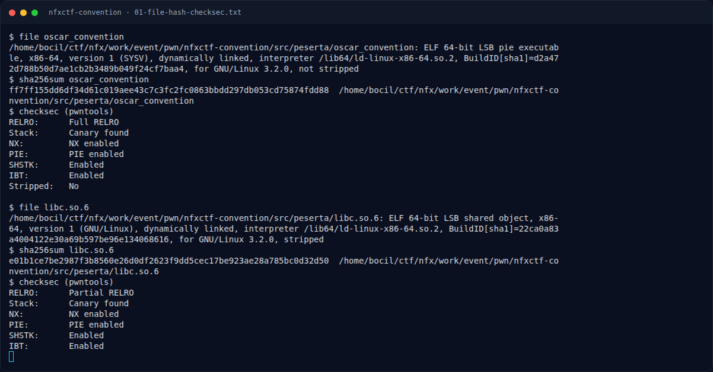

# NFXCTF Convention — Recon

[← Overview](10-nfxctf-convention.md) · [Index](index.md)

## 1.3 Environment

- Linux x86-64, glibc host 2.39; untuk reproduksi dipakai loader + libc bawaan challenge (Ubuntu GLIBC 2.35).
- Tools: `file`, `sha256sum`, `objdump`, `strings`, `nm`, `pwntools` (`ELF`, `ROP`, `process`).
- Menjalankan binary:
  ```bash
  work/event/pwn/nfxctf-convention/src/peserta/ld-linux-x86-64.so.2 \
    --library-path work/event/pwn/nfxctf-convention/src/peserta \
    work/event/pwn/nfxctf-convention/src/peserta/oscar_convention
  ```

## 1.4 Triage awal

```text
$ file oscar_convention
oscar_convention: ELF 64-bit LSB pie executable, x86-64, version 1 (SYSV),
dynamically linked, interpreter /lib64/ld-linux-x86-64.so.2,
BuildID[sha1]=d2a472d788b50d7ae1cb2b3489b049f24cf7baa4,
for GNU/Linux 3.2.0, not stripped

$ checksec (pwntools ELF.checksec)
RELRO:      Full RELRO
Stack:      Canary found
NX:         NX enabled
PIE:        PIE enabled
SHSTK:      Enabled
IBT:        Enabled
Stripped:   No
```

`strings` memperlihatkan seluruh alur menu dan pesan validasi:

```text
Welcome to the NFXCTF Hacker Convention!
Enter your name:
[!] You must be at least rank 5 to change your name.
[+] Name updated.
--- USER PROFILE ---
Name: %s
Rank: %d
Score: %d
Quote:
Activity Log:
[ Mini Game - Answer 10 questions to reach rank 5 ]
Correct! You have reached rank 5.
[!] Only VIP members (rank 20+) can leave feedback.
Enter your feedback:
[+] Feedback saved to log.
```

**Temuan:** binary tidak stripped, jadi symbol `register_user`, `edit_name`, `view_profile`, `leave_feedback`, `play_game`, `menu`, `main` langsung terbaca.

### Evidence langkah ini



*Terminal evidence — `01-file-hash-checksec.txt` (arsip transkrip sesi solve).*

**Berkas mentah langkah ini:**

- [`01-file-hash-checksec.txt`](assets/nfxctf-convention/01-file-hash-checksec.txt)
