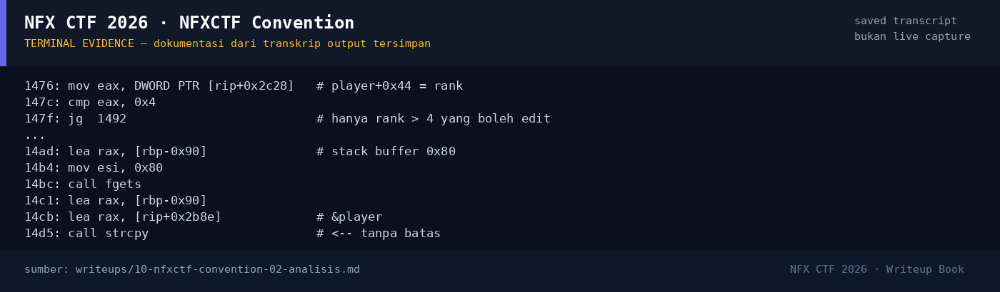

# NFXCTF Convention — Evidence / Bukti

1 screenshot9 transkrip / script

[← Overview](10-nfxctf-convention.md) · [Index](index.md)

## Arsip Evidence

> Semua file di bawah berasal dari folder `assets/nfxctf-convention/`. Screenshot ditempel langsung; file teks/script ditautkan.

### Screenshot

<figure><figcaption>98-terminal-evidence.png</figcaption></figure>

### Transkrip / file pendukung

- [`01-file-hash-checksec.txt`](assets/nfxctf-convention/01-file-hash-checksec.txt)
- [`02-disasm.txt`](assets/nfxctf-convention/02-disasm.txt)
- [`02b-layout.txt`](assets/nfxctf-convention/02b-layout.txt)
- [`03-exploit-run.txt`](assets/nfxctf-convention/03-exploit-run.txt)
- [`03b-leak-probe.py`](assets/nfxctf-convention/03b-leak-probe.py)
- [`03b-leak-probe.txt`](assets/nfxctf-convention/03b-leak-probe.txt)
- [`04-flag-status.txt`](assets/nfxctf-convention/04-flag-status.txt)
- [`exploit.py`](assets/nfxctf-convention/exploit.py)
- [`flag.txt`](assets/nfxctf-convention/flag.txt)

## Tabel Evidence

Semua file ada di `writeups/assets/nfxctf-convention/`:

| Bukti | File | Keterangan |
|---|---|---|
| Identitas, hash, checksec | `01-file-hash-checksec.txt` | `file`, `sha256sum`, `ELF.checksec()` |
| Disassembly | `02-disasm.txt` | `register_user`, `edit_name`, `view_profile`, `leave_feedback`, `main` |
| Layout data | `02b-layout.txt` | `player`, `log_buf`, offset field |
| Leak probe | `03b-leak-probe.py`, `03b-leak-probe.txt` | `%7$p` canary, `%17$p` libc |
| Exploit | `exploit.py` | Script pwntools lengkap |
| Output exploit | `03-exploit-run.txt` | Output asli (canary/libc/flag lokal) |
| Flag & status | `04-flag-status.txt` | Flag dari `flags/pwn/`, sha256, status VERIFIED |
| Fixture lokal | `flag.txt` | `NFX{LOCAL_TEST_FLAG_CONVENTION}` (bukan flag kompetisi) |