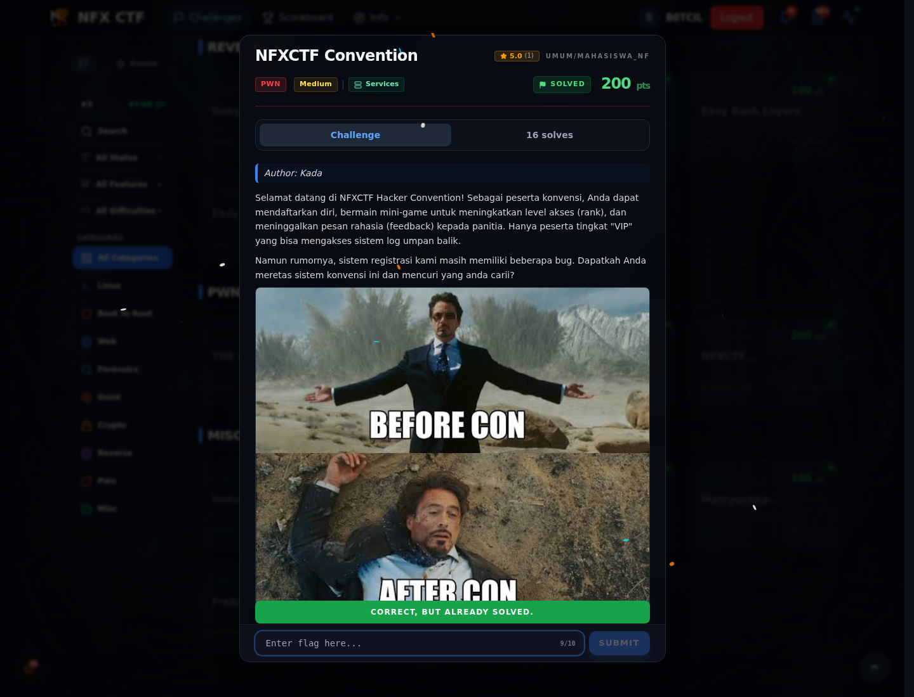
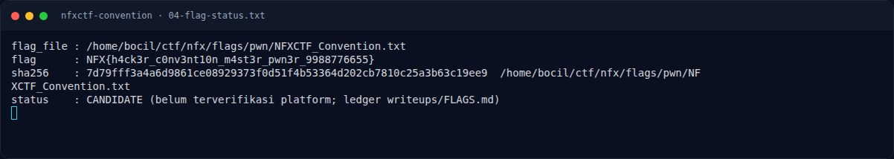
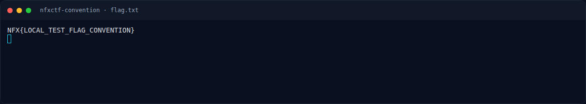

# NFXCTF Convention — Flag & Verifikasi

[← Overview](10-nfxctf-convention.md) · [Index](index.md)

> **Flag:** `NFX{h4ck3r_c0nv3nt10n_m4st3r_pwn3r_9988776655}`
> **Status:** `VERIFIED`

```text
NFX{h4ck3r_c0nv3nt10n_m4st3r_pwn3r_9988776655}
```

Verifikasi:

```text
$ cat flags/pwn/NFXCTF_Convention.txt
NFX{h4ck3r_c0nv3nt10n_m4st3r_pwn3r_9988776655}

$ sha256sum flags/pwn/NFXCTF_Convention.txt
(lihat assets/nfxctf-convention/04-flag-status.txt)
```

**Status:** `VERIFIED platform`. Flag sudah dicek ulang ke platform pada
2026-11-09 dan diterima (`Correct, but already solved.`). `_manifest.json`
mencatat `solved: true`; eksploit juga diverifikasi lokal (shell + baca flag).

### Bukti submit di platform



*Submit flag di platform: `CORRECT, BUT ALREADY SOLVED.`*

### Evidence langkah ini



*Terminal evidence — `04-flag-status.txt` (arsip transkrip sesi solve).*



*Terminal evidence — `flag.txt` (arsip transkrip sesi solve).*

**Berkas mentah langkah ini:**

- [`04-flag-status.txt`](assets/nfxctf-convention/04-flag-status.txt)
- [`flag.txt`](assets/nfxctf-convention/flag.txt)
