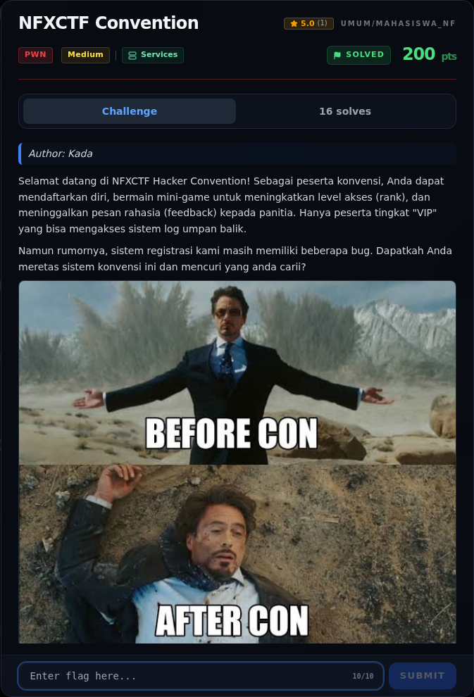

# NFXCTF Convention — Referensi

[← Overview](10-nfxctf-convention.md) · [Index](index.md)

> **Langkah 9/9 — Referensi.** Referensi
>
> **Titik penting:** https://docs.pwntools.com/>
>
> **Selesai.** Kembali ke [Overview](10-nfxctf-convention.md).

- Source bundle: `work/event/pwn/nfxctf-convention/` dan `work/upstream/qazwsx/pwn/NFXCTFConvention.zip`.
- Catatan lama: `work/event/pwn/nfxctf-convention/solve/WRITEUP.md`.
- pwntools ELF/ROP: <https://docs.pwntools.com/>
- Format string positional arguments: `man 3 printf`.

### Evidence langkah ini

*Challenge brief asli di platform NFX CTF 2026.*
