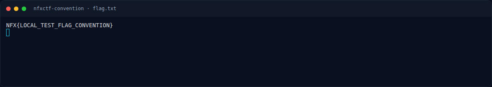

# NFXCTF Convention

Track Mahasiswa NF · PwnMedium280 poinVERIFIED

| Field | Nilai |
|---|---|
| Event | `umum/mahasiswa_nf` |
| Kategori | `Pwn` |
| Difficulty | `Medium` |
| Poin | `280` |
| Author | `Kada` |
| Solves | `12` |
| Tools | python3, pwntools, checksec, objdump, strings |
| Flag | `NFX{h4ck3r_c0nv3nt10n_m4st3r_pwn3r_9988776655}` |
| Status | `VERIFIED` |

[← Kembali ke Index](index.md)

## Challenge Brief (platform)

*Challenge brief asli di platform NFX CTF 2026.*

## Cerita singkat

Jadi ceritanya gini. service adalah simulator konvensi: register, main mini-game untuk naik rank, edit nama, dan (hanya VIP rank 20+) meninggalkan feedback. Terus, ada **tiga bug yang dirangkai**: 1. `edit_name()` menyalin `fgets()` ke variabel global `player` dengan `strcpy()` tanpa batas → overflow `score`/`rank`; 2. `leave_feedback()` memakai `read(0, buf, 0x100)` ke buffer stack `0x70` → stack overflow; 3. `view_profile()` memanggil `printf(log_buf)` → **format string leak**. Lalu, rank awalnya 5 setelah mini-game. Overflow nama membuat `rank = 0x00000a14` (2580) sehingga gate VIP (rank > 19) terbuka. Nah, dari situ kita bisa sampai ke flag dan bukti submit-nya.

## Alur & Titik Penting

| # | Langkah | Titik penting | Buka |
|---:|---|---|---|
| 1 | Recon | NFX{your_flag_here} | [Buka](10-nfxctf-convention-01-recon.md) |
| 2 | Recon | file oscar_convention | [Buka](10-nfxctf-convention-02-recon-2.md) |
| 3 | Analisis | Dari symbol table dan instruksi lea: | [Buka](10-nfxctf-convention-03-analisis.md) |
| 4 | Bug #3 — format string di `view_profile()` | Feedback disimpan lebih dulu dengan snprintf(logbuf, 0x100, "%s", buf), jadi isi feedback tidak diformat saat disimpan; tetapi saat viewprofile() dipanggil, logbuf dipakai sebagai format st… | [Buka](10-nfxctf-convention-04-bug-3-format-string-di-view-profile.md) |
| 5 | Eksploitasi | python3 exploit.py \| tee 03-exploit-run.txt | [Buka](10-nfxctf-convention-05-eksploitasi.md) |
| 6 | Output asli | NFX{LOCAL_TEST_FLAG_CONVENTION} | [Buka](10-nfxctf-convention-06-output-asli.md) |
| 7 | Flag | NFX{h4ck3r_c0nv3nt10n_m4st3r_pwn3r_9988776655} | [Buka](10-nfxctf-convention-07-flag.md) |
| 8 | Bukti / Evidence | arsip screenshot dan transkrip | [Buka](10-nfxctf-convention-08-bukti-evidence.md) |
| 9 | Referensi | https://docs.pwntools.com/> | [Buka](10-nfxctf-convention-09-referensi.md) |

## TL;DR

- Service adalah simulator konvensi: register, main mini-game untuk naik rank, edit nama, dan (hanya VIP rank 20+) meninggalkan feedback.
- Ada **tiga bug yang dirangkai**:
  1. `edit_name()` menyalin `fgets()` ke variabel global `player` dengan `strcpy()` tanpa batas → overflow `score`/`rank`;
  2. `leave_feedback()` memakai `read(0, buf, 0x100)` ke buffer stack `0x70` → stack overflow;
  3. `view_profile()` memanggil `printf(log_buf)` → **format string leak**.
- Rank awalnya 5 setelah mini-game. Overflow nama membuat `rank = 0x00000a14` (2580) sehingga gate VIP (rank > 19) terbuka.
- Format string `%7$p` membocorkan canary dan `%17$p` membocorkan return address libc (`libc+0x29d90`).
- ROP `pop rdi; "/bin/sh"; system` → shell, lalu `cat flag.txt`.

Pratinjau evidence. Buka halaman <a href="10-nfxctf-convention-08-bukti-evidence.html">Evidence / Bukti</a> untuk semua screenshot dan transkrip.

## Navigasi Halaman

<a class="nx-page-card" href="10-nfxctf-convention-01-recon.html"><b>Recon</b>Enumerasi target dan bukti awal</a>
<a class="nx-page-card" href="10-nfxctf-convention-02-recon-2.html"><b>Recon</b>Enumerasi target dan bukti awal</a>
<a class="nx-page-card" href="10-nfxctf-convention-03-analisis.html"><b>Analisis</b>Membaca alur dan akar masalah</a>
<a class="nx-page-card" href="10-nfxctf-convention-04-bug-3-format-string-di-view-profile.html"><b>Bug #3 — format string di `view_profile()`</b>Baca bagian ini</a>
<a class="nx-page-card" href="10-nfxctf-convention-05-eksploitasi.html"><b>Eksploitasi</b>Langkah exploit dan solver</a>
<a class="nx-page-card" href="10-nfxctf-convention-06-output-asli.html"><b>Output asli</b>Baca bagian ini</a>
<a class="nx-page-card" href="10-nfxctf-convention-07-flag.html"><b>Flag</b>Flag dan verifikasi platform</a>
<a class="nx-page-card" href="10-nfxctf-convention-08-bukti-evidence.html"><b>Bukti / Evidence</b>Screenshot, transkrip, dan artefak</a>
<a class="nx-page-card" href="10-nfxctf-convention-09-referensi.html"><b>Referensi</b>Sumber dan bacaan lanjutan</a>

