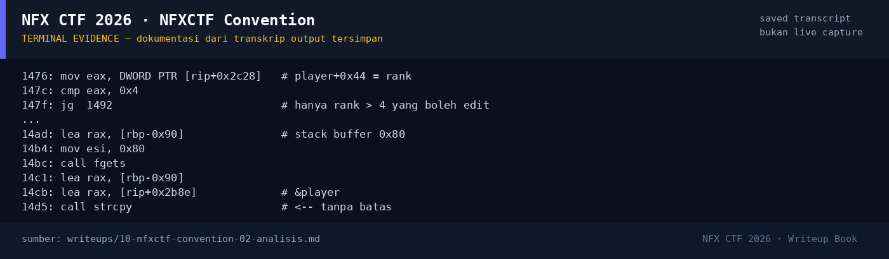

# NFXCTF Convention

Track Mahasiswa NF · PwnMedium280 poinVERIFIED

| Field | Nilai |
|---|---|
| Event | `umum/mahasiswa_nf` |
| Kategori | `Pwn` |
| Difficulty | `Medium` |
| Poin | `280` |
| Author | `Kada` |
| Solves | `12` |
| Tools | python3, pwntools, checksec, objdump, strings |
| Flag | `NFX{h4ck3r_c0nv3nt10n_m4st3r_pwn3r_9988776655}` |
| Status | `VERIFIED` |

[← Kembali ke Index](index.md)

## TL;DR

- Service adalah simulator konvensi: register, main mini-game untuk naik rank, edit nama, dan (hanya VIP rank 20+) meninggalkan feedback.
- Ada **tiga bug yang dirangkai**:
  1. `edit_name()` menyalin `fgets()` ke variabel global `player` dengan `strcpy()` tanpa batas → overflow `score`/`rank`;
  2. `leave_feedback()` memakai `read(0, buf, 0x100)` ke buffer stack `0x70` → stack overflow;
  3. `view_profile()` memanggil `printf(log_buf)` → **format string leak**.
- Rank awalnya 5 setelah mini-game. Overflow nama membuat `rank = 0x00000a14` (2580) sehingga gate VIP (rank > 19) terbuka.
- Format string `%7$p` membocorkan canary dan `%17$p` membocorkan return address libc (`libc+0x29d90`).
- ROP `pop rdi; "/bin/sh"; system` → shell, lalu `cat flag.txt`.

Pratinjau evidence. Buka halaman <a href="10-nfxctf-convention-05-bukti-evidence.html">Evidence / Bukti</a> untuk semua screenshot dan transkrip.

## Navigasi Halaman

<a class="nx-page-card" href="10-nfxctf-convention-01-recon.html"><b>Recon</b>Enumerasi target dan bukti awal</a>
<a class="nx-page-card" href="10-nfxctf-convention-02-analisis.html"><b>Analisis</b>Membaca alur dan akar masalah</a>
<a class="nx-page-card" href="10-nfxctf-convention-03-eksploitasi.html"><b>Eksploitasi</b>Langkah exploit dan solver</a>
<a class="nx-page-card" href="10-nfxctf-convention-04-flag.html"><b>Flag</b>Flag dan verifikasi platform</a>
<a class="nx-page-card" href="10-nfxctf-convention-05-bukti-evidence.html"><b>Bukti / Evidence</b>Screenshot, transkrip, dan artefak</a>
<a class="nx-page-card" href="10-nfxctf-convention-06-referensi.html"><b>Referensi</b>Sumber dan bacaan lanjutan</a>

