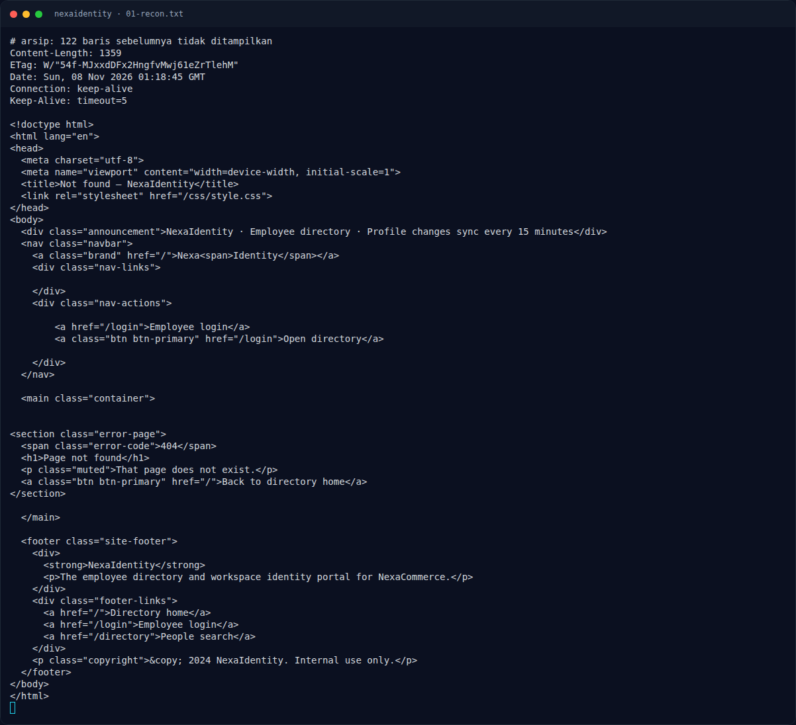
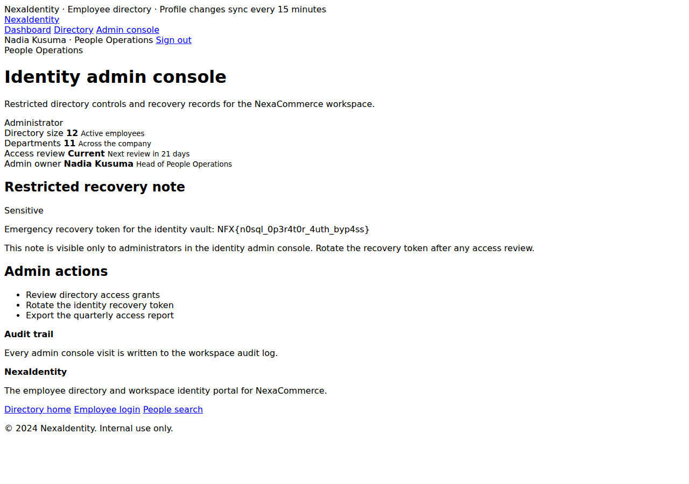

# NexaIdentity — Recon

[← Overview](11-nexaidentity.md) · [Index](index.md)

## 1.1 Deskripsi challenge

> Author: Ariaf
>
> **NexaIdentity** adalah direktori karyawan internal dan portal identitas workspace untuk NexaCommerce. Karyawan dapat masuk, mencari kolega, membuka profil workspace, dan meninjau detail tim.

Tidak ada attachment. Service diberikan lewat platform:

```text
NFX/web/05_nexaidentity   key: NFXCTF-NFCC-NXCTF-2026
```

## 1.2 File / service

Tidak ada source lokal di workspace (`umum/Web/nexaidentity` hanya berisi `BRIEF.md` dan `challenge.json`). Validasi dilakukan black-box pada instance live.

| Item | Nilai |
|---|---|
| Instance | `http://s1.nfx.my.id:41270` (saat validasi) |
| Stack | Express (`X-Powered-By: Express`) |
| Halaman publik | `/`, `/login`, `/directory` (butuh login) |
| Halaman auth | `/dashboard`, `/directory`, `/directory/:id`, `/admin` |
| Akun demo | `employee@nexaidentity.test` / `employee1234` |

Struktur halaman yang teramati:

```text
/                       landing + statistik 12 employees / 11 departments
/login                  form email + password; demo account tertera
/dashboard              ringkasan user
/directory              people search + daftar 12 karyawan
/directory/1            profil Nadia Kusuma (admin@nexaidentity.test)
/directory/2            profil Raka Pratama (employee@nexaidentity.test)
/admin                  403 untuk employee; console admin untuk admin
```

## 1.3 Environment

- `curl`, `python3` + `requests`.
- Instance dijalankan dengan `nxapi.py nx-up "NFX/web/05_nexaidentity" ...`.
- Tidak ada submit flag ke platform.

### Evidence langkah ini



*Terminal evidence — `01-recon.txt` (arsip transkrip sesi solve).*



*Evidence — `01-admin-flag.png`.*
