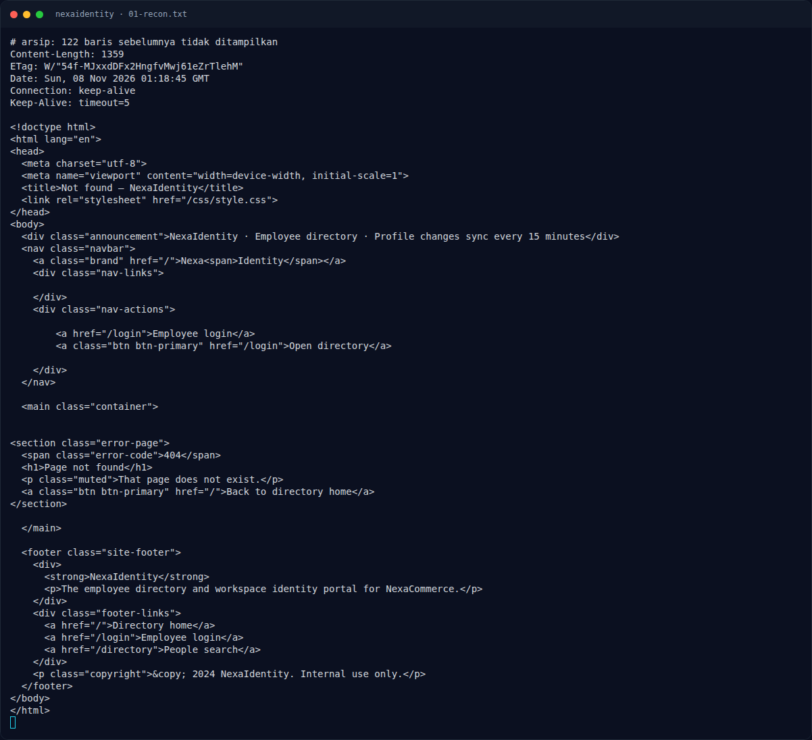
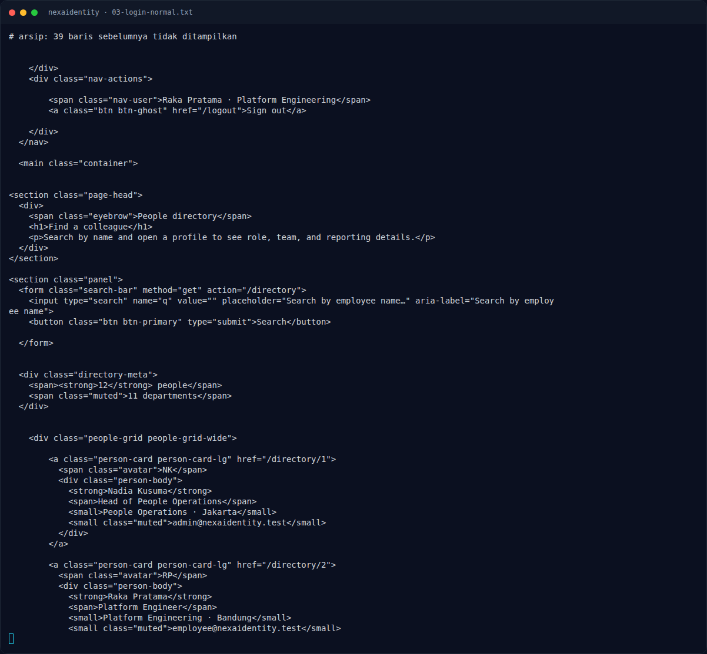

# NexaIdentity — Triage awal

[← Overview](11-nexaidentity.md) · [Index](index.md)

> **Langkah 2/9 — Triage awal.** Setelah login, /dashboard menampilkan Raka Pratama · Platform Engineering.
>
> **Titik penting:** curl -sS -i "$BASE/" · curl -sS -i "$BASE/login" · curl -sS -i "$BASE/robots.txt"
>
> **Berikutnya:** [Analisis](11-nexaidentity-03-analisis.md)

## 1.4 Triage awal

```bash
BASE=http://s1.nfx.my.id:41270
curl -sS -i "$BASE/"
curl -sS -i "$BASE/login"
curl -sS -i "$BASE/robots.txt"
```

Temuan:
- `/` → `200`, Express, halaman direktori.
- `/login` → `200`, form `POST /login` dengan field `email` dan `password`.
- Halaman login menampilkan **Demo employee account**:
  ```text
  employee@nexaidentity.test / employee1234
  ```
- `/robots.txt` → `404`.
- `/directory` tanpa session → `302 /login`.
- `/admin` tanpa session → `302 /login`.

Login normal:

```bash
curl -sS -i -c cookies.txt \
  -d 'email=employee@nexaidentity.test&password=employee1234' \
  "$BASE/login"
```

```text
HTTP/1.1 302 Found
Location: /dashboard
Set-Cookie: connect.sid=s%3A...; Path=/; HttpOnly; SameSite=Lax
```

Setelah login, `/dashboard` menampilkan `Raka Pratama · Platform Engineering`. `/admin` → `403`:

```text
HTTP/1.1 403 Forbidden
The identity admin console is restricted to People Operations administrators.
```

### Evidence langkah ini



*Terminal evidence — `01-recon.txt` (arsip transkrip sesi solve).*



*Terminal evidence — `03-login-normal.txt` (arsip transkrip sesi solve).*

**Berkas mentah langkah ini:**

- [`01-recon.txt`](assets/nexaidentity/01-recon.txt)
- [`03-login-normal.txt`](assets/nexaidentity/03-login-normal.txt)
