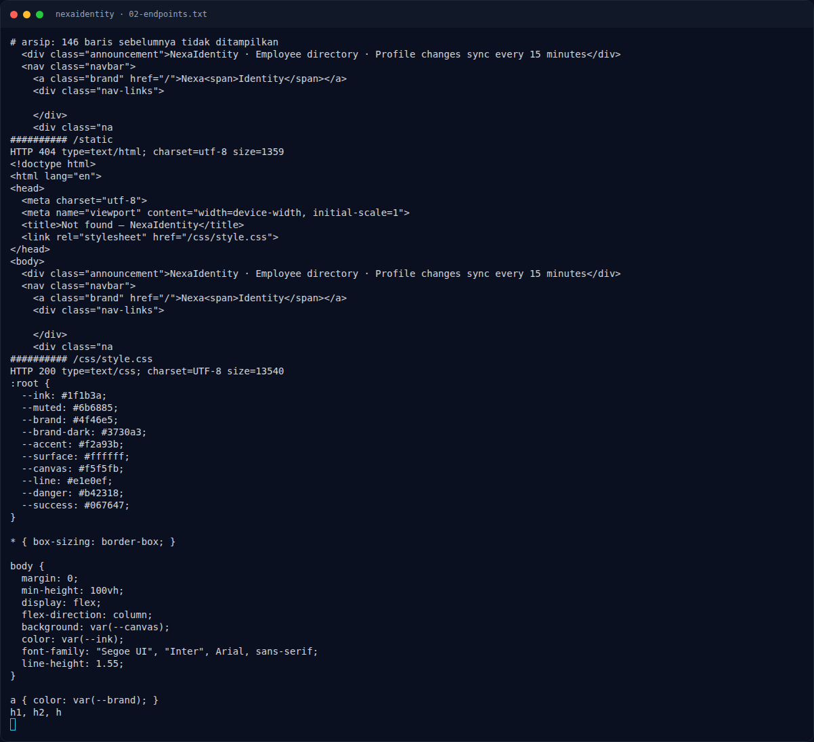

# NexaIdentity — Analisis

[← Overview](11-nexaidentity.md) · [Index](index.md)

## 2.1 Express + qs: bracket notation menjadi objek

Form login menggunakan `application/x-www-form-urlencoded`. Express dengan `extended: true` memakai `qs`, yang mengubah:

```text
email[$ne]=x&password[$ne]=x
```

menjadi:

```js
{
  email: { $ne: "x" },
  password: { $ne: "x" }
}
```

Jika backend melakukan query mirip Mongo:

```js
const user = await users.findOne({ email: req.body.email, password: req.body.password });
```

maka objek operator `$ne` diteruskan apa adanya. Query `{ email: { $ne: "x" }, password: { $ne: "x" } }` cocok dengan **dokumen pertama** yang email dan password-nya bukan `"x"`. Dokumen pertama pada seed adalah admin (Nadia Kusuma), sehingga session menjadi admin.

Ini adalah **NoSQL operator injection / authentication bypass**, bukan SQL injection biasa. Nama flag (`n0sql_0p3r4t0r_4uth_byp4ss`) mengonfirmasi.

## 2.2 Mengapa admin?

`/directory` menampilkan 12 karyawan; kartu pertama adalah:

```text
Nadia Kusuma
Head of People Operations
People Operations · Jakarta
admin@nexaidentity.test
```

Backend tampaknya menyimpan admin sebagai user pertama. `$ne` tanpa kriteria field lain cocok dengan user pertama, yaitu Nadia. Session kemudian memiliki role admin, sehingga `/admin` tidak lagi 403.

### Evidence langkah ini



*Terminal evidence — `02-endpoints.txt` (arsip transkrip sesi solve).*
