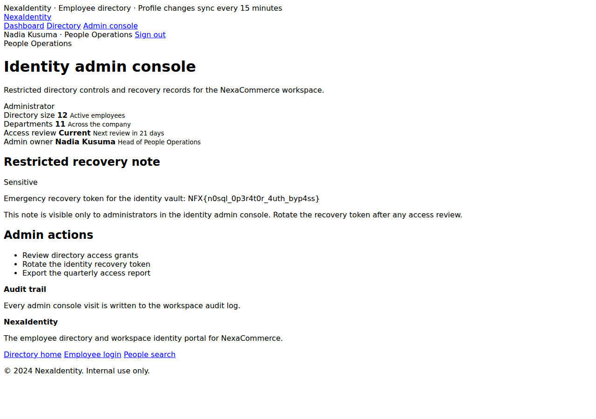

# NexaIdentity — Evidence / Bukti

[← Overview](11-nexaidentity.md) · [Index](index.md)

## Arsip Evidence

> Semua file di bawah berasal dari folder `assets/nexaidentity/`. Screenshot ditempel langsung; file teks/script ditautkan.

### Screenshot

### Transkrip / file pendukung

- [`01-recon.txt`](assets/nexaidentity/01-recon.txt)
- [`02-endpoints.txt`](assets/nexaidentity/02-endpoints.txt)
- [`03-login-normal.txt`](assets/nexaidentity/03-login-normal.txt)
- [`04-authed-pages.txt`](assets/nexaidentity/04-authed-pages.txt)
- [`05-nosql-form-tests.txt`](assets/nexaidentity/05-nosql-form-tests.txt)
- [`admin-c_admin_regex.txt.html`](assets/nexaidentity/admin-c_admin_regex.txt.html)
- [`admin-c_json_ne.txt.html`](assets/nexaidentity/admin-c_json_ne.txt.html)
- [`admin-c_ne_both.txt.html`](assets/nexaidentity/admin-c_ne_both.txt.html)
- [`admin-flag.html`](assets/nexaidentity/admin-flag.html)
- [`exploit_nexaidentity.py`](assets/nexaidentity/exploit_nexaidentity.py)

## Tabel Evidence

| Bukti | File | Keterangan |
|---|---|---|
| Recon awal | `assets/nexaidentity/01-recon.txt` | Landing, login, demo account |
| Enumerasi endpoint | `assets/nexaidentity/02-endpoints.txt` | `/directory`, `/admin`, dll. |
| Login normal | `assets/nexaidentity/03-login-normal.txt` | Employee session |
| Halaman auth | `assets/nexaidentity/04-authed-pages.txt` | `/admin` 403, profil admin |
| Matriks NoSQL | `assets/nexaidentity/05-nosql-form-tests.txt` | Semua varian `$ne`/`$gt`/`$regex` |
| Admin + flag | `assets/nexaidentity/admin-flag.html` | Recovery token |
| Screenshot | `assets/nexaidentity/01-admin-flag.png` | Console admin sebagai Nadia Kusuma |
| Exploit | `assets/nexaidentity/exploit_nexaidentity.py` | Script reproduksi |
| Hash/flag | `flags/web/05_nexaidentity.txt` | Sumber flag |
