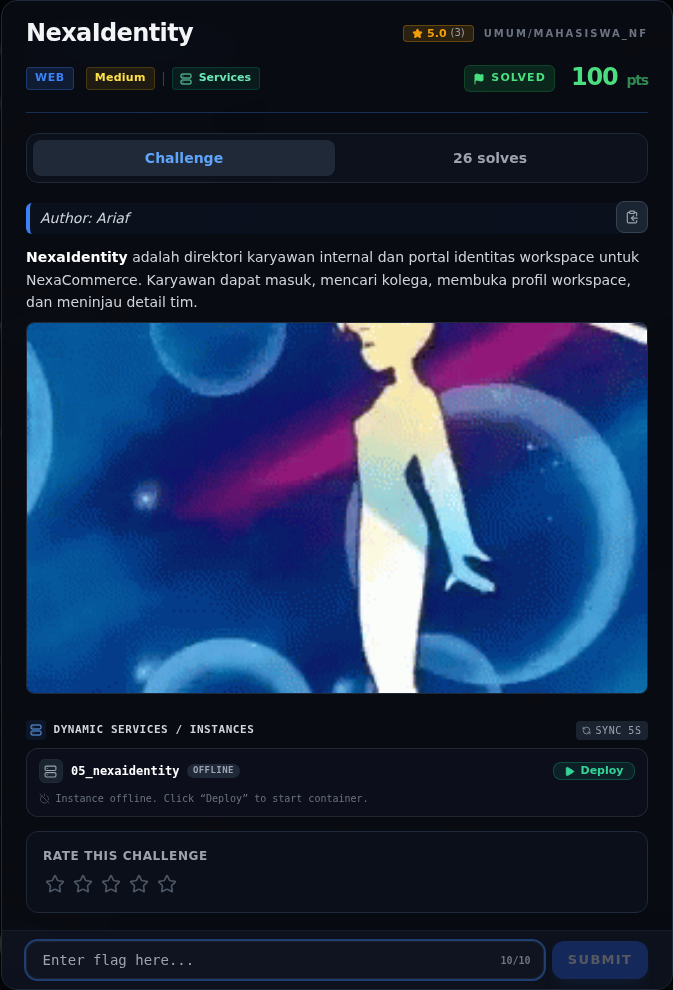

# NexaIdentity — Referensi

[← Overview](11-nexaidentity.md) · [Index](index.md)

> **Langkah 9/9 — Referensi.** Referensi
>
> **Titik penting:** —
>
> **Selesai.** Kembali ke [Overview](11-nexaidentity.md).

- OWASP: NoSQL Injection.
- Express `express.urlencoded({ extended: true })` dan `qs` bracket notation.
- MongoDB query operators `$ne`, `$gt`, `$regex`.
- CWE-943 (Improper Neutralization of Special Elements in Data Query Logic), CWE-287.

### Evidence langkah ini

*Challenge brief asli di platform NFX CTF 2026.*
