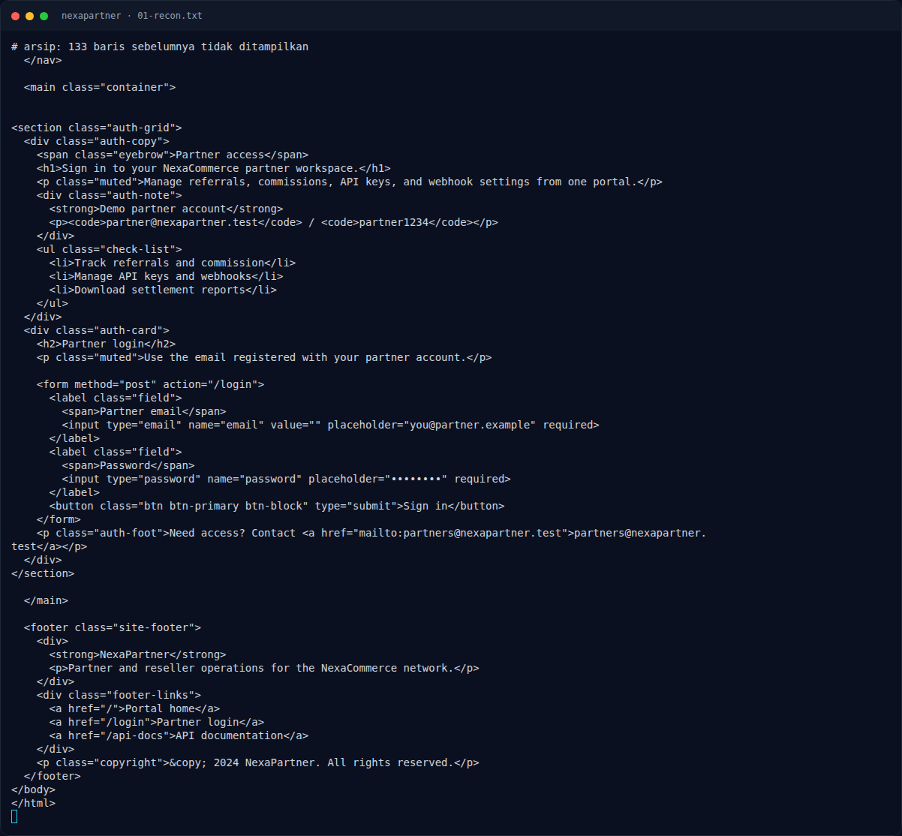
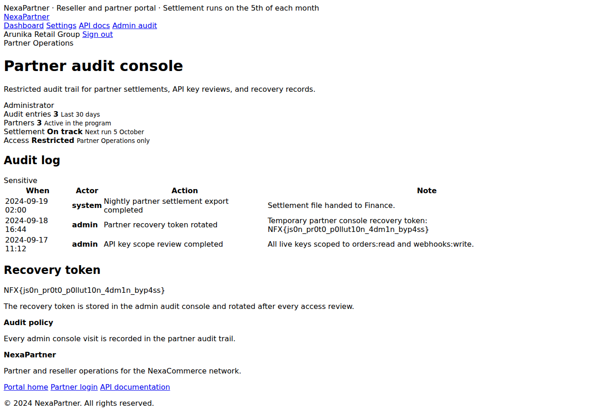

# NexaPartner — Recon

[← Overview](12-nexapartner.md) · [Index](index.md)

## 1.1 Deskripsi challenge

> Author: Ariaf
>
> **NexaPartner** adalah portal reseller dan channel partner untuk NexaCommerce. Partner dapat memantau referral, meninjau komisi, mengelola kredensial API, serta mengatur webhook dan notifikasi.

Tidak ada attachment. Service:

```text
NFX/web/07_nexapartner   key: NFXCTF-NFCC-NXCTF-2026
```

## 1.2 File / service

Tidak ada source lokal (`umum/Web/nexapartner` hanya `BRIEF.md` + `challenge.json`). Validasi black-box pada instance live.

| Item | Nilai |
|---|---|
| Instance | `http://s1.nfx.my.id:43965` (saat validasi) |
| Stack | Express (`X-Powered-By: Express`) |
| Halaman publik | `/`, `/login`, `/api-docs` |
| Halaman auth | `/dashboard`, `/settings`, `/admin`, `/admin/audit` |
| Akun demo | `partner@nexapartner.test` / `partner1234` |

Endpoint yang ditemukan:

```text
GET  /dashboard              Partner dashboard (Arunika Retail Group)
GET  /settings               Form settings + JSON saat ini
POST /api/settings           Simpan settings (JSON)
GET  /api/settings           Baca settings (JSON)
GET  /api-docs               Dokumentasi API partner
GET  /admin                  403 untuk partner biasa
GET  /admin/audit            Audit admin (setelah bypass)
```

`/api-docs` menampilkan endpoint partner (referrals, commissions, webhooks/test) dan contoh API key `pk_live_arunika_4f8c1d2e`. Endpoint tersebut tidak diperlukan untuk flag.

## 1.3 Environment

- `curl`, `python3` + `requests`.
- Instance dijalankan dengan `nxapi.py nx-up "NFX/web/07_nexapartner" ...`.
- Tidak ada submit flag ke platform.

### Evidence langkah ini



*Terminal evidence — `01-recon.txt` (arsip transkrip sesi solve).*



*Evidence — `01-admin-audit-flag.png`.*
