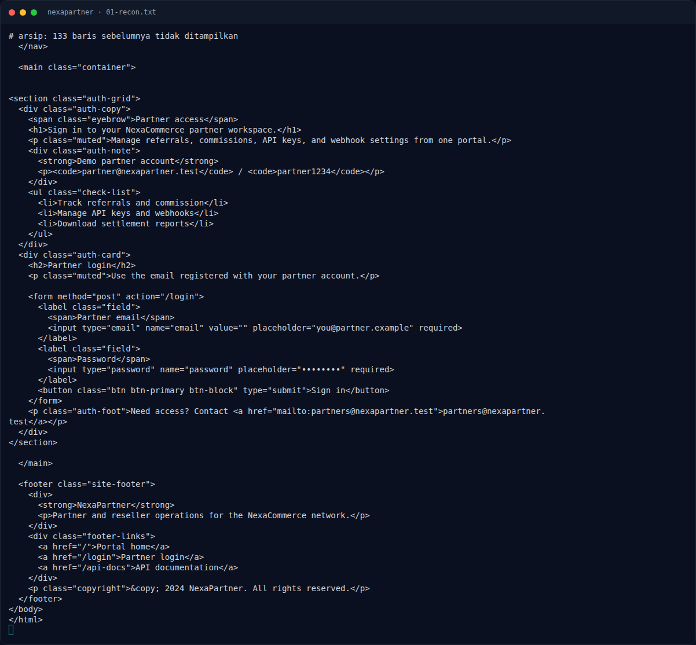
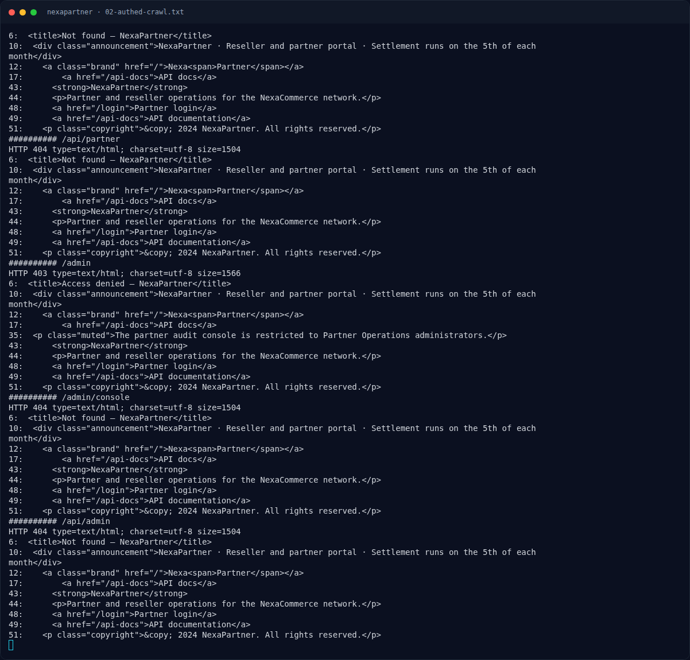

# NexaPartner — Triage awal

[← Overview](12-nexapartner.md) · [Index](index.md)

## 1.4 Triage awal

```bash
BASE=http://s1.nfx.my.id:43965
curl -sS -i "$BASE/"
curl -sS -i "$BASE/login"
curl -sS -i -c cookies.txt \
  -d 'email=partner@nexapartner.test&password=partner1234' "$BASE/login"
```

Temuan:
- `/` → `200`, landing partner.
- `/login` → `200`, demo account:
  ```text
  partner@nexapartner.test / partner1234
  ```
- Login → `302 /dashboard`, `Set-Cookie: connect.sid=...`.
- `/dashboard` menampilkan `Maya Anggraini · Channel Partnerships Manager` dan `Arunika Retail Group`.
- `/admin` → `403`:
  ```text
  The partner audit console is restricted to Partner Operations administrators.
  ```

### Evidence langkah ini



*Terminal evidence — `01-recon.txt` (arsip transkrip sesi solve).*



*Terminal evidence — `02-authed-crawl.txt` (arsip transkrip sesi solve).*

**Berkas mentah langkah ini:**

- [`01-recon.txt`](assets/nexapartner/01-recon.txt)
- [`02-authed-crawl.txt`](assets/nexapartner/02-authed-crawl.txt)
