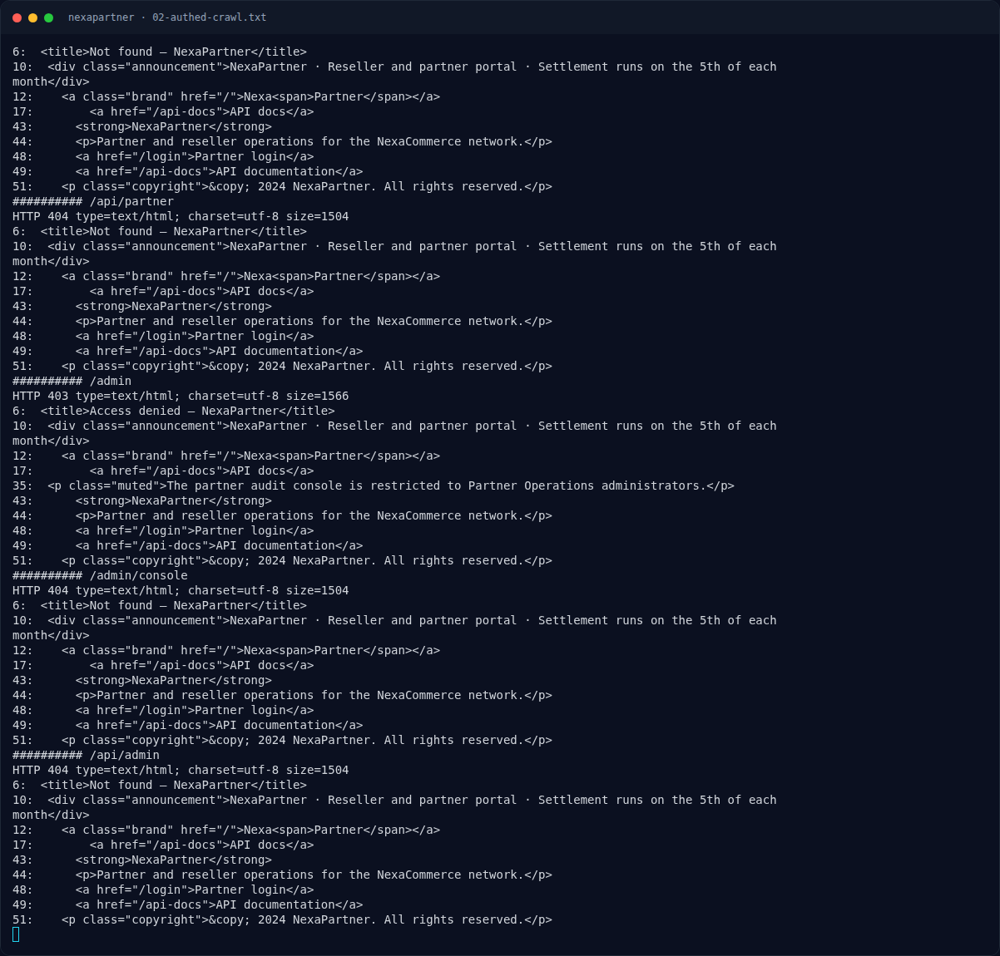

# NexaPartner — Settings API

[← Overview](12-nexapartner.md) · [Index](index.md)

## 2.1 Settings API

Halaman `/settings` berisi JavaScript:

```js
const response = await fetch("/api/settings", {
  method: "POST",
  headers: { "Content-Type": "application/json" },
  body: JSON.stringify({
    webhookUrl: document.getElementById("webhookUrl").value,
    digest: document.getElementById("digest").value,
    theme: document.getElementById("theme").value,
    emailNotifications: document.getElementById("emailNotifications").checked,
  }),
});
```

Request valid:

```bash
curl -sS -b cookies.txt -H 'Content-Type: application/json' \
  -d '{"webhookUrl":"https://x.example/h","digest":"daily","theme":"dark","emailNotifications":false}' \
  "$BASE/api/settings"
```

Respons:

```json
{"ok":true,"settings":{"emailNotifications":false,"webhookUrl":"https://x.example/h","digest":"daily","theme":"dark"}}
```

Server menggabungkan body ke objek settings. Karena tidak ada filter key, body dapat mengandung `__proto__`, `constructor`, atau `prototype`.

### Evidence langkah ini



*Terminal evidence — `02-authed-crawl.txt` (arsip transkrip sesi solve).*
